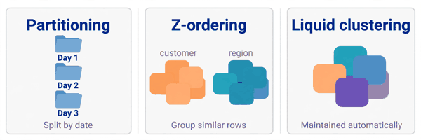
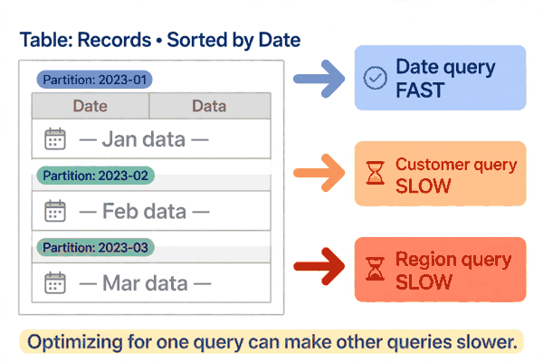
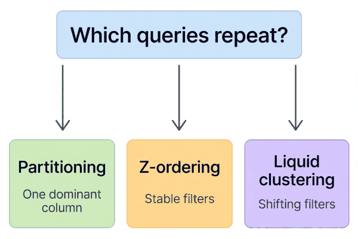

*Part of my daily Databricks series — the hardest topics, explained simply. Also published on [Substack](https://masterdataengineering.substack.com/) and in my LinkedIn newsletter, Master Data Engineering.*

Three engineers were looking at the same slow table, and each one was sure of the fix.

The table held customer events. It was partitioned by event date: one folder per day, neat and easy to explain. But most of the slow queries did not filter by date at all. They filtered by customer, and sometimes by region as well.

The first engineer said the answer was obvious: partition by customer instead. If the query asks for one customer, the engine should only open that customer's folders.

The second engineer disagreed. Repartitioning by customer would create far too many folders, and the date queries would get slower. The answer, she said, was Z-ordering: keep the date partitions, but rearrange the rows inside them so that one customer's rows sit together.

The third engineer said both of them were solving yesterday's problem by hand. Turn on Liquid Clustering, he said, declare the columns that matter, and let the engine maintain the layout as data arrives, instead of rewriting the whole table every time the questions change.

All three were partly right. That is why this choice trips people up: partitioning, Z-ordering, and Liquid Clustering are not three names for the same thing. They are three different answers to one question, which is how data should be laid out so queries can skip what they do not need.

Partitioning splits a table into folders by the value of a column. A table partitioned by event date stores each day's rows in its own folder. When a query filters on that column, the engine can skip whole folders. It never opens them.

That is powerful, but only for that one column. A query for one customer on a date-partitioned table still has to look inside every day's folder, because that customer appears in most of them.

Partitioning also has a failure mode that is easy to walk into. Partition by a column with too many distinct values, like a customer id, and you get a folder for every customer, many holding only a handful of rows each. Now the engine spends its time listing and opening folders instead of reading data.

So partitioning is best when one column dominates the queries, and when that column has a manageable number of values. Date, country, and region are typical candidates. A unique id almost never is.



Z-ordering works at a different level. It does not change the folders. It changes the order of rows inside the files.

Each file records the minimum and maximum values of the columns inside it, and the engine can skip a file whose range cannot possibly contain the rows a query needs. That skipping only works when similar values live in the same files. Z-ordering arranges rows so that closeness on several columns at once — a customer and a region, say — tends to put those rows in the same files.

That is its advantage over sorting by a single column: it tries to help several filters at once.

The price is that Z-ordering is a manual rewrite. You run an OPTIMIZE with a ZORDER BY clause, the table is rewritten, and the layout is fixed at that moment. New data afterwards is not automatically arranged the same way, so the layout decays until someone runs the rewrite again.

It also dilutes as you add columns. Two well-chosen columns can work beautifully. Five columns, chosen because they all sounded important, usually do not.

Liquid Clustering is the successor idea. Instead of rewriting the table by hand whenever the layout needs attention, you declare clustering columns, and the engine maintains the layout as data is written and optimized. You are not choosing a folder structure up front, the way partitioning forces you to. You are telling the engine which columns matter, and letting it group similar values together over time.

That makes two practical differences. The layout can adapt: if the columns that matter change, you change the declared columns rather than rebuilding the whole partitioning scheme. And you are not forced to pick one partition column and live with it forever.

What Liquid Clustering does not do is remove the thinking. You still have to choose the columns, and choosing badly still hurts. Cluster on a column nobody filters on, and you have paid for organization nobody uses. Cluster on too many columns, and you get the same dilution problem Z-ordering has. Maintaining a layout still costs compute, especially on a table written constantly.

Think of it as Z-ordering with maintenance built in, rather than a magic setting. It suits tables whose access patterns shift, and tables where a manual rewrite schedule would never quite keep up with new data.



Now for the wrong pattern.

The first version is partitioning by the wrong column and then defending it. A team partitions by customer id because the first dashboard filtered by customer, then watches the folder count explode and every other query slow down. The partition column was chosen for one query, not for the table.

The second version is Z-ordering by everything. A team lists every column anyone has ever filtered on, runs the rewrite, and wonders why nothing got faster. Each extra column weakened the layout a little more, until the rewrite bought almost nothing.

The third version is turning on Liquid Clustering and walking away. The columns were declared once, the queries moved on, and nobody revisited the choice. A year later the layout is optimized for questions nobody asks anymore. It adapts to the columns you declare, not to the queries you wish you had declared.

Underneath all three versions is the same error: choosing a layout before understanding the queries. Layout is not a property of a table. It is a bet on which questions will be asked, and for how long.

Here is what the fix looks like. First, look at the queries people actually run, not the columns that sound important. Then pick the mechanism that matches that pattern.

A partitioned table, for the case where one low-cardinality column dominates:

```sql
CREATE TABLE events (
  event_id STRING,
  customer_id STRING,
  region STRING,
  event_date DATE
)
USING DELTA
PARTITIONED BY (event_date)
```

A Z-ordered rewrite, for the case where a few stable filters matter and the table is read far more than it is written:

```sql
OPTIMIZE events
ZORDER BY (customer_id, region)
```

A clustered table, for the case where the important filters may change and the layout needs maintaining without a manual rewrite schedule:

```sql
ALTER TABLE events
CLUSTER BY (customer_id, region)
```

Notice what none of these examples do. None of them partitions by customer id. None of them lists five clustering columns.



So how do you pick, when you are staring at a real table?

Start with the queries. Which columns show up in filters again and again, and which show up once and never again? A layout built for the second group is wasted work.

Then ask whether one column clearly dominates. If almost every query filters by date, and date has a manageable number of values, partitioning by date is simple and easy to reason about. Do not reach for something cleverer until the simple answer stops working.

Then ask whether the filters are stable. If the same two columns have mattered for months and will matter for months more, a Z-order rewrite is a reasonable trade: one expensive rewrite in exchange for cheaper reads.

Then ask whether the filters are shifting. If the important columns change every quarter, Liquid Clustering earns its keep, because the layout is maintained rather than rebuilt by hand each time.

And always ask the boring questions first, because they still decide most outcomes:

- Is the table large enough that skipping data matters at all?

- Is the filter column already the partition column, so the problem is solved?

- How often does new data arrive, and who pays to keep the layout fresh?

- Will these filters still be the same filters in a few months?

Answer those, and the choice stops being a debate about which feature is best in general. There is no best in general. There is only the layout that matches the questions this table actually gets, for as long as those questions stay the same.

The three engineers were not really disagreeing about features. They were disagreeing about the future: which queries would matter most, and how fast that would change.

Which columns do your most-run queries filter on, and how long have those columns stayed the same?
