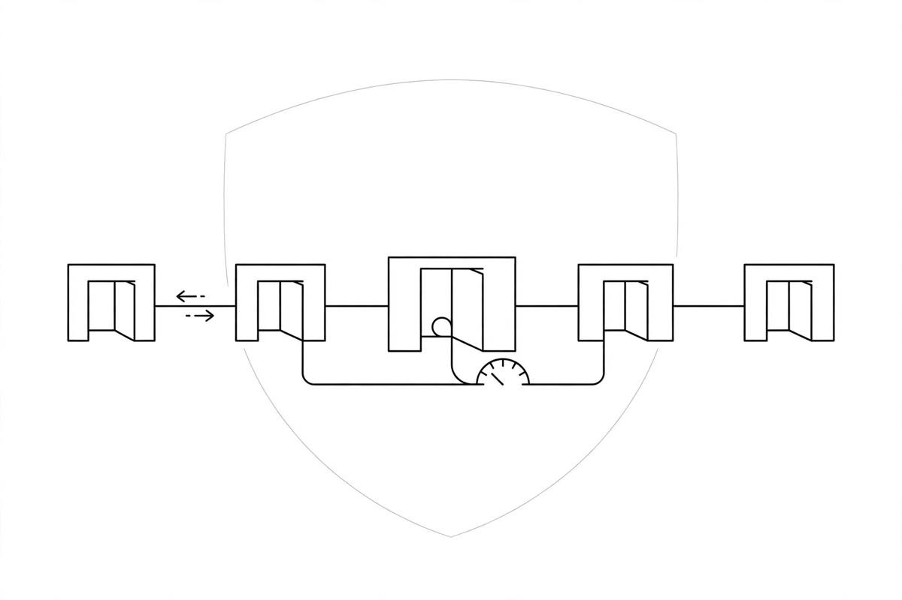

*Part of my daily series on Fundamentals of Data Engineering by Joe Reis and Matt Housley — [read the whole series](/book-series/).*

Yesterday I covered the first four principles of good data architecture. Today, the other five — the ones that decide whether a system survives real life.

5. Always be architecting. Architecture is never finished. Business needs shift, tools change, data grows. So the target keeps moving, and the job is knowing where you are, sketching where you are heading, and picking the next steps in order.

6. Build loosely coupled systems. Break the system into small pieces that talk through clean interfaces — an API, a message schema — not by reaching into each other's internals. Then one team can change its piece without breaking everyone else's. Small teams, clear contracts, independent releases.

7. Make reversible decisions. Most decisions are two-way doors: if you walk through and do not like what you see, you can walk back. Prefer those, and save long debates for the rare one-way doors you truly cannot undo. A reversible choice beats a perfect choice you are stuck with.

8. Prioritize security. The old model was a hard wall with trusted things inside. That wall leaks — phishing, insiders, cloud controls facing the internet. The better model is zero trust: verify every access, wherever it comes from. And the shared deal: the provider secures the platform, you secure what you put on it. Every data engineer is a security engineer now.

9. Embrace FinOps. In the cloud, spending is pay-as-you-go and moves every day. Treat cost like any other metric: watch what each job costs, alert on spikes, set limits for runaway usage. A pipeline that performs beautifully while burning money is not a good pipeline.

From my own work:

On the Databricks lakehouse work at EXL, loose coupling kept us sane. Governed Delta tables were the contract: one team could change how a table was built without breaking everyone downstream, as long as the table stayed stable. One feed failing did not take the rest down.

Reversible decisions mattered there too. We picked pieces that fit the problem in front of us — Spark, Airflow, Delta — knowing we could swap a piece later without rebuilding the whole thing. Cost was always in the conversation: clusters scaled up for heavy loads and back down after, because an idling cluster is money out the window. Health data only moved through governed, access-controlled tables, with access granted for a reason, not by default.

The takeaway: good architecture is a moving practice, not a finished diagram. Keep designing, keep pieces loosely joined, pick doors you can walk back through, own security, and watch the bill like a metric.

Day 16 of my read-through of Fundamentals of Data Engineering.
