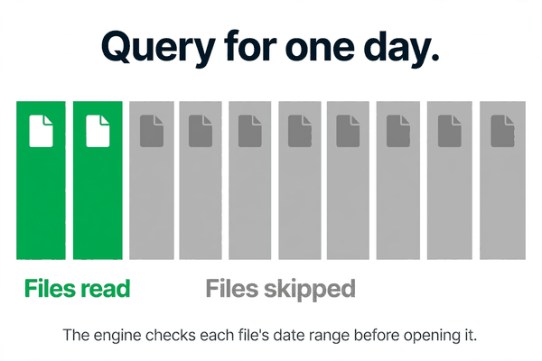
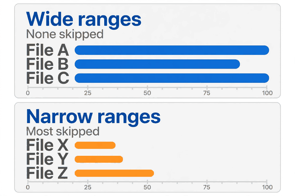
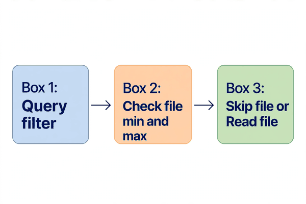

*Part of my daily Databricks series — the hardest topics, explained simply. Also published on [Substack](https://masterdataengineering.substack.com/) and in my LinkedIn newsletter, Master Data Engineering.*

Part of my daily Databricks series — the hardest topics, explained simply.

Picture a table that has grown quietly for years. It holds events, one row per event, stored as a large pile of files. Then one morning a simple question comes in: how many events happened on one particular day? The query looks trivial. One filter, one count. But it runs slowly, and it stays slow. The engineer watching it knows the data for that one day is a tiny fraction of the table. So why does the query behave as if it has to read everything?

The answer is that, in a sense, it does. Not because the engine is lazy, but because it has no safe reason to skip anything.

That is what data skipping is about. It is the engine deciding, before it opens a file, that the file cannot possibly contain a row the query needs. When that decision is possible, the file is never read at all. When it is not possible, the engine has to open the file and look, just in case.

A table is not one big file. It is many files, each holding a slice of the rows. Alongside those files sits the transaction log, which records what happened to the table. For each file, the log also records simple statistics, including the smallest and largest value in each column inside that file.

Those statistics are the whole trick. Before reading a file, the engine compares the query's filter against the file's recorded range. If the query asks for one day, and a file's range covers a different set of days entirely, that file cannot contain a matching row. So the engine skips it.

This is called file pruning, and data skipping is the general name for it. The engine prunes files it can prove are irrelevant, and reads only the files that might matter. It does not know a file definitely contains a matching row, only that it cannot rule it out, so that file still has to be read.

That is why two tables with the same rows and the same query can behave completely differently. The difference is not the data. It is how the data is laid out across files.



Consider the first layout: data written in arrival order, with no thought to how it will be queried. Each file ends up holding a mix of many different days, so every file's recorded date range is wide. A query for one single day cannot rule out any file, because every file's range includes that day. So the engine reads everything, even though the answer lives in a small part of the table.

Now consider the second layout: rows grouped so each file covers a narrow range of days. A query for one day can now rule out nearly every file, because nearly every file's range sits somewhere else entirely. Only the files whose range includes that day need to be read.

Same rows. Same query. Completely different amount of work. The only thing that changed was whether similar values ended up in the same files.

There is a second condition that is just as important. The filter has to be something the engine can compare against the recorded statistics.

A plain filter on a column works: the engine knows the value it is looking for, and it knows each file's range for that column, so it can compare the two directly.

A filter that transforms the column first is a different story. If the query wraps the column in a function before comparing it, the engine may no longer be able to match the filter against the plain recorded range. It cannot always work backwards from the transformed value to the original range, so it plays safe and reads the file.

That is not a bug. It is the engine refusing to guess. Skipping a file that might contain a matching row would give a wrong answer, so when the engine cannot prove a file is irrelevant, it reads it.

So data skipping depends on two things lining up: data laid out so that files have narrow ranges for the columns people filter on, and filters written in a form the engine can compare against those ranges. When either one is missing, pruning quietly stops working. There is no error. The query still returns the right answer. It just reads far more than it needed to.



Now for the wrong pattern.

The first version is writing data in whatever order it arrives, and then being surprised that a date filter is slow. The team checks the query, adds more compute, and nothing helps, because the problem was never the query. Every file spans many days, so no date filter can prune anything.

The second version is filtering on a transformed column and wondering why the same query is slow in one form and fast in another. Written as a plain comparison on the date column, the same condition runs fast. The data did not change. The engine's ability to use the statistics did.

The third version is assuming that partitioning alone solves this. Partitioning helps the engine skip whole folders, but within a partition, or on a table not partitioned by the filtered column, file pruning is still doing the real work. A table can be partitioned by one column and still have wide, unhelpful file ranges for the column people filter on most. The two mechanisms are related, but they are not the same, and one does not replace the other.

Underneath all three versions is the same error: treating a query as if it runs against a table, when it really runs against files. The files, and the statistics recorded about them, decide how much work the query actually does.

Here is what the fix looks like. Start with the simplest version: a plain filter on a column, with a concrete value, written so the engine can compare it directly against the file statistics.

```sql
SELECT COUNT(*)
FROM events
WHERE event_date = DATE '2026-03-14'
```

That is the form pruning can use: the value is known up front, the column is used as stored, and the engine can check each file's range before opening it.

Compare that with a version that hides the column behind a transformation:

```sql
SELECT COUNT(*)
FROM events
WHERE YEAR(event_date) = 2026
  AND MONTH(event_date) = 3
  AND DAY(event_date) = 14
```

This asks for the same day, but the engine has a harder time matching those computed values against the recorded minimum and maximum of the plain column. Prefer the plain comparison whenever the same condition can be written that way.

Then look at the layout. If the files each span a wide range for the column people filter on most, that layout needs attention, regardless of how good the query looks. Grouping similar values together, so each file covers a narrow range, is what makes pruning possible.

One way to do that is to rewrite the table with an ordering that groups the filtered column together:

```sql
OPTIMIZE events
ZORDER BY (event_date)
```

This is not a query trick. It is a layout decision, and it costs a rewrite. It is worth doing when the same column is filtered again and again. It is not worth doing for a column nobody filters on. None of these steps change the answer. They change how much of the table the engine has to touch to produce it.



So how do you tell whether skipping is actually happening for your query?

Start with the filter. Is it a plain comparison on a stored column, with a concrete value known up front? If the column is wrapped in a function, pruning may already be limited before the layout is even considered.

Then ask about the layout. Do the files each cover a narrow range for that column, or does every file span a wide range?

- Which column do the most-run queries actually filter on?

- Is that column the one whose file ranges are narrow, or is it a different column entirely?

- Does the data arrive in an order that naturally groups that column together, or does it scatter it across every file?

- Is the table large enough that skipping files matters, or is the whole table small enough that reading it all is genuinely cheap?

Which column do your most-run queries filter on, and how narrow is that column's range inside each of your files?
