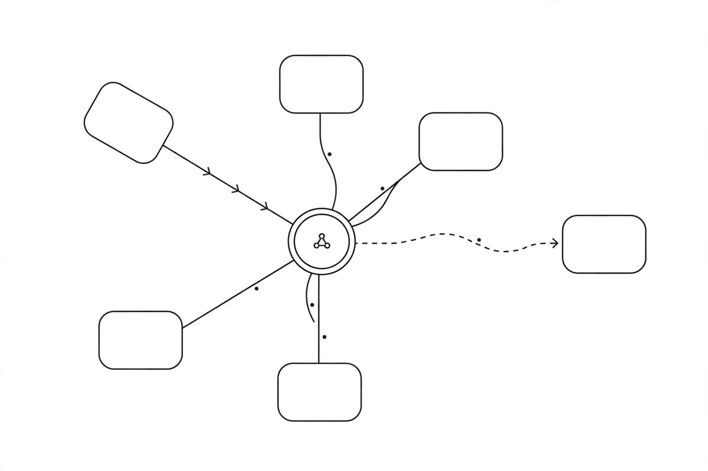

*Part of my daily series on Fundamentals of Data Engineering by Joe Reis and Matt Housley — [read the whole series](/book-series/).*

Most data architecture arguments are really about one thing: how tightly the pieces are glued together.

1. Distributed systems. One machine can only grow so far. You can add CPU and memory until you hit the ceiling, and if that machine dies, everything dies. So scale sideways instead: add machines, spread the work, and replicate data so another machine picks up when one fails. Plan for failure, because given enough time, something will fail.

2. Tight versus loose coupling. Tightly coupled means every part depends on every other part — change one thing, break something else. Loosely coupled means pieces talk through clean interfaces and can change on their own. Loose coupling is the goal, but it needs shared standards and clear owners, or teams build things no one else can use.

3. Monoliths versus microservices. A monolith puts everything under one roof, often one codebase. It is fast to start, until it grows, and then every change feels like whack-a-mole. Microservices are the opposite: small, separate services, so one going down does not sink the rest. But do not be dogmatic: starting with a monolith is fine, just be ready to break pieces out gradually. The worst of both worlds is a distributed system that is still tightly coupled.

4. Single versus multitenant. When teams or customers share one system, two questions matter. Performance: will one heavy tenant slow everyone else down, the noisy neighbor problem? Security: is each tenant's data isolated, with no leakage between them? Shared tables with views can work, but only if the views truly cannot leak.

5. Event-driven architecture. Business runs on events: a new customer, a new order, an update to that order. An event gets produced, routed, and consumed, and the producer does not need to know who consumes it. State spreads across services, so one down service does not stop the rest.

From my own work:

On the Databricks lakehouse work at EXL, governed Delta tables were the contract between teams. One team could rebuild how a table was produced without breaking downstream teams, as long as the table stayed stable. Spark, Airflow, and Delta did the heavy lifting, and clusters scaled up for heavy loads and back down after — an idle cluster is money out the window. And when a messy claims feed broke, it broke alone — the rest kept running, because nothing was glued to it.

The takeaway: coupling is the decision underneath all the others. Keep pieces loosely joined, plan for machines to fail, isolate tenants, and let events flow between services that never meet.

Day 17 of my read-through of Fundamentals of Data Engineering.
