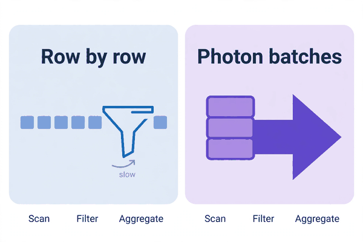
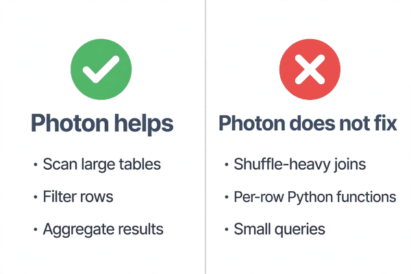
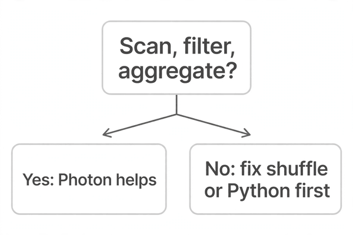

*Part of my daily Databricks series — the hardest topics, explained simply. Also published on [Substack](https://masterdataengineering.substack.com/) and in my LinkedIn newsletter, Master Data Engineering.*

A team I know had a reporting query that ran every morning. It scanned a large table, filtered it down to one region, and grouped the result by product. It was slow, and it stayed slow.

So they did the obvious thing. They gave it a bigger cluster.

The query got a little faster, but not by much. Then someone suggested turning on Photon, and the same query suddenly ran noticeably faster on the same size of cluster. The team was sold. Photon was the answer.

Then they tried it on a second job, and nothing much changed at all.

That second job was a different shape entirely. It joined two large tables, shuffled a huge amount of data between machines, and ran a custom Python function over every row. Photon barely moved it. The team started wondering whether Photon was broken, or whether the first result had been a fluke.

Neither was true. Photon had done exactly what it is built to do, and the second job had asked it to do something else.

Photon is Databricks' native query engine. The standard engine processes data largely row by row, through layers of general-purpose code. Photon processes data in batches, in columnar form, using code written specifically for that job.

That difference sounds small. In practice it changes where the time goes.

When a query scans a table, the engine has to read rows, test each one against a filter, and then group and add up the rows that survive. Done row by row, that means a lot of repeated per-row work: checking types, handling nulls, moving values around one at a time.

Done in batches, the engine can work through a whole column of values at once. It tests the filter against the batch, keeps the rows that pass, and feeds them straight into the aggregation. There is far less overhead per row, and the processor spends its time on the actual work instead of on the bookkeeping around it.

That is why Photon shines on a particular shape of query: scan a lot of data, filter it, aggregate it.

Those three operations are where the batch approach pays off most. Reading is faster because the engine is built to move columnar data efficiently. Filtering is faster because it is applied to batches, not one row at a time. Aggregation is faster because grouping and summing batch data is exactly the kind of repetitive work this design handles well.



But that also tells you where Photon will not help much, and the list matters more than the marketing.

The first case is a shuffle-heavy query. If a query's time is spent moving data between machines — a large join where both sides have to be redistributed, or a wide aggregation over unsorted data — then the bottleneck is the movement, not the per-row processing. Photon can process the rows faster once they arrive, but it cannot make the network faster. A job that spends most of its time waiting on shuffled data will still spend most of its time waiting.

The second case is a query full of custom Python functions. A Python user-defined function runs outside the fast path. The engine has to hand rows to Python, wait for Python to process them one by one, and take the results back. That round trip breaks the batch flow completely. No engine design can make a per-row Python function vectorized, because the function itself is not written that way.

The third case is a small query. If the table is small, or the query touches only a few rows, there is not enough per-row work for the batch approach to save anything meaningful. The fixed costs of running the query dominate, and Photon cannot remove those.

None of this makes Photon useless. It makes it specific. It is an accelerator for a shape of work, not a general speed button.



Now for the wrong pattern.

The first version is turning on Photon and expecting every job to get faster. When the shuffle-heavy job barely moves, the team concludes Photon does not work and turns it off everywhere — including on the reporting query where it was genuinely helping.

The second version is buying a bigger cluster to fix a query that was never compute-bound in the first place. More machines do not help a query whose cost is per-row processing overhead on data that one machine could chew through quickly in batches. The cluster gets bigger, the bill gets bigger, and the query stays slow for the same reason it was slow before.

The third version is blaming Photon for a slow user-defined function. The function runs row by row in Python, the engine waits on it, and the team assumes the engine is at fault. The real fix has nothing to do with the engine choice. It is rewriting the logic so it does not need a per-row Python call at all, or accepting that this particular step will always be slow.

Underneath all three versions is the same error: treating speed as a property of the engine, when it is really a property of the query shape. The engine can only accelerate the work that is actually in its path.

Here is what the fix looks like. Start by looking at the shape of the query, not at the cluster size.

This is the shape Photon helps most: a scan, a filter, and an aggregation over a large table.

```sql
SELECT product_category, SUM(amount)
FROM orders
WHERE region = 'West'
  AND order_date >= DATE '2026-01-01'
GROUP BY product_category
```

Read a lot, keep a subset, add it up. That is the work Photon is built to speed up.

Compare that with a shape Photon cannot rescue: a query whose cost sits in a per-row Python function.

```sql
SELECT order_id, clean_label(raw_label)
FROM orders
```

Here the custom function runs on every row, outside the fast path. Enabling Photon does not change that cost in any meaningful way. If this query is slow, the answer is to rethink the function, not the engine.

Then check where Photon is actually on. On a SQL warehouse, Photon is on by default, so a scan-filter-aggregate query there is already using it. On a general compute cluster, Photon needs a Photon-enabled runtime, chosen when the cluster is created. A query cannot benefit from an engine that was never turned on for its cluster.



So how do you tell whether Photon is the right fix for your slow query?

Start with the shape. Is the query mostly scanning, filtering, and aggregating a large table? If so, Photon is a strong candidate.

Then ask what else the query is doing.

- Is most of the time spent moving data between machines, in a shuffle?

- Is there a custom Python function running on every row?

- Is the table small enough that the whole query is cheap anyway?

- Is the query already running on a warehouse or cluster where Photon is on?

If the answers point to shuffle or to per-row Python, fix that problem first. Photon will still be there afterwards, for the part of the work it can actually accelerate.

Which of your slow queries is really a scan, a filter, and an aggregation — and which one have you been trying to fix with a faster engine when the bottleneck was somewhere else entirely?
