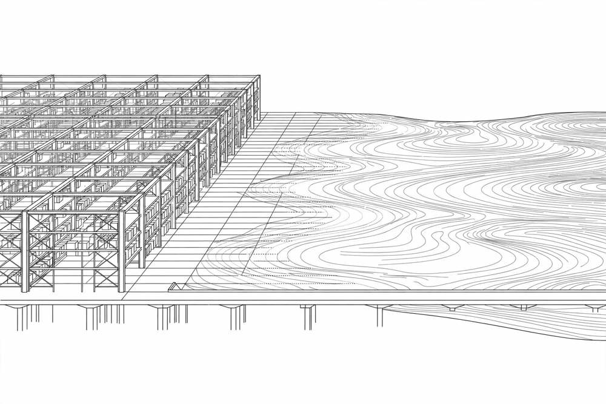

*Part of my daily series on Fundamentals of Data Engineering by Joe Reis and Matt Housley — [read the whole series](/book-series/).*

If you have ever sat in a meeting where someone says warehouse, someone else says lake, and a third person says lakehouse, and all three sound like they mean the same thing, you are not confused. The words really did blur together, because the systems underneath them did.

1. A data warehouse is built for clean, structured answers. Data arrives shaped, modelled, and ready for reporting. Brilliant for questions you already know how to ask, awkward for data you have not figured out yet. It used to be expensive and heavy to run, which kept it out of reach for smaller teams.

2. A data lake flips that deal. Store everything first, raw, structured or not, and decide later what it means. Storage is cheap and almost limitless, and you spin up compute when you need it. Without rules, catalogues, and ownership, though, a lake turns into a dumping ground, and updating or deleting a record becomes painful.

3. A lakehouse takes the best of both. Keep the cheap, flexible storage of a lake, but add the controls a warehouse always had: reliable transactions, the ability to update and delete rows, and proper data management. You can hold raw, messy data and still trust the tables built on top of it. That is why the line between the two keeps fading.

4. A data platform is the bigger picture: the whole set of tools, from storage and processing to governance and serving, offered as one connected system. The modern data stack is the same instinct, done modular: pick cloud-based, plug-and-play pieces for pipelines, storage, transformation, governance, monitoring, and visualisation, and swap a piece out when a better one appears.

From my own work:

On the Databricks lakehouse work at EXL, this was not theory. Governed Delta tables gave us warehouse-style trust on top of flexible lake storage, with Spark and Airflow doing the moving and shaping. When a messy healthcare feed changed shape, we could land it raw first and sort it out, instead of the pipeline refusing it. And a business team needing a clean, fast answer got a modelled table, not a hunt through raw files.

The takeaway: do not pick a word, pick a trade-off. Clean answers fast, lean warehouse. Keep everything and explore, lean lake. Need both, that is what a lakehouse and a modern platform are trying to give you. The winner is the architecture your team can govern, change, and trust.

Day 18 of my read-through of Fundamentals of Data Engineering.
