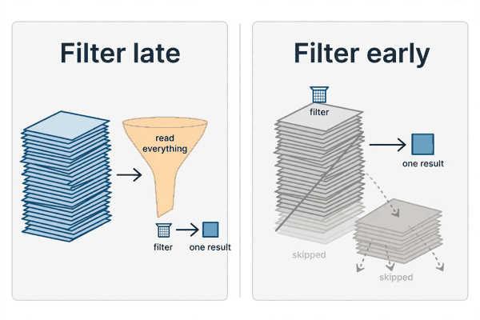
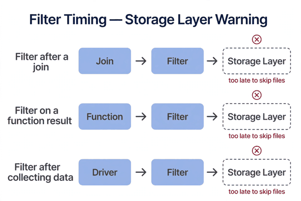
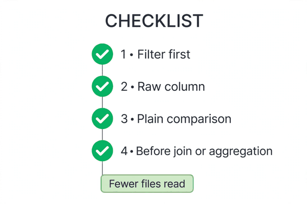

*Part of my daily Databricks series — the hardest topics, explained simply. Also published on [Substack](https://masterdataengineering.substack.com/) and in my LinkedIn newsletter, Master Data Engineering.*

A team I know had a simple question. How many orders came in yesterday?

The table held years of orders. The query was not complicated. It read the table, kept yesterday's rows, and counted them. It should have been quick.

It was not. Every morning it ground through the whole table, and every morning someone asked why such a small question needed such a big scan.

The team did what teams usually do. They looked at the cluster size, and they looked at the query time, and they assumed the two were connected. A bigger cluster would fix it, or a faster engine would fix it. Neither idea touched the real problem.

The real problem was where the filtering happened.

The query was written so the filter was applied late. The engine read everything first, carried all of it through the early stages, and only then threw most of it away. The work of reading, moving, and handling years of data was already done before the filter got its chance to say no.

That is the whole idea behind predicate pushdown, and it is simpler than the name makes it sound.

A predicate is just a filter condition. Something like order_date equals yesterday, or region equals West.

Pushdown means moving that filter as close to the data as possible, so the storage layer can use it before the data is ever read in full.

Think of it like asking a warehouse for one box. Without pushdown, the warehouse ships you every box it holds, and you open them all at your desk to find the one you wanted. With pushdown, you tell the warehouse which box you want first, and it only sends that one.

In practice, the engine does something smarter than opening every file. Delta Lake keeps simple statistics about each file, like the smallest and largest values in a column. When your filter says order_date equals a single day, the engine can look at those statistics and skip every file whose date range does not include that day.

It never opens those files at all. It does not read them, does not move them, does not spend time on rows that were always going to be discarded.



That skipping is the payoff, and it only works if the filter reaches the storage layer in a usable form.

Spark is good at pushing filters down on its own, in many ordinary queries. If you write a plain filter on a plain column, the optimizer will usually do the right thing without you thinking about it. The trouble starts when the way the query is written stops the optimizer from helping.

Here is the wrong pattern, in its most common form.

Someone loads the whole table first, does a bunch of work on it, and filters at the end. Or they pull the data into a local step and filter there, after the expensive read has already happened. By the time the filter runs, the cost has already been paid.

```python
orders = spark.read.table("orders")
result = orders.join(customers, "customer_id")
result = result.filter("order_date = '2026-11-03'")
```

Nothing in that code is obviously wrong. The filter is there. The logic is correct. The answer is right.

But the shape is wrong. The join runs over the full table before the filter narrows anything down. The engine has to move and match far more rows than the question ever needed, because the filter arrives after the heavy work instead of before it.

A second version of the same mistake is filtering on a transformed value instead of the raw column.

```python
orders.filter(year("order_date") == 2026)
```

The engine now has to compute something for every row before it can decide whether to keep it. It cannot simply compare the filter against the file statistics, because the statistics are about order_date, not about the result of a function applied to order_date. The filter is still logically correct. It is just no longer pushable in the same way.

A third version is filtering after an aggregation, or after data has already been collected to the driver. At that point there is nothing left to push down to. The storage layer is long out of the picture, and the filter is just trimming a result that cost far too much to produce.

Underneath all three versions is the same error: treating a filter as something that happens at the end of a pipeline, when its cheapest place is at the very start.

Here is what the fix looks like. Put the filter first, on the raw column, in a form the storage layer can use directly.

```python
orders = spark.read.table("orders")
yesterday = orders.filter("order_date = '2026-11-03'")
result = yesterday.join(customers, "customer_id")
```

Filter first, then join. The join now works on a much smaller set of rows, because the rows that were never needed never reach it.

In SQL, the same idea is even clearer. Write the filter in the WHERE clause, on the raw column, with a plain comparison.

```sql
SELECT customer_id, COUNT(*)
FROM orders
WHERE order_date = DATE '2026-11-03'
GROUP BY customer_id
```

That is the shape the optimizer can work with. The filter is early, simple, and on a column the storage layer knows about. The engine can skip files, read less, and hand a smaller result to everything downstream.



There are limits, and they are worth knowing before you assume every filter will be pushed down.

The first limit is the form of the filter. A plain comparison on a raw column pushes down well. A filter wrapped in a function, a custom Python function, or a complicated expression often does not, because the storage layer cannot match it against file statistics.

The second limit is where the filter sits. A filter on an aggregated result, or on the output of a join, cannot be pushed back into the original table's files in the same way. The filter still works, but it works late, after the expensive part has already run.

The third limit is the data layout itself. File skipping depends on the statistics stored with each file. If a column's values are scattered randomly across every file, then every file's range covers almost everything, and there is little to skip. Pushdown helps most when the data is laid out so that the filter can actually rule files out, which is why partitioning and clustering on commonly filtered columns matter alongside it.

None of this means you should obsess over every filter. Most simple queries are fine. Pushdown matters when a query is slow for no obvious reason, and the answer turns out to be that it read far more than it needed to.



So how do you tell whether predicate pushdown is your problem?

Start by asking where the filter sits in your query.

- Is the filter applied before the expensive steps, like a join or an aggregation, or after them?

- Is the filter a plain comparison on a raw column, or is it wrapped in a function the storage layer cannot use?

- Is the query reading a large table but keeping only a small slice of it?

- Would moving the filter earlier, or rewriting it in a simpler form, change how much data gets read at all?

If the filter is late, or tangled up in a function, or applied after the data has already been moved, then the query is paying to read data it never needed. Fixing that is often cheaper than a bigger cluster, and it stays fixed no matter what size cluster you run on.

Which of your slow queries is really a compute problem — and which one is just filtering too late?
