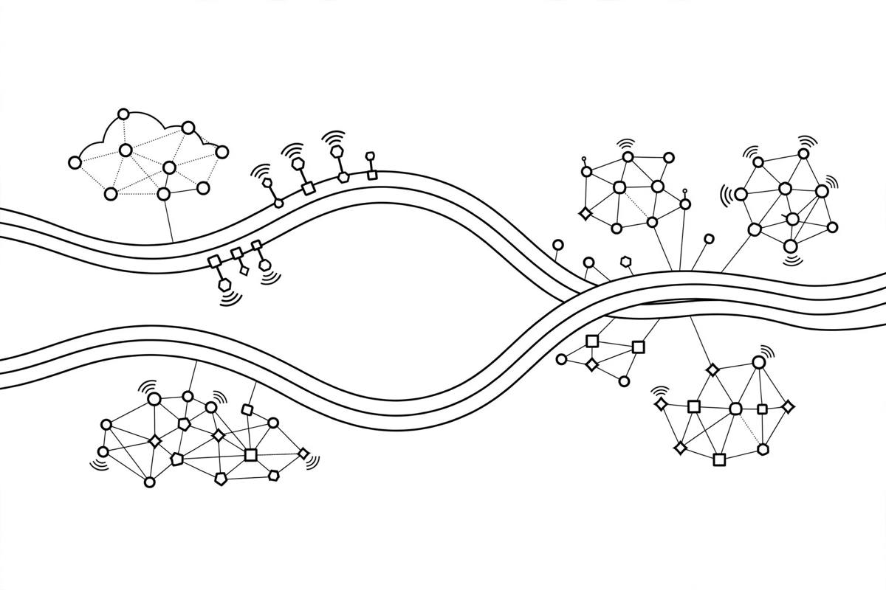

*Part of my daily series on Fundamentals of Data Engineering by Joe Reis and Matt Housley — [read the whole series](/book-series/).*

Every team faces the same question: do we want the answer fast, or do we want it complete?

In a real pipeline, fresh data arrives messy, and complete data takes time to clean and check. The patterns here are just different answers to that tension, and every one trades something away.

1. Lambda runs two paths at once. A speed layer serves fresh data fast. A batch layer reprocesses full history, building complete views. A serving layer stitches the two together. You get speed and completeness, but you pay with two systems, two codebases, and two versions of the truth.

2. Kappa asks why we need two paths at all. One event stream sits at the centre, and you replay it for a batch view. Cleaner, and it matches how events arrive. In practice streaming is harder and costlier to run well, and batch storage still wins for huge history.

3. The dataflow idea unifies the two. Treat everything as events. A live stream is unbounded data. A batch is just a bounded stream with a start and end. Aggregate over sliding or tumbling windows, with nearly the same code for both. That one mental model now sits behind tools like Spark and Flink.

4. IoT stretches this to the physical world. Devices sense and send data, on little power and patchy connections. Gateways gather devices at each site, hold data when the network drops, and forward it on. Storage depends on speed: object storage suits later analysis, a queue or time-series store suits an alert now. Serving can loop back and reconfigure a device.

5. Data mesh tackles ownership, not speed. Instead of one central team owning a giant lake, each domain team owns and serves its own data as a product, on a shared platform under common rules. The platform stays central; responsibility moves to those who understand the data best.

From my own work:

Most of my work has been closer to the batch side. On the Databricks lakehouse work at EXL, Spark and Airflow shaped data into governed Delta tables, and a healthcare feed that changed shape could land raw first and be sorted out, instead of the pipeline refusing it. Land first, clean second, without a second speed layer bolted on.

The mesh idea rings true too. When one central team must understand every feed, it becomes the bottleneck. The team closest to a source knows what a field means, when it changed, and when it cannot be trusted. Put ownership and checks where the knowledge lives.

The takeaway: do not fall in love with a pattern name. Ask what you need most: fresh answers, complete answers, one codebase, or ownership. Pick the trade-off you can live with.

Day 19 of my read-through of Fundamentals of Data Engineering.
