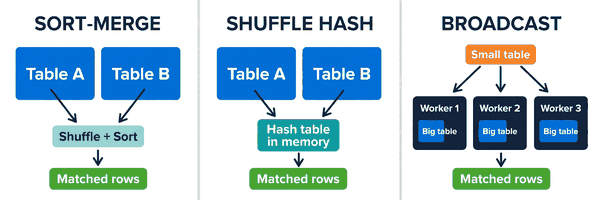
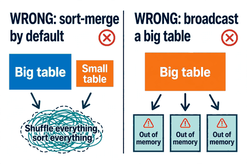
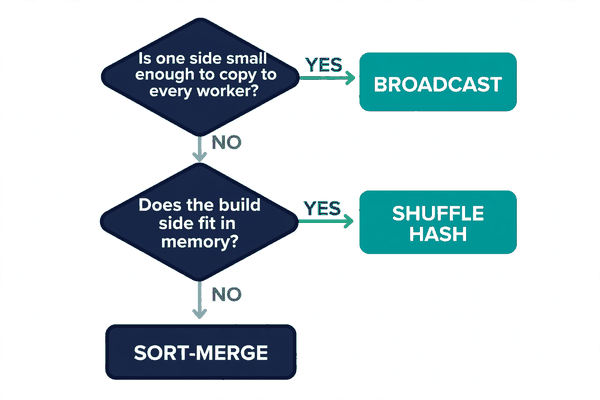

*Part of my daily Databricks series — the hardest topics, explained simply. Also published on [Substack](https://masterdataengineering.substack.com/) and in my LinkedIn newsletter, Master Data Engineering.*

Part of my daily Databricks series — the hardest topics, explained simply.

A team I know ran the same join every night. Orders against stores. A fact table, a small reference table, and one key between them.

It was a simple join. One line of SQL. And every night it shuffled the big table across the whole cluster, sorted both sides, and ran long enough that the morning report was always waiting on it.

Nobody questioned the join itself. The query was correct. The answer was right. So the team did what teams usually do. They looked at the cluster size, and they looked at the size of the tables, and they assumed the join was simply expensive.

The join was expensive. But not because joins are expensive. It was expensive because of the way Spark chose to run it.

The line of SQL you write is not the plan Spark runs. When you write a join, Spark has to decide how rows sitting on different machines find their matching rows. That decision is called a join strategy, and there are three of them.

The first is sort-merge. Spark shuffles both tables by the join key, so matching keys land on the same worker. Then it sorts each side by that key, and walks through both in order, matching rows as it goes.

Sort-merge is the default when both sides are large. It works on any size of data, which is why Spark trusts it. But it always pays the same price: a full shuffle of both tables, plus a sort of both tables, before a single row is matched.

The second is shuffle hash. Spark still shuffles both sides by the join key, so the shuffle is not avoided. But instead of sorting, it builds a hash table from one side in memory, and then probes that hash table with the rows from the other side.

Shuffle hash skips the sort, which makes it faster than sort-merge when the side being hashed fits comfortably in memory. When that side does not fit, the advantage disappears, and Spark has to spill to disk or fall back to another strategy.

The third is broadcast. Spark copies the whole small table to every worker, in full. Each worker then joins its own local slice of the big table against the complete small table sitting in its memory.

Broadcast is the only strategy with no shuffle of the big table at all. For a big fact table joined to a small reference table, that is the whole game. The big table never moves. Only the small table travels, and it travels once.



That is the full menu. Three strategies, three different costs, and Spark picks one for you every time you join. Most of the time it picks well. The trouble starts when it cannot see the sizes it is deciding between.

Spark will broadcast a small table on its own. But only if it knows the table is small. It decides from table statistics, and if those statistics are stale or missing, it cannot tell a small table from a big one. So it plays safe, and safe means sort-merge.

That is what happened to the nightly join. The stores table was small. But Spark had no good statistics for it, so it never considered broadcasting it. Every night it shuffled the orders table, sorted both sides, and did the most expensive possible version of a simple lookup.

Here is the wrong pattern, in its most common form.

```python
orders = spark.read.table("orders")
stores = spark.read.table("stores")
daily = orders.join(stores, "store_id")
```

Nothing in that code is obviously wrong. The join is correct. The answer is right. But without statistics to guide it, Spark runs a sort-merge: both tables shuffled, both sorted, every night, for a lookup that never needed any of it.

The opposite mistake is just as common, and it fails louder. Someone learns that broadcast joins are fast, and starts broadcasting tables that are not small.

```python
from pyspark.sql.functions import broadcast
result = orders.join(broadcast(customers), "customer_id")
```

A broadcast hint is a promise. It tells Spark this side is small enough to copy to every worker. If the table is actually large, the driver has to collect the whole thing first, and then ship a copy to every worker. The driver runs out of memory, or the job dies waiting on a broadcast that never finishes.

The hint did not make the join fast. It made the join impossible, because the promise was wrong.

Underneath both mistakes is the same error: treating the join strategy as something Spark will always get right on its own, when it is really a decision that depends on facts Spark sometimes does not have.

Here is what the fix looks like. When one side is genuinely small, say so with a hint, and make sure the statistics back you up.

```python
from pyspark.sql.functions import broadcast
daily = orders.join(broadcast(stores), "store_id")
```

In SQL, the same idea is a hint on the small table.

```sql
SELECT /*+ BROADCAST(stores) */ o.order_id, s.region
FROM orders o
JOIN stores s ON o.store_id = s.store_id
```

And before you trust any of it, look at the plan. Run EXPLAIN on the query and read which strategy Spark actually chose.

```sql
EXPLAIN SELECT o.order_id, s.region
FROM orders o
JOIN stores s ON o.store_id = s.store_id
```

The plan names the strategy directly: BroadcastHashJoin, ShuffledHashJoin, or SortMergeJoin. That is the truth about your join. Not what you hoped Spark would do, and not what the code seems to say, but what the engine is actually going to run.

If the plan says SortMergeJoin and you expected a broadcast, the statistics are the first thing to check. Keeping them fresh is what lets the optimizer see the real sizes.

```sql
ANALYZE TABLE stores COMPUTE STATISTICS
```



There are limits, and they are worth knowing before you start handing out hints.

The first limit is the broadcast threshold. By default, Spark only broadcasts a table automatically when it estimates it at 10 megabytes or less, controlled by spark.sql.autoBroadcastJoinThreshold. You can raise that threshold, but raising it does not make a big table small. It only lets a bigger table be copied to every worker, which is exactly the mistake that kills the driver.

The second limit is memory on the build side of a shuffle hash join. The hash table has to fit in memory on each worker. If it does not, Spark spills to disk, and the speed advantage over sort-merge is gone.

The third limit is that sort-merge, for all its cost, is the safe default for two genuinely large tables. There is no cheaper strategy when both sides are big and neither fits in memory. Paying the shuffle and the sort is the honest price of that join.

One more thing helps, and it is easy to miss. Adaptive Query Execution can switch strategies at runtime, once it has seen the real sizes of the data flowing through the query. A join that starts as a sort-merge can become a broadcast hash join mid-flight if the small side turns out smaller than the statistics claimed. That only works if AQE is on, and it only helps when the runtime sizes are actually small. It does not rescue a hint that promised something false.



So how do you tell whether the join strategy is your problem?

Start by asking what the plan says, and whether the sizes justify it.

- Is one side of the join small enough to fit in memory on every worker, and does the plan actually broadcast it?

- Is the plan running a sort-merge on a join where one side is a small reference table?

- Are the table statistics fresh enough for the optimizer to see the real sizes, or is it guessing?

- Is a broadcast hint promising something the data cannot deliver?

If the plan is shuffling a big table to look up a small one, or broadcasting a table that is not small, then the join is not slow because joins are slow. It is slow because it is running the wrong strategy for the shape of the data.

Which of your slow joins is really a data problem — and which one is just the wrong strategy?
