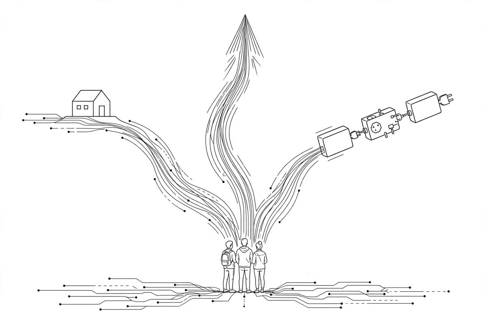

*Part of my daily series on Fundamentals of Data Engineering by Joe Reis and Matt Housley — [read the whole series](/book-series/).*

The tool is never the first question. The team is.

Before you pick a single technology, get your architecture right. The authors are blunt about this: choosing tech before architecture is how you end up with a machine that does a lot and solves nothing. Once the blueprint exists, three questions shape every choice.

1. Team size and capabilities. A team of one wears every hat. A big team can afford specialists. Small teams that copy the complex stack of a giant tech company burn time and money for nothing — the authors call it cargo-cult engineering. If your team is small, lean on managed and SaaS tools, and spend your limited hours on problems that actually move the business. Take an honest inventory of what your people already know — low-code or code-first, Python or Java — and pick tools that fit them, not tools that sound impressive.

2. Speed to market. Speed wins. Pick tools that help you ship fast while keeping quality and security intact, then launch, learn, and iterate in a tight loop. Perfect is the enemy of good. Teams that deliberate for months without deciding anything slowly disappear. Deliver value early and often, with tools your people already know. Avoid work that is complex for its own sake and adds nothing.

3. Interoperability. You will never use one system alone. Ask how easily tool A talks to tool B. Sometimes a standard does the job — almost every database speaks JDBC or ODBC. Sometimes there is no real standard — every REST API has its own quirks — and then the vendor or open source project has to do the work. Design for modularity, so you can swap a tool out when something better shows up.

From my own work:

I have lived the small-team version of this. On the Medicaid churn work, the team was small and the problem was real — a pipeline that had to run, not a stack to show off. We leaned on Spark and Airflow on Databricks, tools the team already knew, and put our hours into the data itself: messy claims feeds, schema drift, and checks that caught bad rows before they reached a model. That is also why I like the lakehouse shape — one governed place where storage, compute, and serving can change independently instead of being welded together.

The takeaway: choose tools for the team you have, the speed you need, and the neighbours they must talk to. The fanciest stack in the world is worthless if nobody on your team can run it.

Day 20 of my read-through of Fundamentals of Data Engineering.
