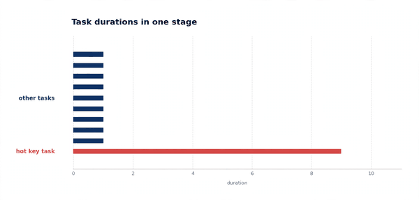
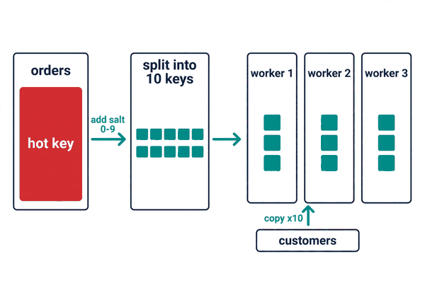
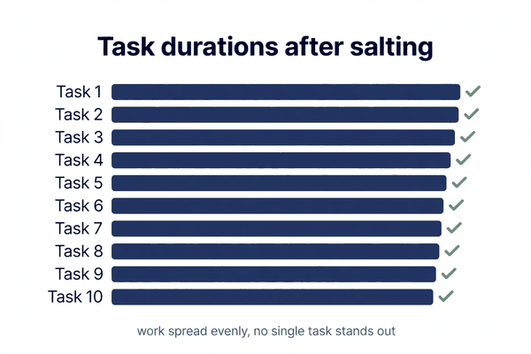

*Part of my daily Databricks series — the hardest topics, explained simply. Also published on [Substack](https://masterdataengineering.substack.com/) and in my LinkedIn newsletter, Master Data Engineering.*

A team I know ran a join every night. Orders against customers. A big fact table, a dimension table, one key between them.

The job was not slow in the way slow jobs usually are. It was not slow everywhere. It was slow in exactly one place.

The Spark UI showed a stage with hundreds of tasks. Almost all of them finished quickly. One task kept going. Long after every other task was done, that one task was still running, and the whole job sat there waiting on it.

The team did what teams usually do. They made the cluster bigger. More workers, more cores, more memory.

The job took the same amount of time. The extra workers finished their small share of the work and sat idle, waiting, just like before.

Adding workers did not help because the problem was never a shortage of workers. The problem was that one key held far more rows than all the others, and every row with that key had to land on the same worker.

That is data skew in a join. And the fix is not a bigger cluster. The fix is salting.

Here is how a join actually moves data. When Spark joins two tables, it shuffles both sides by the join key, so that rows with the same key end up on the same worker. That is how matching rows find each other.

That design works fine when keys are spread evenly. A thousand different customers, each with a modest number of orders, spread nicely across the workers.

It breaks when one key is far bigger than the rest. One customer with a huge share of all orders. One product that outsells everything else. Or a null key, where every row missing a value piles up under the same empty key.

Spark hashes the key to pick a worker. Every row with the hot key hashes to the same place. So one worker receives that whole pile, while the other workers get their normal share and finish early.

The first step is confirming that is actually what is happening. Do not guess. Look at the stage in the Spark UI and check the task durations.

If the tasks are all roughly the same length, you do not have skew. If one task, or a small handful of tasks, runs far longer than the rest, that is the shape of skew. The next question is which key is responsible.



You find the hot key by counting. Group the big table by the join key, order by count, and look at the top of the list.

```python
orders.groupBy("customer_id").count() \
    .orderBy("count", ascending=False).show(10)
```

One row at the top will stand out. It might be a single large customer. It might be a null. Either way, that key is the one dragging the whole job.

Now you know the enemy. The wrong move from here is to reach for the cluster settings. Repartitioning does not help either, because repartitioning by the same key sends the same hot key to the same partition.

The fix is to change the key. Not permanently, and not in the data. Just for the duration of the join, by adding a little random variation to it. That variation is called salt.

Here is the recipe, step by step.

Step one: decide how many salt values to use. Ten is a good starting point. You can adjust it later. More salt spreads the hot key across more workers, but it also means more copies of the small table, so do not go wild.

Step two: salt the big side. Add a new column that takes the join key and appends a random number from zero to nine. Every row with the hot key now carries a different salt value, so the rows that used to pile onto one worker now spread across ten.

```python
from pyspark.sql.functions import col, concat, lit, rand

salted_orders = orders.withColumn(
    "salted_key",
    concat(col("customer_id"), lit("_"), (rand() * 10).cast("int"))
)
```

Step three: explode the small side. The small table has one row per customer, and that row now has to match ten different salted versions of the key. So you make ten copies of each row, one for each salt value from zero to nine.

```python
from pyspark.sql.functions import explode, sequence

salt_values = spark.createDataFrame([(i,) for i in range(10)], ["salt"])

exploded_customers = customers.crossJoin(salt_values).withColumn(
    "salted_key",
    concat(col("customer_id"), lit("_"), col("salt"))
)
```

Step four: join on the salted key instead of the original key. The hot customer's orders are now spread across ten tasks, because each salt value hashes to a different worker. The small table's rows are waiting on each of those workers, because you copied them there.

```python
joined = salted_orders.join(exploded_customers, "salted_key")
```

Step five: clean up. Drop the salt column and the helper columns. The result is the same join you wanted, with the same rows, except the work was spread evenly instead of piled onto one worker.

```python
result = joined.drop("salted_key", "salt")
```



That is the whole technique. Five steps, and the only new idea is the salt: a random number glued onto the key so that one key becomes ten keys for the duration of the join.

First, salting only fixes skew in the join itself. If the hot key also causes skew in an aggregation after the join, you will need to handle that separately.

Second, the small side pays a price. Exploding it ten times means ten copies of every row. If the small table is genuinely small, that is cheap. If the small table is large, ten copies of it is not cheap at all, and salting starts to cost more than it saves.

In that case, there is a cleaner alternative. Split the hot key out and handle it on its own. Join the normal keys the regular way, then join the hot key separately with a broadcast, and union the two results back together.

```python
hot = orders.filter(col("customer_id") == "HOT_KEY")
normal = orders.filter(col("customer_id") != "HOT_KEY")

from pyspark.sql.functions import broadcast
result = normal.join(customers, "customer_id").union(
    hot.join(broadcast(customers), "customer_id")
)
```

That version has no salt and no explosion. It works when you have one or two hot keys you can name. It does not work when there are many hot keys, or when the hot key changes every day.

Third, pick the salt range from the skew, not from habit. Ten is a reasonable default, but if one key holds a wildly disproportionate share of the data, ten might not be enough. Watch the task durations after you salt. If the tasks are even, the salt range was right. If one task still stands out, raise it.

Fourth, do not salt a join that is not skewed. Salting adds a cross join on the small side and an extra column on the big side. On a healthy join, that is pure overhead. Confirm the skew first, with the task durations and the key counts, and only then reach for salt.



One more thing helps, and it is easy to miss. Skew is not always a property of the data. Sometimes it is a property of the key you chose.

A null key is the classic example. Thousands of rows with no customer id all hash to the same place, and the join stalls on that one pile of nulls. Before salting, ask whether those rows should be in the join at all. Filtering out null keys, or handling them separately, can remove the skew entirely without any salt.

The same applies to a placeholder value. A default customer id, a test account, a catch-all bucket — anything that collects rows that do not really belong to one customer. If the key is an artefact rather than a real grouping, fix the key, not the join.

So how do you tell whether salting is your fix?

- Does one task in the stage run far longer than the rest, while the others finish quickly?

- Does grouping the big table by the join key show one key with a far larger share than the others?

- Is that key a real customer, or a null, a placeholder, or a catch-all that should be filtered or handled separately?

- If the skew is real, can the small side afford to be copied once per salt value — or should you split the hot key out instead?

If one key is holding the whole job hostage, the answer is not a bigger cluster. The answer is to stop sending all of that key to one worker.

Which key in your biggest join is the hot one — and how long is its task running?
