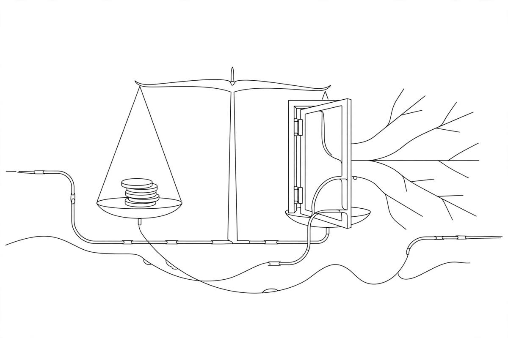

*Part of my daily series on Fundamentals of Data Engineering by Joe Reis and Matt Housley — [read the whole series](/book-series/).*

Every data team I have worked on has had the same argument at some point: this tool is cheaper. And almost every time, the person saying it was looking at the wrong number.

The price tag is the smallest part of what a technology costs you. The book looks at cost through three lenses.

1. Total cost of ownership. This is everything a choice costs, not just the invoice. Direct costs are the ones you can point at: team salaries, the cloud bill. Indirect costs are the overhead you pay no matter what. Then there is how you pay. Capital expenses are big up-front buys that depreciate over years. Operational expenses are pay-as-you-go, spread out over time, and easy to pin on one project. The cloud flipped the default, and the authors push an opex-first approach: pay for what you use, not for hardware that goes stale before it pays for itself.

2. Total opportunity cost of ownership. This is the cost nobody puts in the spreadsheet, and the book calls it a massive blind spot. Pick stack A and you have given up stacks B, C, and D — plus the team, the training, and the maintenance that come with A. The real question is not what A costs today. It is how quickly and cheaply you can move if A turns out to be the wrong pick, or goes stale. Inflexible technology is a bear trap: easy to walk into, painful to escape. Before you commit, ask what it costs to leave.

3. FinOps. Here is the part most people get wrong. FinOps is not about saving money. It is about making money. Run cloud spend the way DevOps runs systems: monitor it, adjust it constantly, and tie every dollar to business value — revenue, growth, faster releases. If your spend helps you ship faster and scale when it matters, it is doing its job. If nobody watches it, it is just a bill.

From my own work:

I have felt all three on the same project. On the Medicaid churn work, we ran Spark and Airflow on Databricks — pay-as-you-go, no hardware to buy, no multi-year bet before we knew the shape of the problem. That let a small team iterate fast on messy claims feeds. And we kept the pieces loosely coupled, so swapping one part would not mean rebuilding the whole pipeline. The pipeline fed a churn model worth $4M to the business. The value was never in cheap tools. It was in the model reaching the people who could act on it, on time, every week. That is FinOps in plain words: spend that earns its keep.

The takeaway: the cheapest tool costs least over its whole life, leaves you free to change your mind, and earns its keep in business value. Price is a line item. Cost is the whole story.

Day 21 of my read-through of Fundamentals of Data Engineering.
