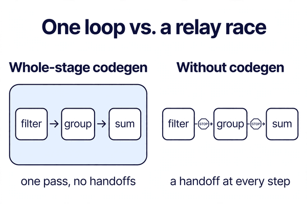
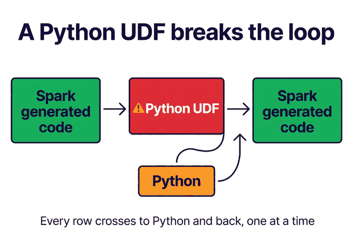
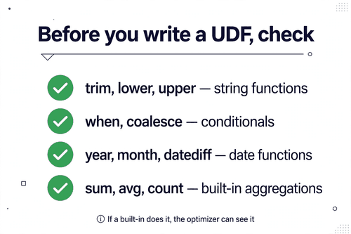

*Part of my daily Databricks series — the hardest topics, explained simply. Also published on [Substack](https://masterdataengineering.substack.com/) and in my LinkedIn newsletter, Master Data Engineering.*

A team I know had two queries. On paper, they did almost the same thing. Read a table of orders, keep the ones from this year, add up the amounts by region.

The first query ran through in the time it takes to make coffee. The second one crawled. Same table, same cluster, same amount of data. The only difference was one small piece of logic in the middle.

The team assumed the second query was slow because the data was bigger, or the cluster was busy, or something was wrong with the shuffle. None of that was true. The difference was something most people never see: how Spark turns a query into code.

Here is the part nobody tells you when you start with Spark. Spark does not run your query the way you wrote it.

When you write a chain of operations — read, filter, group, sum — Spark does not execute them one by one, passing rows from one operator to the next like a relay race. That would be slow. Every handoff between operators costs time, and a query with five steps would pay that cost five times.

Instead, Spark takes the whole stage — every operator between one shuffle and the next — and compiles it into a single piece of generated code. One function that reads a row, filters it, groups it, and adds it up, all in one pass. No handoffs. No relay race.

That is whole-stage codegen. And it is the reason a simple Spark query can feel surprisingly fast.

Think of it like this. The way you write a query is a recipe with separate steps: chop the vegetables, heat the pan, fry them, season them. The way Spark runs it is a single cook doing all of it in one smooth motion, without putting anything down between steps.

The generated code is plain Java bytecode, compiled on the fly. Spark looks at your whole stage, writes a function that does everything in that stage, compiles it, and runs it. The next time a similar stage runs, the compiled version is already there.

This is why Spark is faster than it looks. The query you write is a polite description of what you want. What actually runs is a tight loop the optimizer built for that exact query.

So what made the second query crawl?

The team had written a small Python function to clean up the region names. Nothing fancy. A few lines that standardised the spelling of a region before grouping by it.

```python
from pyspark.sql.functions import udf
from pyspark.sql.types import StringType

@udf(StringType())
def clean_region(region):
    return region.strip().lower().replace(" ", "_")

orders.withColumn("region", clean_region("region")) \
    .groupBy("region").sum("amount").show()
```

That little function broke everything.

A Python UDF cannot be compiled into the generated code. Spark's code generator only speaks the language of its own built-in operations. A Python function is a black box. Spark cannot see inside it, cannot fold it into the single loop, and cannot optimise around it.

So the whole stage falls apart. Instead of one tight loop, Spark has to stop at the UDF, hand every row over to Python, wait for Python to process it, and hand the result back. Row by row. Millions of times.

That handoff is called serialisation, and it is expensive. Every row has to be converted from Spark's internal format into something Python understands, processed, and converted back. The generated code stops at the UDF boundary. The single smooth motion becomes a stop-start relay again.



The worst part is that nothing in the query looks wrong. The UDF is five lines. The query is readable. The Spark UI does not flash a warning saying "codegen failed here." The job just runs slowly, and you are left guessing.

Here is how to spot it. If a query with a Python UDF is slow, open the stage in the Spark UI and look at the plan. When codegen is working, the plan shows a single generated stage with the operators fused together. When a UDF is in the way, you will see the plan split at the UDF, with a separate step for the Python evaluation.

The fix is usually simpler than people expect. Most Python UDFs are doing something Spark's built-in functions already do.

The region-cleaning function above is a perfect example. Stripping spaces, lowercasing, replacing spaces with underscores — every one of those has a built-in function. No Python needed.

```python
from pyspark.sql.functions import lower, regexp_replace, trim

orders.withColumn(
    "region",
    regexp_replace(lower(trim("region")), " ", "_")
).groupBy("region").sum("amount").show()
```

Same result. Same rows. But now the whole stage is visible to the code generator again, and it compiles into one loop.

That is the rule of thumb. Before you write a Python UDF, check whether the built-in functions can do the job. In my experience, they can do it most of the time.

There are a few other things that break codegen, and they are worth knowing because they look innocent too.

The first is a Python UDF used inside a filter or a join condition. Same problem, same fix: rewrite it with built-in functions, or use a Pandas UDF if you genuinely need row-by-row Python logic, because Pandas UDFs at least process data in batches instead of one row at a time.

The second is a complex expression Spark cannot generate code for. This is rarer, and the symptom is the same: the stage splits, and the plan shows a fallback step. If you see that, simplify the expression or break the query into two steps with a temporary view in between.

The third is a user-defined aggregate function written in Python. Same black box, same break. Use the built-in aggregations where you can. They are compiled, fast, and tested by far more people than your function ever will be.



So what should you actually do with this knowledge? Three habits.

First, treat a Python UDF as a cost, not a convenience. Every UDF is a hole in the generated code. Sometimes the hole is worth it — the logic genuinely cannot be expressed any other way. Most of the time it is not, and the built-in functions were sitting right there.

Second, learn the built-in functions the way you would learn a second language. The string functions, the date functions, the conditional functions like `when` and `coalesce`. Each one you know is one fewer UDF you will write, and one fewer hole in your codegen.

Third, when a query is slow for no obvious reason, check whether codegen is actually running. Look at the plan. If you see a UDF in the middle of it, you have found your answer before you have touched a single cluster setting.

There is a broader lesson here too. Spark's speed does not come from raw power. It comes from the optimizer turning your description of a query into efficient code. The more of your logic the optimizer can see, the faster the code it generates.

A Python UDF hides your logic from the optimizer. The built-in functions show it. That is the whole trade-off, and it is worth remembering every time you reach for a `def`.



One more thing helps, and it is easy to miss. Codegen is not something you turn on. It is on by default, and it has been for years. If your queries feel slow, the question is not whether codegen is enabled. The question is whether something in your query is stopping it from working.

The usual suspect is a UDF. Check there first.

So how do you tell whether codegen is doing its job on your slowest query?

- Does the query contain a Python UDF anywhere — in a column, a filter, or a join condition?

- Can that UDF be rewritten with Spark's built-in functions?

- Does the stage in the Spark UI show one fused plan, or a split where the UDF sits?

- If you remove the UDF, does the query suddenly behave like the fast one?

If the answer to the first question is yes and the second is also yes, you do not have a performance problem. You have a UDF problem. And the fix is a few lines of built-in functions, not a bigger cluster.

Which query in your pipeline is hiding a Python UDF — and what would it look like written with built-in functions?

