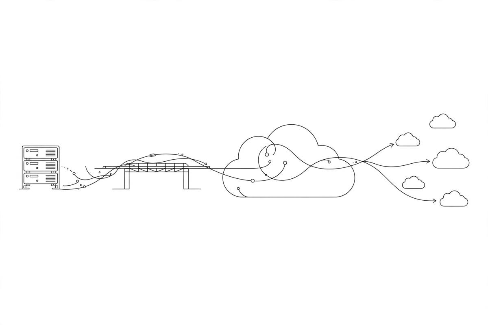

*Part of my daily series on Fundamentals of Data Engineering by Joe Reis and Matt Housley — [read the whole series](/book-series/).*

Where your data lives is not a technical detail. It decides your costs, your speed, and how stuck you get later.

The book lays out four places to run your stack — each a trade-off, not a right answer.

1. On premises. You own the machines, in your own data center or a rented one. When a disk dies, you replace it; when new hardware comes out, you plan the upgrade. And you buy for your worst day, not your average one — a retailer sizes for the holiday rush, then that capacity sits idle the rest of the year. The risk: standing still while a faster competitor scales past you.

2. Cloud. You rent instead of owning, and you rent by the minute. A machine spins up in under a minute and scales with demand. That is the flip: pay for what you use, not capacity bought ahead of time. It runs from raw machines to managed services to full software you just log into. At the far end: serverless — you write the code, someone else runs the servers.

3. The trap: treating the cloud like your old data center. Lifting servers into the cloud and leaving them running is the most common expensive mistake here. Long-running cloud servers cost far more than the same machines on premises. It only pays off if you scale down when quiet and up for the big job. Data in is cheap or free; data out can cost a fortune. Data has gravity: once it lands, moving it costs.

4. Hybrid and multicloud. Hybrid means keeping some workloads where they are and moving only the ones that clearly gain from the cloud. Common pattern: analytics in the cloud, where data flows one way, so you barely pay to move it back. Multicloud means spreading across two or more public clouds — near customers, or the best service from each. The cost is real: moving data between clouds, wiring networks, keeping security straight.

From my own work:

At EXL we run Spark and Airflow on a Databricks lakehouse — chosen for the problem, not the other way around. The churn pipeline ran on pay-as-you-go compute, so a small team could iterate on messy claims feeds before buying hardware. Heavy jobs scaled up; when done, we scaled down. Nothing was welded to one vendor — loosely coupled pieces, so swapping one part would not mean rebuilding the pipeline. Hybrid instinct inside a cloud deployment: keep the flow simple, keep your exit open.

The takeaway: pick where your stack lives for the work you have today, not the architecture you might want in five years. Start simple, usually one cloud. Keep an escape plan in your back pocket, even if you never use it — the freedom to leave is what keeps a good decision good.

Day 22 of my read-through of Fundamentals of Data Engineering.
