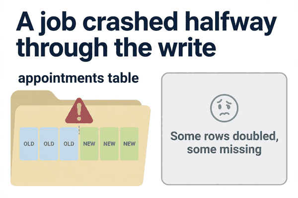
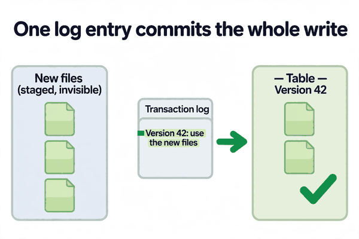
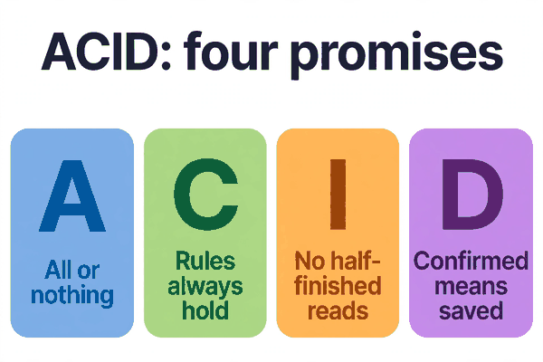

*Part of my daily Databricks series — the hardest topics, explained simply. Also published on [Substack](https://masterdataengineering.substack.com/) and in my LinkedIn newsletter, Master Data Engineering.*

Picture this. It is 2 AM and a nightly job is rebuilding a table of patient appointments. It reads yesterday's appointments, applies the day's changes, and writes the whole table back out.

Halfway through the write, the cluster dies. A node goes down, the job fails, and nobody is awake to notice.

At 8 AM, a dashboard loads the appointments table. Some patients appear twice. Some are missing entirely. A few rows are from yesterday, a few from today, mixed together in the same table like two decks of cards shuffled into one.

The team re-runs the job to fix it. It crashes again. Now the table is in an even stranger state, and nobody can say which version of the data they are looking at.

This is the failure that ACID exists to prevent. And if you work on a data lake, it is worth understanding what those four letters actually buy you, because the lake gives you none of it by default.

A data lake is, at its simplest, a pile of files. Parquet files sitting in cloud storage, organised into folders. That is the whole design. Files are cheap, durable, and easy to read in parallel.

But a pile of files has no opinions about correctness. When a job writes a table, it is really writing a bunch of files one after another. There is no single moment where the table flips from the old version to the new version. Readers who arrive in the middle see whatever files happen to exist at that moment.

That is what happened at 2 AM. The job had written some of the new files and not others. The table was neither the old version nor the new one. It was something in between, and that in-between state was the one the dashboard served all morning.

ACID is four promises that stop this from happening. They come from the database world, and they sound academic until you have lived through the failure they prevent.

Atomicity means all or nothing. A write either lands completely or it does not land at all. There is no halfway state that anyone can see. The job at 2 AM would have failed, and the table would still have been yesterday's complete, correct version. The dashboard would have shown yesterday's data, which is wrong by a day, but it would have been consistent. Nobody would have seen patients duplicated and missing at the same time.

Consistency means the data always follows the rules you set. If a column is supposed to be a date, a string cannot sneak in. If a field cannot be null, a null row gets rejected instead of quietly landing in the table. Without this, a bad upstream change corrupts the table silently, and you find out from a business user three weeks later.

Isolation means two jobs writing at the same time cannot see each other's unfinished work. One job's half-written files are invisible to the other. Without it, a report running at the same time as a load reads a mix of both.

Durability means once a write is confirmed, it stays written. A crash five seconds later does not undo it.

That is the whole list. Four promises. And plain Parquet gives you none of them.

Here is the pattern that gets teams into trouble. It looks completely reasonable.

```python
appointments.write \
    .mode("overwrite") \
    .parquet("/data/appointments")
```

This overwrites a folder of Parquet files. Spark deletes the old files and writes new ones, file by file. If the job fails partway through, the folder is a mix of old and new files. If a dashboard reads the folder at the same moment, it reads the same mix.

There is no transaction. There is no "commit" moment. There is just a folder, changing under everyone's feet.

The fix is to put a transaction log in front of the files. That is what Delta Lake does, and it is the reason Delta exists.

With Delta, the write works differently. Spark writes the new Parquet files to the side, where nobody can see them yet. Then it adds a single entry to a transaction log: a small JSON file that says, in effect, "from now on, this table is these files."

That log entry is the commit. It is one small, atomic operation. Readers either see the version before the entry or the version after it. They never see a mix.

```python
appointments.write \
    .format("delta") \
    .mode("overwrite") \
    .save("/data/appointments")
```

Same data, same job, one extra word in the code. The difference is everything.



If the job crashes now, the new files are sitting there unreferenced, and the log still points at yesterday's version. The table is untouched. Re-running the job is safe, because the failed attempt left no trace in the table itself.

That single commit point is also what makes time travel possible. Every commit is a log entry, so Delta can show you the table as it was at any earlier entry. A bad overwrite stops being a crisis and becomes a query.

```sql
SELECT * FROM appointments VERSION AS OF 42;
```

Version 42 is the table before the bad write. You can look at it, compare it, and restore it. The log remembers what the folder alone would have forgotten.

So what does each letter buy you, in practice, on a lake with Delta underneath?

Atomicity buys you a clean failure. A crashed job leaves the old table intact. You re-run it in the morning instead of spending the morning untangling a half-written table.

Consistency buys you a loud failure instead of a silent one. Delta enforces the schema by default. A column that arrives with the wrong type gets rejected at write time, with an error, instead of landing in the table and breaking a report downstream.

Isolation buys you safe concurrency. Two jobs can write to the same table, and optimistic concurrency sorts it out: one commits, the other retries. Neither one ever reads the other's half-finished work.

Durability buys you a confirmed write. Once Delta says the commit landed, it is in the log and on disk. A cluster dying five seconds later changes nothing.



There is one thing ACID does not buy you, and it matters. It does not make your logic correct.

A write can be perfectly atomic and still be wrong. A MERGE with a bad match condition will cleanly, atomically write the wrong data. A job that double-counts appointments will double-count them with full transactional guarantees. ACID protects the write. It does not protect the thinking.

That is the boundary to keep in mind. If the data is wrong because the pipeline's logic is wrong, no transaction log will save you. That is a testing problem, not a storage problem. But if the data is wrong because a job crashed halfway, or two jobs collided, or a reader arrived mid-write — that is exactly what ACID is for.

So the rule of thumb is simple. If a table matters enough that someone will make a decision from it, it should sit behind a transaction log. On Databricks, that means Delta.

A folder of Parquet files is fine for an intermediate step nobody reads directly. It is a bad place to keep a table the business depends on. The moment a dashboard, a report, or another pipeline reads it, the four promises start to matter.

And the cost of the promises is small. The log is a few JSON files. The write pattern barely changes. The difference is that a 2 AM failure becomes a re-run in the morning, not a data incident.



One habit makes this concrete. The next time you write a table with `.parquet`, stop and ask whether anyone will ever read it while it is being written.

- Is a dashboard pointed at it?

- Does another job read it on a schedule?

- Could it be mid-write when someone queries it?

- Would a half-written version cause a wrong decision, not just an error?

If the answer to any of those is yes, write it as Delta. The four letters are cheap insurance, and the 2 AM version of you will be glad they are there.

Which table in your pipeline is still a plain folder of Parquet files — and what would happen if a job died halfway through rewriting it?
