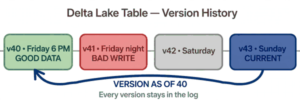
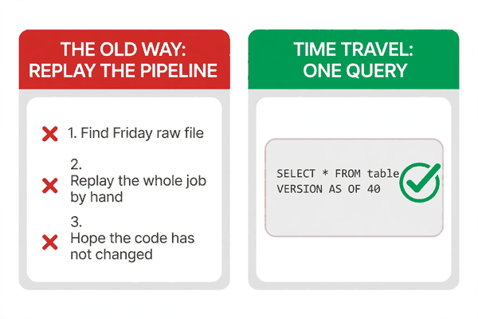
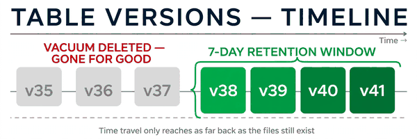

*Part of my daily Databricks series — the hardest topics, explained simply. Also published on [Substack](https://masterdataengineering.substack.com/) and in my LinkedIn newsletter, Master Data Engineering.*

Picture this. It is Monday morning, and a dashboard that tracks member eligibility has changed overnight.

On Friday, the dashboard said 48,000 members were active. On Monday, it says 41,000. Nobody changed the dashboard. Nobody changed the query. Seven thousand members have simply vanished from the numbers.

The team checks the pipeline. The nightly job ran fine on Friday night, Saturday night, and Sunday night. No errors. No failures. Green checks all the way down.

Then someone looks at the source file from Friday. The eligibility feed arrived with a bad column that night. A status field that should have said "active" or "terminated" arrived blank for a whole batch of members. The job did exactly what it was told: it read the blanks, treated them as terminated, and overwrote the table.

Three nightly runs later, the damage is baked in. The table has been overwritten three times since Friday. The good data is gone. Or at least, that is what the team thinks.

This is the moment time travel earns its keep. Because on Delta Lake, the good data is not gone. It is still there, one version back, waiting to be asked for.

A Delta table is not just the files you see today. Every write adds a new version, and every version is recorded in the transaction log. Friday's table is version 40. Friday night's bad write is version 41. Saturday is 42, Sunday is 43. The current table is version 43, but versions 40, 41, and 42 still exist underneath it.

Time travel is the feature that lets you query any of those versions, as if you had run the query back then.

The syntax is one line.

```sql
SELECT * FROM member_eligibility VERSION AS OF 40;
```

That query returns the table exactly as it was after version 40 committed, before the bad write landed. No restore. No copy. No re-running anything. You just ask for the old version, and Delta reads the files that version pointed to.

There is a second form, for when you remember the time but not the version number.

```sql
SELECT * FROM member_eligibility TIMESTAMP AS OF '2026-11-06 18:00:00';
```

That returns the table as it was at 6 PM on Friday. Delta looks up the last version committed before that timestamp and reads that one.



Here is the pattern that gets teams into trouble. It looks completely reasonable, and it is how most teams handle a bad overwrite today.

They re-run the pipeline from the raw files. They dig out Friday's source file, replay the job by hand, and write the result back into the table. If the raw file is still around, and if the job is deterministic, and if nobody changed the code since Friday, it works.

That is a lot of ifs. And in practice, at least one of them fails. The raw file was archived. The job code changed on Saturday. A lookup table it depends on has moved on. The replay produces numbers that are close to Friday's, but not Friday's, and nobody can prove which one is right.

The other common pattern is worse. Teams keep manual daily copies of every important table, just in case. A snapshot job copies the whole table every night into a dated folder. It works, but it doubles the storage, doubles the maintenance, and the snapshot job itself becomes one more thing that can fail silently.

Both patterns exist because, on a plain data lake, yesterday's data really is gone once you overwrite it. A folder of Parquet files has no memory. The old files get deleted, the new files take their place, and there is nothing left to ask.

Delta changes that, because Delta never forgets a version. The transaction log remembers every commit, and the old files stay on disk until they are cleaned up. Time travel is not a backup system bolted on the side. It is a side effect of how Delta already works.

So the fix for the Monday-morning mystery is not a replay or a snapshot. It is a query.

First, find the version you want. Every Delta table keeps its own history, and you can read it like a log.

```sql
DESCRIBE HISTORY member_eligibility;
```

That returns one row per version: the version number, the timestamp, the operation that created it, and who ran it. The bad Friday-night write is right there in the list, with its timestamp and the job that ran it. The version before it is the good one.

Then query the good version and compare it against today.

```sql
SELECT status, COUNT(*) FROM member_eligibility VERSION AS OF 40 GROUP BY status;
```

```sql
SELECT status, COUNT(*) FROM member_eligibility GROUP BY status;
```

Two queries, side by side. The difference between them is the damage, measured exactly. No guessing, no replay, no arguing about what Friday's numbers were. Friday's numbers are right there, because version 40 never went away.

If the comparison confirms the bad write, the recovery is one more line.

```sql
RESTORE TABLE member_eligibility TO VERSION AS OF 40;
```

That creates a new version, 44, whose contents are version 40's data. The mistake is not erased from history — versions 41, 42, and 43 are still in the log, and you can still query them. The table is simply pointed back at the good data. It is an undo that leaves a paper trail.



Time travel is useful for more than disaster recovery. It answers questions that come up constantly and are painful without it.

A model was trained last month and performed well in testing, but it is behaving strangely in production. What data did it actually train on? Query the training table as of the training date, and you are looking at exactly what the model saw. No reconstructing, no hoping the data has not changed.

An auditor asks what a table contained on the last day of the quarter. The table has been overwritten a hundred times since then. Query it as of that date, and you have the answer in seconds.

A dashboard number changed and nobody knows why. Query the table as of last week and as of today, compare, and the change is either in the data or in the query. That narrows the search from everything to one side.

All three of these are the same trick. The table remembers. You just have to ask it the right way.

There is one limit, and it matters. Time travel only reaches as far back as the old files still exist. Delta cleans up old files with VACUUM, and VACUUM respects a retention window. The default is seven days.

That means you can query last Friday's table, but not last month's, unless someone changed the retention. Once VACUUM deletes the old files, those versions are gone for good. The log still lists them, but the data underneath has been removed, and the query will fail.

```sql
VACUUM member_eligibility RETAIN 168 HOURS;
```

That is the default: 168 hours, seven days. If your team needs a longer lookback — for audits, for model training, for quarterly reporting — raise the retention before you need it, not after. And never set it to zero. A zero retention sounds like saving storage, and it deletes the very versions time travel depends on.



So the rule of thumb is simple. Before you re-run a pipeline to recover old data, or before you build a snapshot job to protect it, check whether the table already remembers.

If it is a Delta table, it does. Run DESCRIBE HISTORY, find the version, query it. The recovery that used to take a morning of replaying jobs takes one line. The audit question that used to need a backup restore takes one query. The debugging session that used to end with "we can't know what the data looked like then" ends with the actual data on screen.

The transaction log is already keeping the history. Time travel is just the door into it.

When was the last time a table changed under you and nobody could say what it used to look like — and how far back would you have needed to go to find out?
