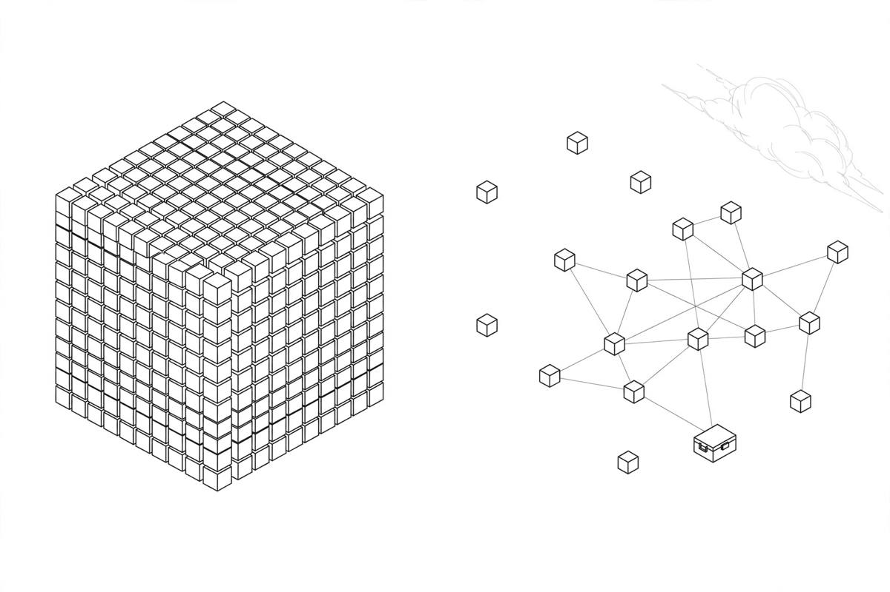

*Part of my daily series on Fundamentals of Data Engineering by Joe Reis and Matt Housley — [read the whole series](/book-series/).*

Every data stack hits the same fork in the road: one big system that does everything, or small pieces that each do one thing well.

The first option is the monolith. Everything in one place, one codebase, usually one language. Easy to reason about, and a small team moves fast.

But a monolith is brittle. One bug can take the whole system down. The book tells of one ETL pipeline that took 48 hours to run: if anything broke, the whole thing restarted from the top. Leaving is the worst part: everything tangled together, moving costs serious time and money.

Modularity is the other direction. Break the stack into small pieces, each with one job. The win is choice: the best tool for each step, swapped out when a better one shows up. Parquet data can be read by any tool that speaks it, so no vendor owns your data.

The price is complexity. Instead of one system, you now have five or ten, and orchestration becomes the glue holding them together.

There is a trap in between: the distributed monolith. It looks modular, but services share one codebase. Hadoop was like this, and Airflow can be too. One task's library must be installed everywhere, so dependency conflicts are constant. The fix: its own environment per job, or its own container.

Serverless means you write the code and the cloud runs it. No servers to manage, and you pay only when it runs. Great for small jobs. But a function can only run for so long, and at high volume the per-event cost adds up fast. A million tiny calls can sting.

Servers give you control and power, often cheaper at steady high volume. But you own the failures. Treat them as disposable: build from code, deploy through a pipeline, scale on demand.

Containers sit in the middle. A container packages code with its dependencies, so it runs the same way anywhere. Each job gets isolated dependencies, the cure for that trap. Kubernetes manages them at scale. The advice: start serverless, move to servers with containers once you outgrow it.

From my own work:

At EXL, Spark and Airflow on a Databricks lakehouse, modular by design. Storage in Delta, compute separate. I have lived the monolith side too: a late failure in a long pipeline restarted the whole run. Smaller tasks that rerun on their own changed that. The dependency problem is real too: one team's library upgrade can break another team's job in a shared environment. Pinning dependencies per job is the lesson.

The takeaway: do not marry one side. Pick for reversibility. Ask how easily you can swap one piece later. The tools will change; your data will outlive them.

Day 24 of my read-through of Fundamentals of Data Engineering.
