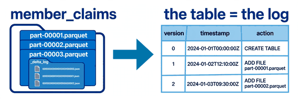
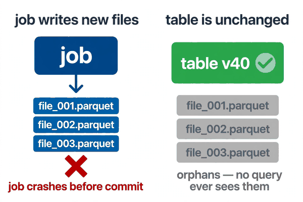
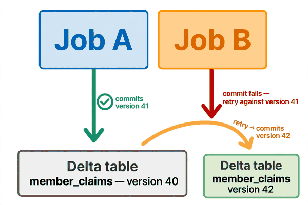

*Part of my daily Databricks series — the hardest topics, explained simply. Also published on [Substack](https://masterdataengineering.substack.com/) and in my LinkedIn newsletter, Master Data Engineering.*

Picture this. It is 2 AM, and a job that loads member claims data has crashed halfway through.

The job wrote new files for three hours, then died. The on-call engineer opens the table folder to see what landed. There are new Parquet files in there, timestamps from tonight. There are also the old files, still sitting next to them.

So the question nobody can answer at 2 AM is simple: did half the data land, or none of it?

The engineer runs a count. The number looks plausible, but plausible is not an answer. If half the new files are in the table and half are not, every downstream report is wrong in a way nobody can see. If none of them are in, the job just needs a re-run. The difference between those two situations is the whole night.

This is the moment most people discover that a Delta table is not the folder of files they are looking at.

A Delta table is two things. The first is the data files, plain Parquet, sitting in a folder. The second is a small folder inside it called _delta_log. That folder is the table.

Every time anything changes in a Delta table — a write, a delete, an update, a schema change — Delta appends one small JSON file to the _delta_log folder. Version 0, version 1, version 2, each one numbered in order. Each file records exactly one change: which Parquet files were added, which were removed, and what operation caused it.

The current state of the table is whatever the latest log entry says it is. Not the folder. The log.

That is why the 2 AM question has a clean answer. The crashed job wrote new Parquet files to the folder, but it never got to write its log entry. No log entry, no commit. The table is exactly what it was before the job started. Those new files are orphans: data on disk that no version of the table points to, and no query will ever see them.

A write in Delta is atomic because the commit is a single file. The data files can land in any order, take as long as they like, even fail halfway. None of it matters until the log entry appears. The moment it appears, the whole change is visible at once. There is no in-between state where half a write is queryable.

If you have ever wondered how time travel works, this is the answer. Time travel is not a separate feature bolted on the side. It is the log, read backwards.

Each log entry is a version. Version 40 is a file that says "add these Parquet files, remove those ones." Version 41 is another file, same idea. To query the table as of version 40, Delta reads the log up to entry 40 and opens only the files those entries point to. The data files for later versions are still on disk, but the query ignores them, because version 40 never mentioned them.

Here is what a log entry actually looks like, stripped down.

```json
{
  "add": {
    "path": "part-00003-abc123.parquet",
    "size": 48201344,
    "modificationTime": 1792459200000
  },
  "remove": {
    "path": "part-00001-xyz789.parquet"
  },
  "commitInfo": {
    "timestamp": 1792459200123,
    "operation": "WRITE",
    "userName": "nightly-claims-job"
  }
}
```

One entry, three facts: what arrived, what left, and who did it. DESCRIBE HISTORY is just this log, formatted as a table. Every version number, every timestamp, every operation, every user — it all comes from these JSON files.



Now here is the pattern that gets teams into trouble. It looks completely reasonable, and it is the same mistake in three different costumes.

The first costume is the cleanup. Someone opens a table folder, sees hundreds of tiny JSON files in _delta_log, and decides they are junk. They delete them to save space. The table instantly becomes unreadable, because Delta no longer knows which Parquet files belong to it. The data is all still there, every byte of it. But without the log, there is no table. It is like shredding the index of a book and keeping the pages.

The second costume is the shortcut. Someone copies Parquet files out of a Delta table folder into a new location and expects a working table. They get a folder of files with no log, which is just a pile of Parquet. Or they copy files in the other direction, dropping new Parquet files into a live table folder and wondering why no query sees them. Files without a log entry do not exist, as far as Delta is concerned.

The third costume is the manual fix. A bad write lands, and instead of using the log to roll back, someone deletes the bad Parquet files by hand. Now the log points at files that no longer exist, and every query fails. The log and the files have to agree, and hand-editing one side always breaks the other.

All three mistakes come from the same wrong mental model: thinking the folder is the table. The folder is storage. The log is the table.

So the fix is not a setting or a trick. It is reading the log before touching anything.

When a write looks wrong, start with the history.

```sql
DESCRIBE HISTORY member_claims;
```

That shows every version, newest first, with the operation, the timestamp, and the user or job behind it. The bad write is right there, with its version number. The version before it is the good state.

When a job crashes mid-write, check whether its version committed.

```sql
SELECT MAX(version) FROM (DESCRIBE HISTORY member_claims);
```

If the crashed job's version is not in the list, nothing landed. Re-run the job. If it is in the list, the write committed and the problem is somewhere else. Either way, you are deciding from the log, not from guessing at file timestamps in a folder.

When two jobs write to the same table at the same time, the log is what keeps them from corrupting each other. Each writer prepares its change against the latest version, then tries to commit the next version number. If another writer got there first, the commit fails, and the losing job retries against the new latest version.



There are two details worth knowing, because both surprise people the first time they meet them.

The first is checkpoints. After enough versions, replaying every JSON file from version 0 gets slow, so Delta periodically writes a checkpoint: one Parquet file summarizing the table state up to that version. New readers start from the latest checkpoint and replay only the entries after it. You will see files like 00000000000000000010.checkpoint.parquet in the log folder. They are supposed to be there. Do not delete them either.

The second is retention. The log grows by one file per commit, so Delta cleans up old log files on a schedule, keeping 30 days by default. That does not delete your data, but it limits how far back DESCRIBE HISTORY and time travel can reach. If your team needs a longer lookback for audits, raise the retention before you need it.

None of this requires memorizing internals. The working rule is one sentence: never touch the files, always work through the log.

Do not delete log files. Do not copy Parquet files in or out by hand. Do not delete bad files by hand. If data needs to change, write it through Delta, delete it through Delta, roll it back through Delta. The log records every one of those operations, which means the history stays honest and the recovery stays one command.



The 2 AM story ends the way it should. The engineer checks the history, sees the crashed job never committed, and re-runs it. No partial data, no manual cleanup, no downstream reports to fix. The table was never in a half-written state, because a half-written state cannot exist. The log either has the entry or it does not.

That is what the transaction log buys you. Not a feature you turn on, but a guarantee built into how every write works: the table is the log, the log is a numbered list of facts, and a change is either fully committed or it never happened.

Next time a job crashes halfway through a write, where will you look first — the folder of files, or the log?

