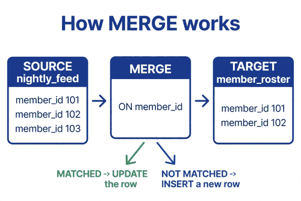
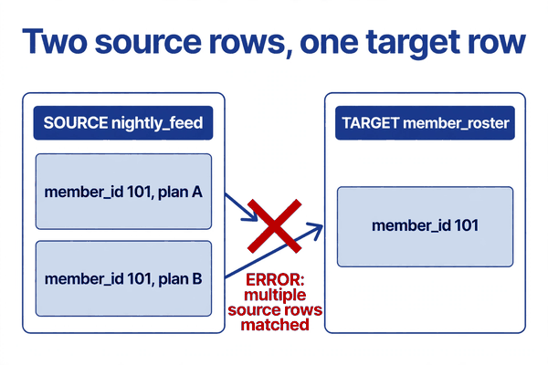
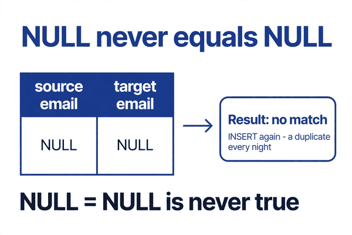

*Part of my daily Databricks series — the hardest topics, explained simply. Also published on [Substack](https://masterdataengineering.substack.com/) and in my LinkedIn newsletter, Master Data Engineering.*

Picture this. It is Monday morning, and the member roster table has twice as many rows as it did on Friday.

The nightly load job ran green all weekend. No errors, no alerts, no failed stages. But the Monday report shows member counts nearly doubled, and the same member appears twice — once with the old address, once with the new one. The downstream team is asking which row is real, and nobody can answer, because both rows came from the same job.

The job uses MERGE. That is the part that stings. MERGE is supposed to be the safe way to load a table. One statement, upsert handled, no duplicates. And yet here are the duplicates, sitting in a table that MERGE itself wrote.

MERGE is simple to describe. You have a target table and a source with new or changed rows. You tell Delta how to match them, usually on a key like member_id. For every source row that matches a target row, update the target. For every source row that does not match, insert it as a new row. Optionally, delete target rows that no longer appear in the source.

That is the whole idea. And the whole idea rests on one line: the match condition.

Get the match condition right, and MERGE is the most reliable way to keep a table current. Get it slightly wrong, and MERGE will corrupt your data while reporting success. There is no warning for a wrong match condition. The job finishes green either way. You find out on Monday, from a report that stopped making sense.

Here is what the Monday-morning MERGE usually looks like.

```sql
MERGE INTO member_roster AS target
USING nightly_feed AS source
ON target.member_id = source.member_id
WHEN MATCHED THEN UPDATE SET *
WHEN NOT MATCHED THEN INSERT *;
```

It reads clean. It looks correct. And it has three ways to bite, all hiding in lines that look harmless.



The first bite is duplicate keys in the source.

The feed sends one row per member, or so everyone assumes. Then a member enrolls in two plans, and the feed sends two rows for that member — same member_id, different plan details. Or a source system glitch sends the same row twice. The source is no longer one row per key, and MERGE does not know which source row should win.

Delta refuses to guess. When two source rows match the same target row, the MERGE fails with an error about multiple source rows matching one target row. That is the good outcome, because at least the job turns red and someone looks at it.

The bad outcome is what teams do next. They "fix" the error by adding a second column to the match condition, so the two source rows no longer collide. Match on member_id and plan_code, for example. The error goes away. The job turns green. And now neither source row matches the existing target row, because the target row has no plan_code, or a different one. So both source rows get inserted as brand-new members.

The duplicate did not go away. It changed shape. Instead of an error you can see, you now have two rows for one member, quietly, every night, until someone notices the counts.

The fix is to clean the source before MERGE ever sees it. Deduplicate on the business key, in the query, every single time — even when you are sure the source is clean. Being sure is how the Monday-morning table happens.

```sql
WITH deduped AS (
  SELECT *,
    ROW_NUMBER() OVER (
      PARTITION BY member_id
      ORDER BY updated_at DESC
    ) AS rn
  FROM nightly_feed
)
MERGE INTO member_roster AS target
USING (SELECT * FROM deduped WHERE rn = 1) AS source
ON target.member_id = source.member_id
WHEN MATCHED THEN UPDATE SET *
WHEN NOT MATCHED THEN INSERT *;
```

One row per key goes into the MERGE. The newest row wins, and the rule for "newest" is written down in the query, not decided silently by whichever row Delta happened to read first.



The second bite is NULL in the match key, and it is sneakier, because nothing fails at all.

Suppose the match is on email instead of member_id. It seems reasonable — email is unique, everyone has one. Except some members do not have an email on file. Their email is NULL.

In SQL, NULL never equals NULL. That is not a Databricks quirk, it is how SQL works everywhere. A source row with a NULL email will never match a target row with a NULL email, no matter how identical the rest of the row is. So every night, the MERGE looks at those members, finds no match, and inserts them again.

The table grows by one duplicate per member per night. The job stays green the whole time. The first sign of trouble is a count that creeps upward, or a report that starts double-counting people who never gave an email address.

The rule is blunt: never match on a column that can be NULL. Match on the real business key, the one the source system guarantees — member_id, claim number, policy number. If you genuinely have no non-nullable key, use a null-safe comparison, the kind that treats two NULLs as equal. But that is a workaround for a data problem, not a pattern to build on. The better fix is to go back to the source and get a real key.

The third bite is the WHEN NOT MATCHED clause with no guard on it.

WHEN NOT MATCHED THEN INSERT means every source row that fails to match gets inserted. Every one. Including the test members the source system sends along. Including the terminated members who should never enter the roster. Including rows with garbage in them that a filter upstream was supposed to catch but did not.

MERGE does exactly what it is told. The problem is that "insert everything unmatched" is almost never what anyone actually wants. The fix is a condition on the clause itself.

```sql
MERGE INTO member_roster AS target
USING deduped_source AS source
ON target.member_id = source.member_id
WHEN MATCHED AND source.status = 'active'
  THEN UPDATE SET *
WHEN NOT MATCHED AND source.status = 'active'
  THEN INSERT *;
```

Now only active members flow in. The terminated rows, the test rows, the rows with a status nobody recognizes — they hit neither clause, and they are ignored. The MERGE statement itself becomes the last line of defense, not just a passthrough.

There is one more habit that separates a MERGE you can trust from one you cannot: checking the result.

A MERGE that ran is not a MERGE that worked. Before the job ends, count what it did. How many rows were updated, how many inserted, how many in the source never matched anything. Then check the target for the one thing that should never be true.

```sql
SELECT member_id, COUNT(*) AS rows
FROM member_roster
GROUP BY member_id
HAVING COUNT(*) > 1;
```

If that query returns anything, the MERGE did not do its job, whatever the job status says. Run it after every load that matters. It costs almost nothing, and it is the difference between finding the duplicate on Monday and finding it on the night it happened.



None of this is about memorizing MERGE syntax. The syntax is the easy part. The hard part is the match condition, and the match condition is a statement about your data: one row per key in the source, a key that is never NULL, and an insert rule that says who actually belongs in the table.

If any of those three things is not true, MERGE will still run. It will run green, on schedule, and it will write the wrong answer into your table with total confidence. The duplicates on Monday morning are not a MERGE bug. They are a match condition that nobody checked.

Next time you write a MERGE, read the ON clause twice. Then dedupe the source, match on a key that cannot be NULL, guard the insert, and count the duplicates after. Four small habits, and the Monday-morning table never happens to you.
