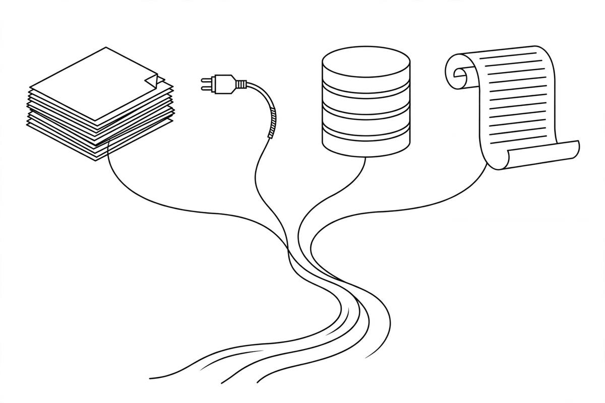

*Part of my daily series on Fundamentals of Data Engineering by Joe Reis and Matt Housley — [read the whole series](/book-series/).*

Every pipeline I have built started the same way. Not with a tool. With a question: where does this data actually come from?

Chapter 5 is about that question, and it is the one most engineers skip. We jump straight to moving data. The authors slow down and ask how data gets created first, because how data is born decides how you handle it.

Four sources show up again and again.

First, files. A file is just a sequence of bytes, yet still the universal way the world exchanges data. Agencies send Excel and CSV files, vendors email them, systems dump them. Excel, CSV, TXT, JSON, XML, each with its own quirks, and none will tell you when the format changes.

Second, APIs. In theory they make ingestion easy: call an endpoint and the data comes to you. In practice, you maintain a custom connection for every API, auth, pagination, rate limits, fields that appear and disappear without warning. The API looks clean from the outside. The maintenance is the real work.

Third, application databases, the OLTP systems. These sit behind the apps people use, built to read and write one record at a time, thousands per second. They are brilliant at that job and the wrong tool for analytics. Run a big scan against one and you slow the application itself.

Fourth, logs. Every system leaves a trail of events: who did what, and when. Database logs are the interesting one: the database writes every change to its log before confirming it. That log lets a database recover after a crash, and it powers change data capture.

So here is my framework. Before you ingest anything, answer three questions about the source. How is the data created? How does it change? What breaks if you read it wrong?

From my own work:

In healthcare, I have dealt with all four. Claims data arriving as files from vendors, columns shifting between deliveries. EHR feeds through APIs that change shape without notice. Application databases behind the systems that run the business, which I had to read from carefully so I never slowed the application itself. And logs everywhere, telling me what happened when a feed went quiet overnight.

Schema drift taught me the most. A feed that worked on Monday can break on Tuesday because a source system added a field or renamed one. Nothing in your pipeline changed. The source changed. If you do not know your source, you find out from a failed job, not from the documentation.

The takeaway: the ingestion problem is almost never the pipeline. It is the source. Understand how your data is created, how it changes, and how it can surprise you before you move a row.

Day 26 of my read-through of Fundamentals of Data Engineering.
