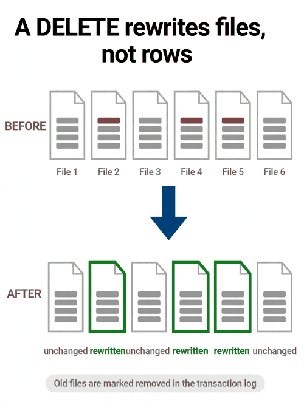
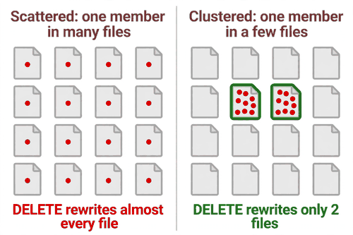
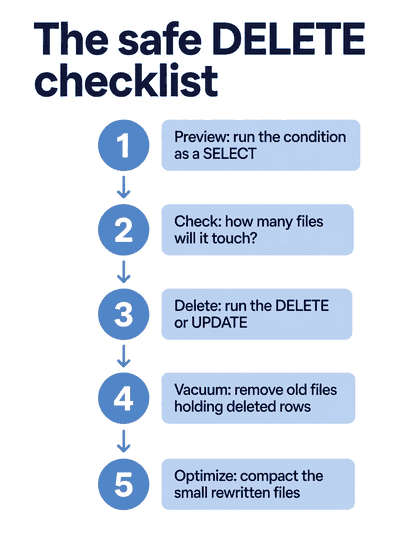

*Part of my daily Databricks series — the hardest topics, explained simply. Also published on [Substack](https://masterdataengineering.substack.com/) and in my LinkedIn newsletter, Master Data Engineering.*

Deletes and updates without rewriting the world

Part of my daily Databricks series — the hardest topics, explained simply.

Picture this. It is Friday afternoon, and a compliance request lands in your inbox.

One member has asked for their records to be deleted. Not a table, not a partition, not a month of data. One member, one row, maybe a handful of rows across a couple of tables. You write the DELETE, run it, and go to make coffee.

An hour later it is still running.

The table has a few hundred million rows, but the delete touches one member. One row. The job is not stuck — it is working hard, reading and writing enormous amounts of data, for one row. The nightly load is due to start soon, and the delete is sitting on the table like a roadblock.

This is the moment most people learn how Delta actually handles a DELETE. It does not cross out a row. It rewrites files.

A Delta table is a set of Parquet files, and Parquet files are immutable. Once a file is written, nothing edits it in place. Not Delta, not Spark, not anyone.

A row inside a file cannot be crossed out, blanked, or swapped. The only way to change what is in a file is to write a new file.

So when you run a DELETE, Delta finds every file holding a matching row, reads each one, writes a new version with the matching rows left out, and records the swap in the transaction log. The old files are marked as removed. The new files take their place.

The delete itself is small. The rewrite is whatever size the files are.

That is the whole story, and it explains the Friday afternoon job. The member's rows were scattered across the table — a few rows in this file, a few rows in that file, spread across months of loads. The DELETE had to rewrite every file that held even one of their rows.

The number of rows deleted was tiny. The number of files rewritten was not.



The same thing happens with an UPDATE, for the same reason. Changing a member's plan code means rewriting every file that contains a row you are changing. There is no in-place edit in Delta. A "small" update and a "small" delete are the same operation underneath: find the files, rewrite them, log the swap.

Once you see that, the rule for fast deletes writes itself. The cost of a DELETE is not the number of rows you delete. It is the number of files those rows live in.

A delete that touches ten rows in ten files is cheap. A delete that touches ten rows in ten thousand files rewrites ten thousand files. The rows are irrelevant. The files are everything.

Here is what the slow pattern usually looks like.

```sql
DELETE FROM member_roster
WHERE member_id = 'M-88412';
```

One line, one member, one condition. It looks like it should take a second — and on a small or well-organized table, it does. On a big table where member rows are scattered across every file, it rewrites a large part of the table to remove a single member.

The scatter is the usual culprit, and it is usually an accident. The table is partitioned by load date, because that is how the data arrives. A member who has been around for two years has rows in hundreds of files, one per load. No single file holds many of their rows, but nearly every file holds at least one.

So the fix is not a faster DELETE. The fix is to stop scattering the rows a delete needs to reach.

The most direct fix is to organize the table by the column you delete on. If member_id is the column in your WHERE clause, the table needs to be arranged so that one member's rows sit together in a small number of files.

Liquid clustering on member_id does this. Z-ordering on member_id does this. Either way, the same DELETE now finds the member's rows in a handful of files, rewrites those few files, and finishes in seconds instead of an hour.



That is the first question to ask before any DELETE or UPDATE on a big table: how many files will this touch? You can answer it before running anything. Run the same condition as a SELECT and look at the files it reads.

```sql
SELECT member_id, COUNT(*) AS rows
FROM member_roster
WHERE member_id = 'M-88412'
GROUP BY member_id;
```

If it reads a small number of files, the DELETE will be quick. If it scans most of the table, the DELETE will rewrite most of it. Same statement, same row count — and you can see it coming.

There is a second habit that matters just as much, and it is about the UPDATE side. A DELETE with a wrong condition removes rows you wanted to keep. An UPDATE with a wrong condition changes rows you never meant to touch. Both run without complaint, and both are harder to undo than to prevent.

So before any UPDATE or DELETE that matters, run the condition as a SELECT first. Look at the rows it returns. Count them. If the count is not what you expected, stop — the condition is wrong, and the statement you were about to run would have done exactly what you told it to, to exactly the wrong rows.

```sql
-- Read it first, then delete it
SELECT COUNT(*) AS rows_to_delete
FROM member_roster
WHERE member_id = 'M-88412'
  AND status = 'withdrawn';
```

This takes seconds and it is the cheapest insurance in data engineering. The teams that get bitten by a bad DELETE are almost never the teams that forgot Delta rewrites files. They are the teams that ran a statement they never previewed.

For bulk changes, there is a third option. If you are deleting or updating a large share of the table — a whole cohort, or every row before a certain date — do not delete row by row. Rewrite the table in one pass, keeping only the rows you want.

```sql
CREATE OR REPLACE TABLE member_roster AS
SELECT * FROM member_roster
WHERE status <> 'withdrawn';
```

One read, one write, no file-by-file rewrite of files that mostly survive. It replaces the whole table, so it is not the tool for a one-member compliance request. Use the DELETE for the small, precise change, and the rewrite for the big, sweeping one.

There is one more thing about DELETE that catches people, and it matters most exactly when the delete matters most: the compliance case.

A DELETE removes the rows from the current version of the table. That is what queries see afterwards. But the old files — the ones that still contain the deleted rows — stay on storage until VACUUM runs.

Delta keeps them so time travel still works. That is a feature, right up until the moment you need the data truly gone.

If a member asked for their records to be deleted, the DELETE alone is not the end of the job. The old files need to be removed too, and that means running VACUUM, which clears out files the log no longer references. VACUUM has a default retention of seven days, which protects time travel. For a compliance deletion, you may need to run it with a shorter retention, and that means accepting that time travel to before the delete will no longer work.

That is a trade-off to make deliberately, not discover later. Delete the rows, vacuum the old files, and then verify: query the table for the member, and check that nothing comes back.



After a round of deletes or updates, clean up. Rewriting files leaves the table fragmented — lots of small new files where big ones used to be. Run OPTIMIZE afterwards, so the next query does not pay the price of the rewrite.

None of this is about avoiding DELETE or UPDATE. They are ordinary statements, and Delta handles them well when the table is organized for them. The mistake is thinking of them as small operations because the row count is small.

The row count is not the cost. The file count is. Organize the table so the rows a delete needs are together, preview the condition before you run it, rewrite the table when the change is big, and remember that a deleted row is only truly gone once the old files are vacuumed away.

Next time you write a DELETE, ask one question first: how many files is this about to rewrite? If the answer surprises you, fix the layout, not the statement.

How many files would your last DELETE have rewritten?
