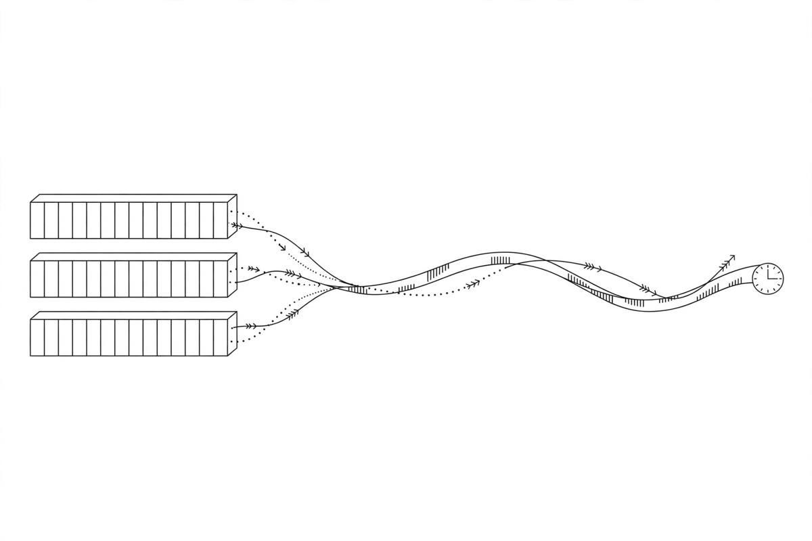

*Part of my daily series on Fundamentals of Data Engineering by Joe Reis and Matt Housley — [read the whole series](/book-series/).*

Most pipelines do not fail loudly. They fail quietly, with a wrong answer. And the reason is almost always the same: the data changed, and nobody tracked how.

The systems that create data hold the current state, not the history. An address changes and the old one is overwritten. A snapshot tells you what is true now, nothing about what changed or when.

Four ideas fix this.

First, CRUD. Create, read, update, delete. That is how almost every application stores its state. It works, but an update destroys the old value. CRUD is fine for running an app, but a poor source of truth for analytics, which is mostly questions about change over time.

Second, change data capture, or CDC. Instead of asking the database for its current state, you read its log of changes. Every insert, update, and delete becomes an event in near real time. The database already writes this log so it can recover after a crash, and CDC taps into that same log. You get the full history, not just the ending.

Third, insert-only. Same idea, built into the table. Instead of updating a row, you insert a new one with a timestamp. The table keeps every version, and the current address is the latest row for that customer. The trade-off: tables grow fast, and lookups cost more.

Fourth, messages and streams. A message is a single signal between two systems, and once it is delivered, it is gone. A stream is an append-only log of events, kept for weeks or months, so you can replay history and aggregate over many events. We often collect messages into streams to analyze them later.

Then there is time. Four kinds, and you want all four recorded. Event time is when it happened. Ingestion time is when it arrived. Process time is when you processed it. Processing time is how long that took. Keep one timestamp and you cannot tell a late event from a slow pipeline.

From my own work:

In healthcare, I have lived all of this. Claims data and EHR feeds arrive with change baked in: a member's status updates, a claim moves through stages. A snapshot tells me where things stand today. It tells me nothing about the journey, and the journey is where the insight sits.

That is why I lean on insert-only patterns in Delta Lake and on reading change events instead of snapshots. When every change is a new row with a timestamp, I can rebuild any point in time and answer the question the business actually asked: not what is true now, but what changed and when.

The takeaway: a snapshot answers what is. History answers what happened. A pipeline that only knows the present cannot explain the past.

Day 27 of my read-through of Fundamentals of Data Engineering.
