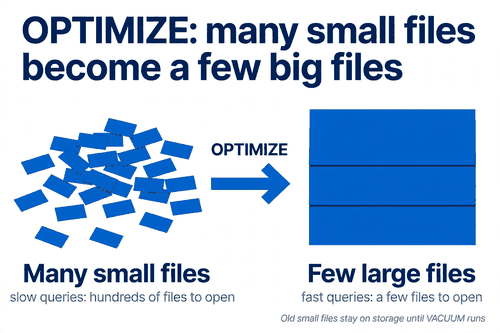
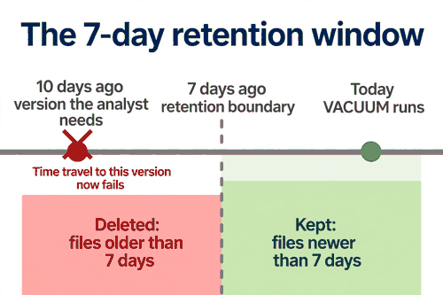
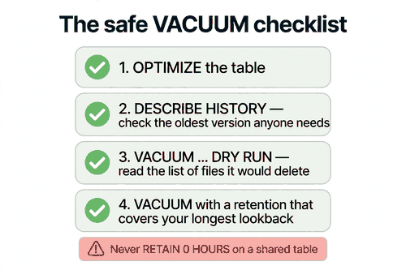

*Part of my daily Databricks series — the hardest topics, explained simply. Also published on [Substack](https://masterdataengineering.substack.com/) and in my LinkedIn newsletter, Master Data Engineering.*

OPTIMIZE, VACUUM, and the day VACUUM deleted data someone needed

Part of my daily Databricks series — the hardest topics, explained simply.

Picture this. It is Tuesday morning, and a message lands in the team channel.

The finance analyst is trying to reproduce a report from ten days ago. She is not guessing at the numbers — she is using time travel, querying the table exactly as it looked back then. It worked last week. Today it fails.

The error says the files are gone.

The table itself is fine. The current data is fine. Every dashboard is up. But the old version of the table — the one she needs — no longer exists on storage. Someone deleted it.

Nobody dropped the table. Nobody overwrote it with bad data. Someone ran VACUUM the night before, to clean up storage. And VACUUM did exactly what it was asked to do.

This is the day most people learn what VACUUM actually is. It is not a tidy-up button. It is a delete command that removes files permanently, and once it runs, there is no undo.

To understand how this happens, you need two commands and one clock.

The first command is OPTIMIZE. Over time, a Delta table collects small files. Every streaming micro-batch, every small append, every DELETE or UPDATE leaves a trail of little files behind it. Queries slow down because they have to open hundreds of files instead of a few.

OPTIMIZE fixes that. It reads the small files, packs their rows into fewer, bigger files, and records the swap in the transaction log. The table now has a tidy layout and queries run faster.

But OPTIMIZE does not delete anything. The old small files are still sitting on storage, marked as removed in the log but physically present. That is deliberate. Delta keeps them so time travel still works — you can still query the table as it looked before the OPTIMIZE ran.

That is where the second command comes in. VACUUM is the one that actually deletes files. It scans storage for files the transaction log no longer references, and deletes the ones older than the retention period.

The retention period is the clock, and it is the whole story. By default it is seven days. VACUUM deletes unreferenced files older than seven days, and leaves everything newer alone.

Seven days sounds generous. It is not, if anyone on your team still needs to look further back than that.

In the Tuesday-morning story, the analyst needed ten days back. The table had been optimized the previous Friday, which made the old files unreferenced. VACUUM ran on Monday night with the default retention. The files holding the ten-day-old version were older than seven days, so VACUUM deleted them. The current version was untouched. The version she needed was gone.



OPTIMIZE and VACUUM feel like a pair — clean up, then take out the trash — so teams run them together, one after the other, in the same job. The trap is not the pairing. The trap is the retention.

The most common version of the trap looks like this.

```sql
VACUUM member_roster RETAIN 0 HOURS;
```

Someone wants the storage back right now, not in seven days. Maybe the table just had a big OPTIMIZE and the old files are large. Maybe the storage bill is under scrutiny. So they set the retention to zero, and VACUUM deletes every unreferenced file, including the ones from an hour ago.

Delta tries to stop you. There is a safety check that blocks any retention shorter than seven days, and you have to deliberately turn it off to run a zero-hour VACUUM. The check exists precisely because of the Tuesday-morning story. Turning it off is the moment the damage becomes possible.

And the damage is not always a failed time-travel query. A long-running reader can be holding a reference to old files. A streaming job's checkpoint can point at them. A downstream job that started before the VACUUM can fail halfway through because the files it was reading disappeared mid-run. The files look unreferenced to the log, but something live was still using them.

So the fix is not to stop vacuuming. Old files really do pile up, and storage really does cost money. The fix is to vacuum with the clock in mind.

Start by asking a question nobody asks before running VACUUM: how far back does anyone still need to go?

Check the table's history first. It tells you what versions exist and when they were written.

```sql
DESCRIBE HISTORY member_roster;
```

If the oldest version anyone might need is ten days old, your retention has to be longer than ten days. The default of seven is a floor set by Delta, not a recommendation. Your real retention is set by the oldest lookback your team actually uses — the monthly reconciliation, the audit query, the report someone reproduces six weeks later.

Then run VACUUM as a dry run first. It lists the files it would delete, without deleting anything.

```sql
VACUUM member_roster RETAIN 168 HOURS DRY RUN;
```

One hundred and sixty-eight hours is seven days. Read the list. If a file on it is one you recognize — a version someone is still querying, a file a running job might need — stop. The dry run is free, and it is the only chance you get to see the damage before it happens.



When the list looks right, run the real VACUUM with the same retention. Keep it on a schedule, not as a panic response to a storage bill. A weekly VACUUM with a retention that matches your longest lookback is boring, and boring is the point. The teams that lose data to VACUUM are almost never the teams with a schedule. They are the teams that ran it once, by hand, with a retention someone typed in a hurry.

There are three rules worth taping to the wall.

First, never set retention to zero on a table anyone else reads. If the storage really has to go today, copy the table first, or accept that time travel to before the VACUUM is gone. That is a decision to make with the team, not alone at midnight.

Second, never turn off the retention safety check on a shared table. The check is the only thing standing between a typo and a deleted version. If a job needs a shorter retention, that job needs a review, not a config change.

Third, run OPTIMIZE and VACUUM as separate steps, and check between them. OPTIMIZE creates the unreferenced files. VACUUM deletes them. Looking at what OPTIMIZE left behind — how many files, how old, which versions they belong to — is how you catch a bad vacuum before it runs.

```sql
-- The safe pattern, in order
OPTIMIZE member_roster;

DESCRIBE HISTORY member_roster;

VACUUM member_roster RETAIN 168 HOURS DRY RUN;

VACUUM member_roster RETAIN 168 HOURS;
```

Notice what is missing from that pattern: no zero, no disabled safety check, no rush. Each step gives you a chance to stop.

If you do need a shorter retention — and sometimes you genuinely do, for a scratch table or a table nobody time-travels on — set it deliberately, write down why, and tell the people who read the table. A retention of three days is fine when everyone agrees no one looks back further than three days. It is a disaster when one person does and nobody asked them.



OPTIMIZE and VACUUM are good commands. They keep tables fast and storage bills sane, and every production table needs them. The mistake is treating VACUUM like a broom. A broom sweeps up dust. VACUUM deletes files that time travel, running jobs, and audits may still need — and it does not ask twice.

The analyst got her report in the end, rebuilt from the source system, which took most of the day. The lesson cost a day of her time and a week of trust in the platform.

It did not have to. A dry run would have shown the files on the list. A look at the history would have shown the ten-day-old version. A retention matched to the team's real lookback would have left those files alone.

Next time you run VACUUM, ask one question first: what is the oldest version anyone on your team still needs? If you do not know the answer, find out before you run it — not after.

How far back does anyone on your team still need to time travel?
