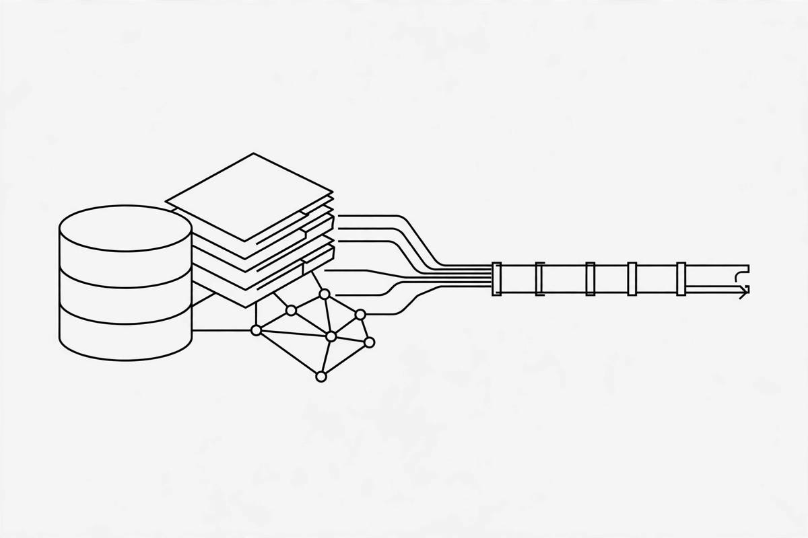

*Part of my daily series on Fundamentals of Data Engineering by Joe Reis and Matt Housley — [read the whole series](/book-series/).*

Every pipeline starts with someone else's system, and every source system has its own personality. Don't learn it first, and it will surprise you later, usually at 2 AM.

First, databases. The old reliable is the relational database: rows and columns, one fixed schema, joins across tables, and a strong guarantee that a transaction either fully happens or not at all. It still runs most applications, and most of my data still starts there.

Then the NoSQL family, built for workloads relational databases could not handle. Key-value is a giant dictionary: give a key, get a value, great for caching. Document stores hold JSON-like documents with a flexible schema and no joins, freedom until a renamed field breaks your pipeline. Wide-column takes enormous write rates with one index, the row key. Graph stores connections as first-class citizens, for questions about who connects to whom.

Before you pull from any of them, ask how you look things up, how it scales, how consistent it is, and how you get the data out.

Second, APIs. REST is still the dominant way systems talk: every call is independent, no session, no memory between calls. GraphQL lets you ask for exactly the shape of data you want in one request. Webhooks flip it: the source calls you when something happens, a reverse API. And gRPC is the strict, efficient one, with a fixed contract.

Third, data sharing. In the cloud you can read someone else's data in place, with fine-grained permissions, instead of copies flying around. Inside a company, the same idea lets each team own its data and share it selectively, the practical heart of the data mesh idea.

Fourth, third-party sources. Nearly every company is a data company now, government agencies included. Labour stats, space research, CRM records, it is all out there, usually through an API, a sharing link, or a download. But you do not control it: its quality, schedule, and rules are someone else's decision.

From my own work:

In healthcare, my sources are messy by nature. Claims and EHR feeds arrive from systems I did not build, and schema drift is a fact of life. One renamed field upstream and three dashboards quietly go wrong.

So my first move is always the same: read the source system's documentation before writing a single line of pipeline code. A full scan of a document store can slow the source down and cost real money, so I ask first and scan second. And when I pull from a REST API, I plan for rate limits and pagination from day one.

The takeaway: the source shapes your pipeline more than any tool you pick later. Learn the source first.

Day 28 of my read-through of Fundamentals of Data Engineering.
