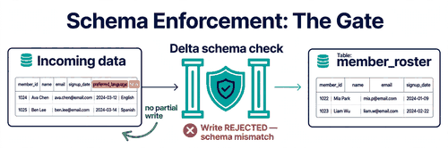
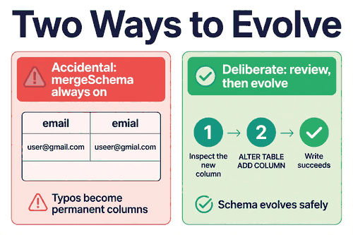
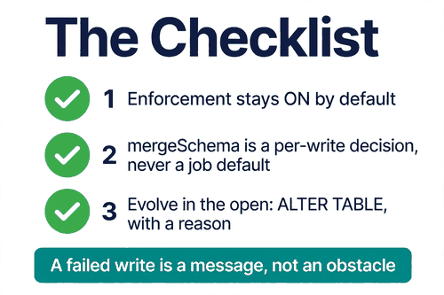

*Part of my daily Databricks series — the hardest topics, explained simply. Also published on [Substack](https://masterdataengineering.substack.com/) and in my LinkedIn newsletter, Master Data Engineering.*

Schema enforcement vs. schema evolution: the day a new column broke the pipeline

Part of my daily Databricks series — the hardest topics, explained simply.

Picture this. It is Monday morning, and the pipeline that has run cleanly for six months just failed.

The error is short and unhelpful: the incoming data does not match the table's schema. Nothing in your code changed. Nobody touched the job. The data did change, though — somewhere upstream, someone added a column.

The source team added a field called `preferred_language` to the member feed. It is a perfectly reasonable column. Your table does not have it, and Delta Lake just refused the write.

This is schema enforcement doing its job. It feels like a bug. It is a guardrail.

Delta tables remember their schema. Every write is checked against it: same columns, same names, same types, in the same order. If the incoming data brings an extra column, or is missing one, or has a column with a different type, the write fails before a single row lands.

That strictness is the point. A table is a contract with everyone downstream — the dashboards, the reports, the models, the other pipelines. If any write could quietly change the shape of the data, the contract means nothing. Enforcement is what stops a bad upstream change from silently becoming everyone's problem.

But the story does not end with "enforcement saved the day." The story ends with what the team did next, and that is where most of the damage happens.

The most common reaction is the quick one: turn the guardrail off. Someone finds the setting that lets the schema change automatically — `mergeSchema` — and switches it on for the job, or for every job, so this never blocks a pipeline again.

The pipeline runs. The new column appears in the table. The team moves on. And a month later, someone notices the table has two columns that mean the same thing.

One is `email`. The other is `emial`.

A typo in the source feed, merged in automatically, is now a permanent column in a production table. Half the rows have a value under `email` and a null under `emial`. The other half have it the other way round. Every query against that table now has to check both columns, and nobody trusts either one.



That is the other side of this topic, and it is the one people learn the hard way. Schema enforcement and schema evolution are not two settings to pick between once. They are two modes, and the mistake is leaving the wrong one on by default.

Schema enforcement is the default, and it should stay the default. It says: this table has a shape, and no write gets to change it without someone deciding to. When a write fails because of a new column, that failure is information. It is the system telling you the source changed and someone needs to look.

Schema evolution is the exception. It says: this particular write is allowed to change the table's shape, because a human looked at the change and decided it belongs here. The mechanism in Delta is `mergeSchema`, and the important word is "merge" — it adds the new column to the table permanently.

Here is what the failing write looks like. A table with four columns receives a DataFrame with five.

```python
# member_roster has: member_id, name, email, signup_date
# The new batch has all four, plus preferred_language

new_members.write.format("delta").mode("append").saveAsTable("member_roster")
```

That write fails. Delta compares the incoming schema with the table schema, finds `preferred_language` with no match, and refuses. No partial write, no rows landed, no silent column added. The pipeline stops and tells you.

The wrong fix is to add `mergeSchema` and walk away.

```python
# The quick fix that becomes a permanent habit
new_members.write.format("delta").mode("append") \
    .option("mergeSchema", "true") \
    .saveAsTable("member_roster")
```

This works, and that is the problem. It works for the good column and it works for the typo column. It works for a column renamed by accident, for a column that changed from an integer to a string, for a column someone added for a one-off experiment. Every one of those becomes part of your table, forever, with no review and no record of who approved it.

The right fix has a step in the middle: look at the change first.

When the write fails, read the error. It names the mismatch. Then look at the incoming data and answer three questions.

First, is this column real? Does it have a sensible name, sensible values, and a purpose someone can explain? A column called `preferred_language` with values like "en" and "es" is real. A column called `emial` is not.

Second, does it belong in this table, or does it belong somewhere else? A member's preferred language belongs with the member record. A column that only one downstream report needs might belong in a derived table, not in the shared source table everyone reads.

Third, who else reads this table? Adding a column is safe for readers — existing queries keep working, because they ask for columns by name. But removing or renaming a column breaks every query that mentions it. Evolution that only adds is gentle. Evolution that renames or drops is not evolution at all; it is a breaking change wearing a friendly name.



Once the answers are yes, yes, and nobody breaks — then evolve the schema, deliberately, in its own step.

The cleanest way is to add the column yourself, before the write, so the change is visible in the code and in the table's history.

```sql
ALTER TABLE member_roster ADD COLUMN preferred_language STRING;
```

Now the table expects the column, the write matches, and the change is recorded as a deliberate act. Anyone reading the table's history can see when the column arrived and that someone added it on purpose.

The second way is to allow the merge for that one write, and only that one write.

```python
new_members.write.format("delta").mode("append") \
    .option("mergeSchema", "true") \
    .saveAsTable("member_roster")
```

Same code as the wrong fix — the difference is not the syntax, it is the discipline. One-off, reviewed, for a column you have already inspected. Not a setting left on in the job config, not a default in the pipeline template, not something the next person inherits without knowing it is there.

That discipline matters because `mergeSchema` has limits that surprise people. It can add columns. It cannot change a column's type, and it cannot rename one. If the source changes `signup_date` from a date to a string, the merge fails, and that is a good thing — a type change is a decision, not an accident to absorb silently. The fix for a type change is to cast the incoming column explicitly, in the open, where the next person can see what was decided.

```python
from pyspark.sql.functions import col

cleaned = new_members.withColumn(
    "signup_date", col("signup_date").cast("date")
)

cleaned.write.format("delta").mode("append").saveAsTable("member_roster")
```

There are three rules worth taping to the wall.

First, enforcement stays on by default, on every table, forever. A failed write is a message from the system, not an obstacle to remove. Read it before you override it.

Second, `mergeSchema` is a per-write decision, never a job default. The moment it lives in a shared config or a pipeline template, every typo and experiment upstream becomes your schema. If you find it turned on somewhere, turn it off and ask what it was covering for.

Third, evolve in the open. Add the column with `ALTER TABLE`, or merge it in a reviewed write, and say why. A schema change with a reason and a name attached is a normal part of a table's life. A schema change nobody remembers approving is how a table ends up with `email` and `emial` side by side, and a team that stops trusting its own data.



Delta's enforcement is not there to annoy you on a Monday morning. It is there because the alternative is worse: a table whose shape drifts a little every week, driven by whoever changed the source last, until nobody can say what the table contains or why.

The Monday-morning failure was the system working. The team looked at the new column, decided it was real, added it deliberately, and the pipeline ran. The next time the source adds a column by accident, the same failure will stop it again — and that time, everyone will be glad it did.

What is the strangest column that has ever shown up in one of your tables?
