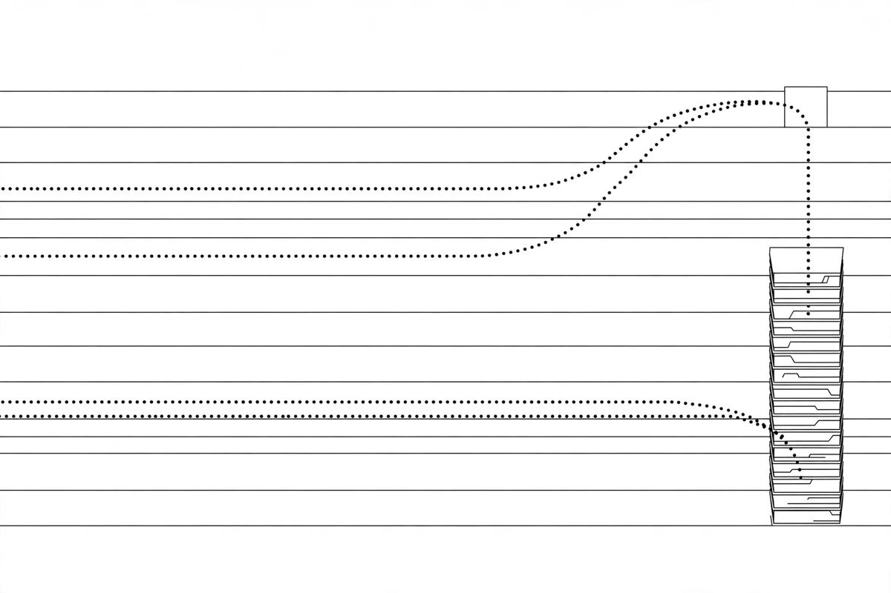

*Part of my daily series on Fundamentals of Data Engineering by Joe Reis and Matt Housley — [read the whole series](/book-series/).*

A message queue and an event-streaming platform look like twins. They are not. Mix them up and your pipeline will teach you.

A message queue sends small messages between systems that never talk directly. One publishes, the queue holds it, a subscriber picks it up. Once confirmed, the message is gone.

That is the whole point. The two sides never need to be up at the same time, and the queue absorbs a rush when one side runs faster.

Three things to design around. First, ordering. In a distributed queue, messages can arrive out of order, so unless your queue guarantees strict first-in-first-out, build for it.

Second, delivery: exactly once or at least once. At-least-once means the same message can show up twice, usually after a crash. So design your processing to be idempotent: processing it twice gives the same result as once.

Third, scale. Good queues scale sideways across many servers and swallow huge volumes, but the same distribution makes ordering fuzzy and duplicates possible.

Now the event-streaming platform: a queue that keeps a diary. Instead of deleting messages after delivery, it writes every event into an ordered log and keeps it around, so you can replay from any point in time. An event is a key, a value, a timestamp.

Events live in topics, named collections of related events, with many producers and consumers. The same event can feed two jobs: fulfillment ships the package, marketing tunes a campaign in real time.

Topics split into partitions, lanes on a freeway. A partition key decides which lane a message takes; every message with the same key lands in the same lane. Pick badly and you get hotspotting: one lane jammed, the others empty.

These platforms run across many machines, so losing one does not lose your data.

From my own work:

Most of my healthcare pipelines run in batch, with Airflow and Delta Lake, a deliberate choice, since claims and EHR feeds arrive on a schedule. But the streaming ideas still run my day.

Idempotency is the big one. When a feed replays a file or a job retries, my processing has to give the same result the second time. Backfills are the same idea: when a schema drifts upstream, I reprocess from a known point, which only works if my pipeline can replay cleanly. Ordering matters too: a claim update arriving before the original corrupts a record if I trust arrival order.

The takeaway: a queue moves a message and then forgets it. A stream keeps the history so you can replay it and many consumers can read the same events. Pick the queue to hand work off, the stream when you need the past too.

Day 29 of my read-through of Fundamentals of Data Engineering.
