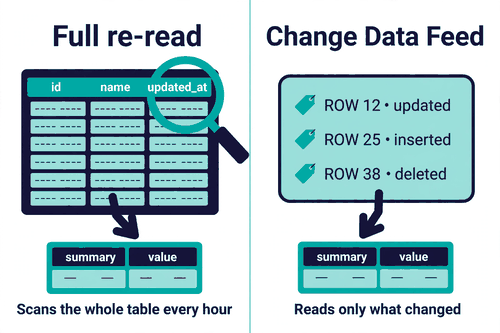
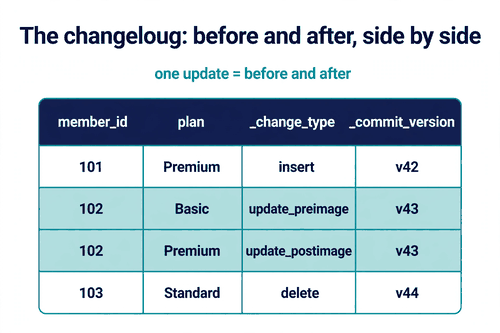
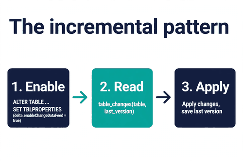

*Part of my daily Databricks series — the hardest topics, explained simply. Also published on [Substack](https://masterdataengineering.substack.com/) and in my LinkedIn newsletter, Master Data Engineering.*

Change Data Feed: the changelog you're not using

Part of my daily Databricks series — the hardest topics, explained simply.

Picture this. It is Thursday afternoon, and someone from the compliance team walks over with a simple question.

"When did this member's plan change from Basic to Premium, and who changed it?"

You open the member table. The row says Premium. That is all it says. There is no record of when it changed, what it was before, or what else changed in the same write. The table knows the present. It has no memory of the past.

So you start digging. You check the pipeline logs. You check the job history. You check the chat channel where someone might have mentioned it. An hour later, you have a guess. A guess is not an answer, and for a compliance question, a guess is worse than no answer at all.

This is the gap most teams live with and never notice. Their tables store the current state, and nothing else. Every update overwrites the old value, every delete removes the row, and the history of what happened evaporates the moment the write lands.

Delta Lake already records that history. Most teams just never turn it on.

Every Delta table keeps a transaction log — a journal of every write, in order, with a version number. The log knows that version 42 added a batch of members, version 43 updated a plan, version 44 deleted a test row. What the log does not do, on its own, is hand you the changed rows in a usable form.

That is what Change Data Feed is for.

Change Data Feed — CDF — is a setting on a Delta table that says: keep a readable record of every row that changes, and what kind of change it was. Turn it on, and from that version forward, every insert, update, and delete is written to a changelog you can query like any other table.

Here is the part people get wrong first: CDF is not retroactive. Turning it on today does not recover the changes from last week. The changelog starts the moment you enable it. If the compliance question arrives before you turned it on, the answer is still gone.

That is why the right time to enable it is before you need it, on the tables that matter — the member table, the claims table, the table whose rows someone will ask about one day.

Enabling it is one statement.

```sql
ALTER TABLE member_roster SET TBLPROPERTIES (
  delta.enableChangeDataFeed = true
);
```

Or set it when you create the table, so it is on from the very first write.

```sql
CREATE TABLE member_roster (
  member_id BIGINT,
  name STRING,
  plan STRING,
  updated_at TIMESTAMP
) TBLPROPERTIES (delta.enableChangeDataFeed = true);
```

From the next write onward, every change is recorded. And reading those changes is a query, not a project.

```sql
SELECT * FROM table_changes('member_roster', 42);
```

That returns every row that changed after version 42, with three extra columns attached: `_change_type`, `_commit_version`, and `_commit_timestamp`. The change type tells you what happened to the row.

An insert is one row, marked `insert`. A delete is one row, marked `delete`, carrying the values the row had before it disappeared. An update is two rows: the old values marked `update_preimage`, and the new values marked `update_postimage`.



That preimage and postimage pair is the whole point. It is what turns "the plan is Premium now" into "the plan changed from Basic to Premium in version 43." The before and the after, side by side, with the version and the timestamp attached. That is an answer to a compliance question, not a guess.

CDF is not only for audits. It is also the fix for the most wasteful pattern in downstream pipelines: the full re-read.

Here is the pattern. A team needs a summary table that stays in sync with the member table. So every hour, a job reads the entire member table, filters for rows whose `updated_at` is newer than the last run, and writes those rows downstream.

```python
# The hourly full re-read: scans everything, every time
members = spark.read.table("member_roster")
changed = members.filter(col("updated_at") > last_run)
changed.write.format("delta").mode("append").saveAsTable("member_summary")
```

This looks reasonable. It has three quiet failures.

First, deletes never show up. A deleted row is gone from the table, so no filter can find it. The downstream summary keeps the row forever, quietly wrong.

Second, a row updated twice between runs shows only its final state. The middle change — the one that might have mattered — never appears.

Third, a backfill with an old `updated_at` timestamp gets skipped entirely. The row changed, but its timestamp says it is old, so the filter passes it by. And all the while, the job pays to scan the whole table to find the handful of rows that actually moved.

The fix is to stop asking the table what changed, and start reading the changelog.

```python
changes = spark.read.format("delta") \
    .option("readChangeFeed", "true") \
    .option("startingVersion", last_version) \
    .table("member_roster")

# _change_type tells you what happened to each row:
# insert, update_preimage, update_postimage, delete
```

Now the downstream job reads only the changes since the last version it processed — not the whole table. Deletes arrive as `delete` rows, so the summary can remove them. Updates arrive as preimage and postimage, so nothing in between is lost. A backfill is just more change rows; no timestamp filter can skip them.



The downstream job then needs one piece of bookkeeping: remember the last version it processed. Each run reads from that version, applies the changes, and stores the new high-water mark. The next run picks up exactly where the last one stopped.

That is the whole incremental pattern. Read the feed, apply the changes, save the version. No full scans, no timestamp filters, no missed deletes.

There are two limits worth knowing before you rely on it.

The first is retention. The changelog lives as long as the transaction log does, and the log is cleaned up on a retention schedule — thirty days by default, with VACUUM removing old data files after seven days. Ask for a version older than what is retained, and the read fails. The practical rule is simple: run your downstream job often enough that it never falls behind the retention window, and keep the last processed version somewhere safe.

The second is that CDF records row changes, not schema changes. It will not tell you a column was added. For that, the table's history is still the place to look.



There are three rules worth taping to the wall.

First, enable CDF before you need it, on the tables whose rows someone will ask about. The changelog starts when you turn it on, and no setting recovers the history before that.

Second, build downstream pipelines on the feed, not on timestamp filters. A timestamp filter misses deletes, misses double updates, and misses backfills. The feed misses none of them, and it reads far less data doing it.

Third, track the last version you processed, and run often enough to stay inside retention. The feed is only useful if you actually read it before the log is cleaned up.

A table that only remembers the present is a table that cannot answer the simplest question about its own past. The changelog is already there in the transaction log. Change Data Feed just makes it readable.

Turn it on for the tables that matter, and the next time someone walks over with a question about what changed and when, you will have an answer instead of a guess.

What is the last question about your data that you could not answer, because the table only remembers the present?
