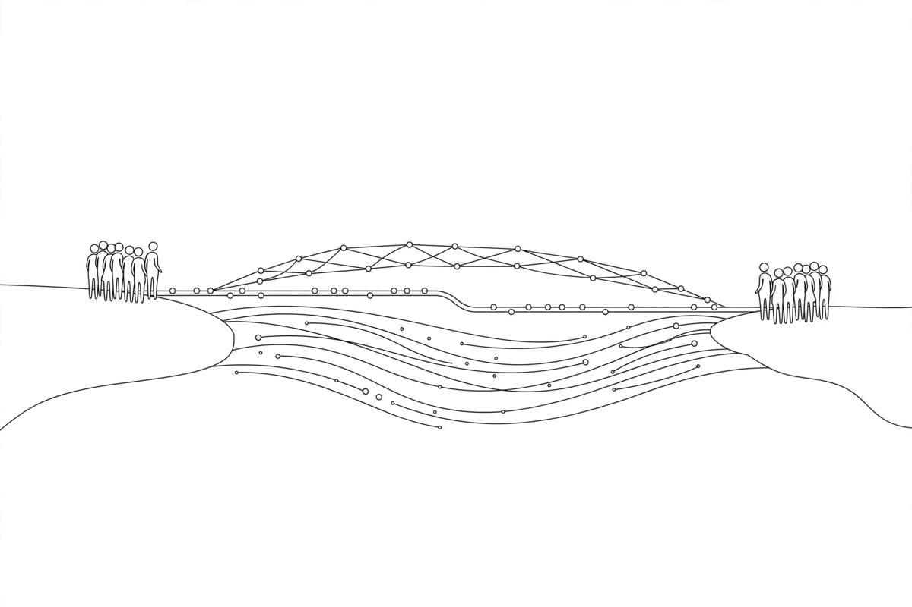

*Part of my daily series on Fundamentals of Data Engineering by Joe Reis and Matt Housley — [read the whole series](/book-series/).*

Your pipeline is only as good as the people upstream who feed it.

You do not own your source systems. Someone else does — and their data is the raw material for everything downstream. If that relationship breaks, no pipeline code saves you.

Two kinds of people sit upstream. Systems stakeholders build and maintain the source system — software engineers, app developers, third parties. Data stakeholders own and control access to the data — usually IT or governance.

You are at their mercy. A deploy you missed, a changed field, a database falling over — your pipeline breaks, and you changed nothing.

So build the relationship before you need it. Set up a feedback loop: they warn you when something changes upstream, you tell them how the data is actually used. That loop is the most overlooked value in the job.

Then put it in writing. A data contract says what data you pull, how often, by what method, and who to call on each side. An SLA sets the expectations — data available and good quality — and an SLO measures it.

The undercurrents have to hold at the source too. Security first: is the data encrypted at rest and in transit, are you reaching it over a VPN or the open internet? Keep tokens and passwords in a key manager, never in your code.

Data management next. Who governs the upstream data, and how is quality checked? Schemas will change — the question is whether anyone tells you first. And privacy: raw or masked data, how long is it kept, are you even allowed to touch it?

DataOps means watching the source the way you watch your own pipeline — monitor uptime, check the data matches what you expect, and plan the backfill for when it goes down.

From my own work:

In healthcare, I never own the source. Claims and EHR feeds come from systems other teams run, and the schema drifts. A field changes meaning, a feed arrives late — my pipeline absorbs it.

So I work the relationships the way the book describes. I know who owns each feed and who to call when it breaks, and I set expectations about what good data looks like. My Airflow jobs check incoming data before it flows downstream, and backfills replay cleanly when a source goes down.

HIPAA makes this non-negotiable. PHI has to be encrypted, access controlled, and I have to know exactly who can see what. That only works if the source team and I agree on it.

The takeaway: source systems are not someone else's problem. They are yours the moment their data lands in your pipeline. Know the people, write down the agreement, watch the undercurrents — by the time bad data reaches you, it is already late.

Day 30 of my read-through of Fundamentals of Data Engineering.
