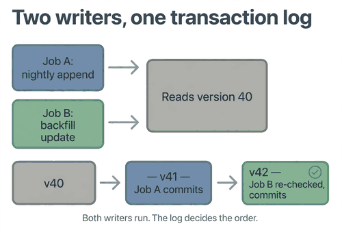
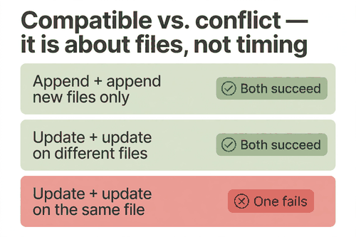
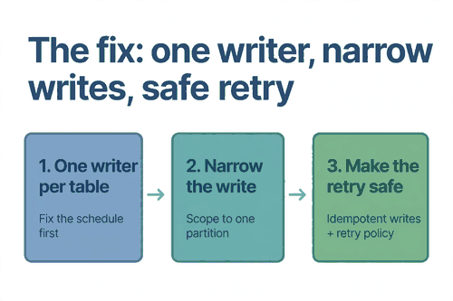

*Part of my daily Databricks series — the hardest topics, explained simply. Also published on [Substack](https://masterdataengineering.substack.com/) and in my LinkedIn newsletter, Master Data Engineering.*

Concurrent writes: optimistic concurrency and conflict resolution

Part of my daily Databricks series — the hardest topics, explained simply.

Picture this. It is 2 AM, and your phone buzzes. The nightly claims job failed.

You open the logs, expecting the usual: a bad file, a missing column, a cluster that ran out of memory. Instead you get an error you have never seen before. It says something about a concurrent transaction, mentions a table version, and tells you files were deleted by another transaction while this one was reading them.

The job ran fine for weeks. Nothing changed in the code. So what changed?

Another job did. While the claims job was writing to the member table, a backfill job was writing to the same table. Two writers, one table, same minute. One of them won. The other one failed with an error that reads like a riddle.

This is what happens when two jobs write to the same table at the same time — the part of Delta Lake nobody explains until it bites them.

A Delta table is Parquet files plus a transaction log. Every write is a new version in that log. Version 41 added a batch of rows. Version 42 updated a plan. Version 43 deleted a test row. The log is the table's memory, and every write appends one entry to it.

A single write works like this. First, the transaction reads the latest version of the table. Say it is version 40. Then it does its work — reads the files it needs, computes the new rows, writes new files to storage. Then it tries to commit. Committing means appending a new entry to the log, as version 41, listing the files added and removed.

Two writers change everything. Imagine two jobs starting at the same minute. Both read version 40. Both write their new files. Job A commits first and becomes version 41. Now Job B tries to commit — and the version it read is no longer the latest.

This is where Delta makes its decision. It does not just reject Job B. It checks what Job A actually changed, and whether Job B's work overlaps with it.

Delta calls this optimistic concurrency. Optimistic, because it assumes conflicts are rare and checks only at commit time, instead of locking the table for the whole write. Most databases lock things up front. Delta lets both writers run and sorts it out at the end.

The sorting-out is a file-overlap check. If Job A and Job B touched different files, there is no real conflict. Delta lets Job B commit as version 42, and both writes land. If they touched the same files, Delta refuses Job B, and the job fails with a concurrency error.

That distinction is the whole concept. A conflict is not "two jobs wrote at the same time." A conflict is "two jobs wrote to the same files at the same time."

That is why appends almost never conflict. An append writes brand-new files. It does not touch any existing file. Two appends to the same table, at the same minute, both succeed — each becomes its own version, one after the other.



Updates and deletes are a different story. An update rewrites the files that hold the affected rows. A delete does the same. A MERGE rewrites the files its match condition touches. If two of those operations reach for the same file, only one of them can commit.

Here is the failure that wakes people up at 2 AM. A nightly job appends the day's new claims to the claims table. A backfill job, running late that night, updates plan assignments on the same table to fix a batch of miscoded claims.

```sql
-- The nightly job: appending today's claims
INSERT INTO claims
SELECT * FROM staging_claims WHERE claim_date = current_date();
```

```sql
-- The backfill: fixing miscoded claims from last week
UPDATE claims
SET plan_code = 'PREMIUM'
WHERE plan_code = 'PREM' AND claim_date >= '2026-11-09';
```

Both jobs read version 40. The append writes new files and commits as version 41. The update has already read the files it needs to rewrite. When it tries to commit, Delta finds the overlap and refuses it.

The update fails. The backfill does not run. And if nobody retries it, the miscoded claims stay miscoded.

Here is the part that surprises people: Delta retries some of these conflicts for you. When the conflicting change is only an append — new files, nothing removed — Delta can often re-check, find no real overlap, and commit anyway. The job succeeds and you never know it happened.

But when the overlap is real — two operations rewriting the same files — there is nothing to retry automatically. No version of "try again with the same plan" works, because the plan was built on a version of the table that no longer exists. The transaction has to be re-run from scratch, reading the new latest version.

That is the error you saw at 2 AM. Not a bug. Delta doing exactly what it is designed to do: refusing to let two writers silently overwrite each other's work.

So what do you do about it? There are three fixes, in order of how much they actually help.

The first fix is to stop the collision. Most concurrent-write failures are a scheduling problem wearing a database error's clothes. Two jobs writing to the same table at the same time is a design choice, even when nobody chose it on purpose.

Look at the schedule. If the nightly append and the backfill overlap by ten minutes, move one of them. If a streaming job and a batch job both write to the same table, give the streaming job its own staging table and let the batch job merge from it. One writer per table is the simplest rule in Delta, and it prevents almost all of these failures.

The second fix is to shrink the overlap. When two writers must share a table, make them touch different files. Partitioning is the practical way to do that.

If the table is partitioned by date, and the nightly job writes today's partition while the backfill touches last week's partition, their file sets do not overlap. Both commits succeed, because Delta's check is per file, not per table. The same logic applies to MERGE: scope the match condition to the partitions you actually need to change, instead of scanning and rewriting the whole table.

```sql
-- Scoped to one partition: rewrites only that partition's files
MERGE INTO claims AS target
USING corrections AS source
ON target.claim_id = source.claim_id
  AND target.claim_date = '2026-11-09'
WHEN MATCHED THEN UPDATE SET target.plan_code = source.plan_code;
```



The third fix is to make the retry safe. Some collisions you cannot schedule away. A streaming job and an ad-hoc fix will overlap sooner or later, and one of them will fail. The question is what happens next.

A job that fails and is retried from scratch, reading the latest version, usually succeeds on the second attempt — because the other writer has finished by then. That only works if the job is idempotent: running it twice produces the same result as running it once. An append of the same batch twice creates duplicates. A MERGE keyed on a stable ID does not.

So design writes to be safe to repeat. Use MERGE with a stable key instead of blind appends for corrections. And set a retry policy on the scheduled job, so a concurrency failure at 2 AM becomes a quiet retry at 2:05, not a page.



Three rules, worth taping to the wall.

First, one writer per table whenever you can manage it. Concurrent writes are a scheduling problem before they are a database problem, and a schedule is cheaper to fix than a retry loop.

Second, when writers must share a table, narrow each write to the partitions and files it actually needs. Delta checks conflicts per file, so a narrow write collides far less often than a wide one.

Third, make every write safe to retry, and give the job a retry policy. A concurrency failure is not a data problem. It is a timing problem. The correct response is almost always "run it again, from the latest version" — and that only works if running it again is safe.

Two writers, one table, one log. Delta does not lock the table to keep them apart. It lets both run, checks the overlap at commit time, and refuses the one that would have overwritten the other's work.

Design for one writer, narrow the writes you cannot separate, and make the retry safe. Then the 2 AM page becomes a line in a log you never have to read.

When did two of your jobs last collide on the same table — and which one lost?
