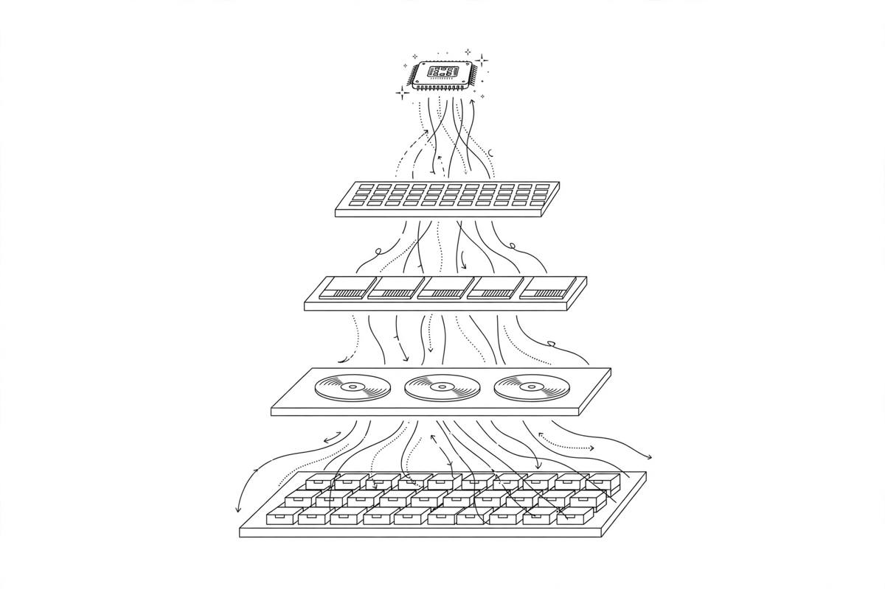

*Part of my daily series on Fundamentals of Data Engineering by Joe Reis and Matt Housley — [read the whole series](/book-series/).*

Most data engineers use storage every day and have no idea how it actually works.

I get it. The cloud hides all of it. But the moment something gets slow or expensive, you need to know what sits underneath.

First, the magnetic disk. Spinning platters, a head that moves to find your data. Cheap, a few cents per gigabyte. But slow: four milliseconds to find a random piece of data, a couple hundred megabytes a second to read. A full 30-terabyte drive takes more than 20 hours to read.

One disk is slow. Ten thousand disks reading at once are fast. That is the whole idea behind cloud object storage.

Second, the SSD. No moving parts, data stored as electric charge. Random lookups in under a tenth of a millisecond. The catch is cost, roughly ten times more per gigabyte than a disk, so for bulk analytics data, disks still win.

Third, memory. RAM sits next to the CPU and answers in about 100 nanoseconds, roughly a thousand times faster than an SSD. But it forgets everything when the power goes away, and it costs about ten dollars a gigabyte.

Then the ingredients people forget: networking and the CPU. Once storage spreads across a network, the network sets the speed. Spread data across availability zones and you get durability. Keep it close to the people using it and you get speed.

Serialization is next. Data in memory is not in a shape you can store or send, so you flatten it into a standard format. Row formats like CSV suit one-record lookups. Columnar formats like Parquet compress well and scan fast.

Compression looks simple, make the data smaller, but it does more than save disk space. Squeeze data ten to one and a disk that reads 200 megabytes a second effectively reads two gigabytes a second. The price is CPU time to compress and decompress.

And caching ties it all together. Think of storage as a ladder. CPU cache at the top answers in a nanosecond. Then RAM, then SSD, then disk, then object storage, then archival storage at the bottom, cheap, but it can take twelve hours to get your data back.

From my own work:

I live on the middle rungs of this ladder. My pipelines land data in Delta Lake on object storage, cheap disk underneath, massive parallelism on top. Parquet does the most quiet work for me: columnar layout, heavy compression, my claims data shrinks and slow scans finish fast.

Replay a month of data in a backfill and you are hammering the slow layers. Idempotent jobs and partitioned reads keep the replays off the hot path.

The takeaway: storage is not one thing. It is a ladder of trade-offs, speed against cost against durability. Know which rung you are on.

Day 31 of my read-through of Fundamentals of Data Engineering.
