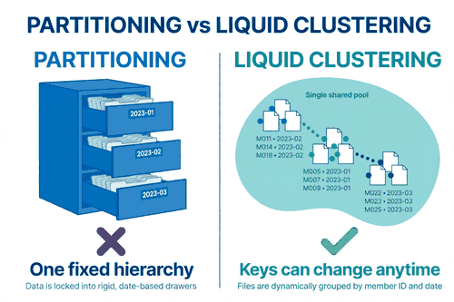
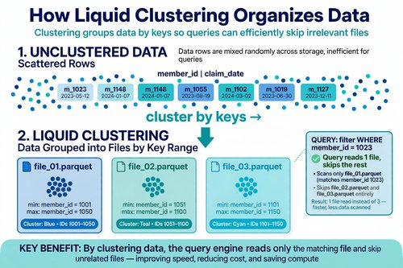
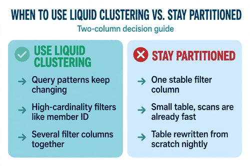

*Part of my daily Databricks series — the hardest topics, explained simply. Also published on [Substack](https://masterdataengineering.substack.com/) and in my LinkedIn newsletter, Master Data Engineering.*

Liquid clustering, under the hood: how Delta organizes your data without partitions

Part of my daily Databricks series — the hardest topics, explained simply.

Picture this. Your claims table has two billion rows, and it is partitioned by claim date.

That made sense when the table was built. Every query filtered on a date range, the partition pruning worked beautifully, and the dashboards were fast. Then the business changed its mind.

Now the most important query does not filter by date at all. It filters by member ID. A care manager opens a member's history, the dashboard asks for every claim that member ever had, and the query reads the entire table to find them.

Two billion rows, scanned, for one member.

The team does the obvious thing: repartition the table by member ID. That means rewriting two billion rows into a new layout, during a maintenance window nobody wants to schedule, and the moment they finish, someone will ask for a query filtered by provider instead.

This is the trap partitioning sets for you. The physical layout of your table is a bet on which column people will filter by. And the bet is fixed at write time.

Partitioning works like a filing cabinet. Each partition value gets its own drawer — its own directory of files. A query that names the partition column opens one drawer. A query that does not name it opens every drawer.

That is the whole mechanism, and it has three hard limits.

The first limit is that a table gets one hierarchy. You can partition by date, or by state, or by member ID — but you only get one first choice. Everything else is a second-level compromise that rarely helps.

The second limit is that changing your mind is expensive. Switching partition columns means rewriting the entire table. For a two-billion-row table, that is a weekend of compute and a migration plan.

The third limit is that partitioning is all or nothing per value. A column with fifty thousand distinct values creates fifty thousand directories. A column with three values creates three giant partitions. Neither is a good layout, and the data does not care that you tried.

Liquid clustering is Delta's answer to all three limits. It is not a small improvement on partitioning. It is a different way of thinking about how data sits on disk.

Here is the core idea. Instead of carving the table into directories by one column, you tell Delta which columns matter — the clustering keys — and Delta arranges the files so that rows with similar values across all of those keys sit together in the same files.

No directories per value. No fixed hierarchy. The layout is a property of the files, not of the folder structure.



Under the hood, it works a lot like Z-ordering. Delta maps each row's clustering-key values onto a curve that winds through the multi-dimensional space of those columns, and then sorts rows along that curve before writing them into files.

The practical effect is simple. Rows that are close together on the clustering keys end up in the same files. Rows that are far apart end up in different files.

That matters because of how Delta skips files. Every file carries min/max statistics for each column. When a query filters on a clustering key, Delta reads those statistics and skips every file whose range cannot contain a matching row.

With partitioning, that skipping only works well for the one partition column. With liquid clustering, it works for all of the clustering keys at once. A query on member ID skips files. A query on claim date skips files. A query on both skips even more.

And here is the part that changes the game: you can change the clustering keys without rewriting the table.

```sql
-- Start with the columns your queries actually filter on
CREATE TABLE claims
USING DELTA
CLUSTER BY (member_id, claim_date)
AS SELECT * FROM staging_claims;
```

```sql
-- The business changes its mind. Change the keys, not the table.
ALTER TABLE claims CLUSTER BY (provider_id, claim_date);
```

That ALTER does not rewrite two billion rows. It changes the target layout. New writes follow the new keys immediately, and the existing data gets reorganized gradually, the next time you run OPTIMIZE.

Compare that with partitioning, where the same change is a full rewrite and a maintenance window.



There is a catch, and it is the same catch as Z-ordering: clustering is not free. The layout has to be maintained. Every OPTIMIZE run spends compute reorganizing files into the new arrangement. If your data changes constantly and your queries never filter on the clustering keys, you are paying for organization nobody uses.

So when is liquid clustering the right call?

The clearest case is a table whose query patterns keep changing. Analytics tables live this life. This quarter the team filters by member, next quarter by provider, the quarter after that by plan. Partitioning forces you to pick one and suffer the others. Liquid clustering lets the layout follow the workload.

The second case is high-cardinality filter columns. Member ID has millions of distinct values — far too many for partitions, which would create millions of tiny directories. But it is exactly the kind of column clustering handles well, because it never creates directories at all.

The third case is multiple filter columns used together. A table partitioned by date helps the date filter and does nothing for the member filter. Clustering keys on both columns help both.

And when should you not use it?

Do not use it on a small table. If a full scan takes seconds anyway, no layout trick is going to matter. Do not use it when one low-cardinality column dominates every query — a table filtered by region, always, with four regions, is a partitioning table. And do not use it on a table that is rewritten from scratch every night anyway. A full rewrite already re-sorts the data, so clustering has nothing to maintain.

One more thing worth knowing: a table gets either partitioning or liquid clustering, not both. You pick one layout strategy per table. That is the trade-off in one sentence, and it is the right question to ask before you create the table: is the filter pattern stable and one-dimensional, or does it change and span several columns?



Here is the checklist I use before switching a table to liquid clustering.

First, look at the last month of queries against the table. Which columns actually appear in WHERE clauses? If the answer is one stable column, stay partitioned. If it is two or three columns that shift over time, clustering earns its keep.

Second, check the cardinality of those columns. Hundreds of thousands of distinct values or more is clustering territory. A handful of values is partitioning territory.

Third, run OPTIMIZE and watch the cost. Clustering pays for itself in query time, but the reorganization is real compute. If the OPTIMIZE bill is bigger than the query savings, the layout is not the problem — the queries are.

Fourth, remember that clustering is incremental. You do not need a big-bang migration. Change the keys, let new writes follow them, and let OPTIMIZE reorganize the old data over time. The table stays usable throughout.

Partitioning asks you to predict the future of your queries and carve it into directories. That works until the future changes, which it always does.

Liquid clustering admits that query patterns move, and builds a layout that can move with them. Same files, same statistics, same skipping — but the organization follows the workload instead of freezing it in place.

The claims table in my story never got repartitioned. It got clustering keys on member ID and claim date, and the care-manager query stopped scanning two billion rows to find one member's history.

What is the one query pattern your table's layout was never designed for?

