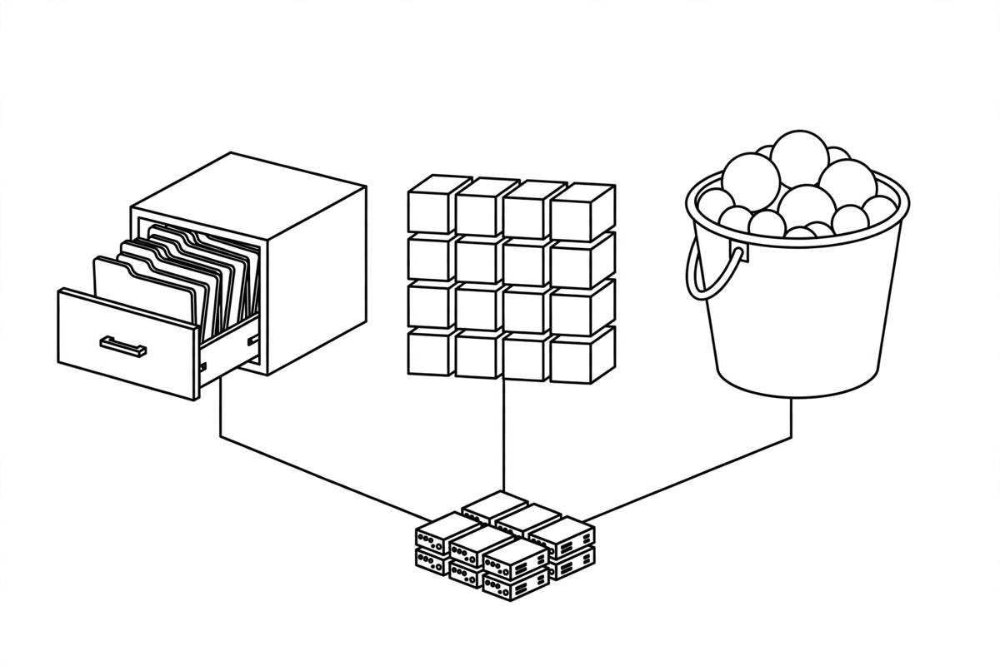

*Part of my daily series on Fundamentals of Data Engineering by Joe Reis and Matt Housley — [read the whole series](/book-series/).*

Yesterday was the raw ingredients. Today is what gets built on top: the storage systems you use.

One server is simple, but it tops out — spread data across many servers and you get distributed storage, servers coordinating to store and process at a bigger scale, keeping copies so one dead server does not take your data.

File storage is the one you know. A file is a finite stream of bytes you can read from anywhere and append to, in a directory tree. Your laptop disk, a NAS box, a managed cloud filesystem — all file storage.

Block storage is one level down. A block is the smallest chunk a disk can address, 4,096 bytes on most modern disks, and databases love blocks for fast random access. In the cloud this is the disk attached to your virtual machine. The managed kind replicates your data and survives the machine. Instance store is fast and cheap — and everything on it vanishes when the machine goes away. Good for a cache, terrible for anything you cannot rebuild.

Object storage is the one that runs modern data engineering. An object is a file-like thing with one big difference: once written, it never changes. Objects live in a bucket and are found by a key, not a directory tree. The folders in the console are an illusion — just keys with slashes. That sounds like a limitation. It is the secret. No locks, no change synchronization, so data spreads across enormous clusters and reads and writes in parallel. That is why it scales to exabytes, and why data lakes sit on it.

A write takes time to reach every copy. Strong consistency means every read returns the latest write — correct, slower. Eventual consistency is fast but might return a slightly stale copy. The book calls the eventual side BASE — basically available, soft state, eventually consistent — against the ACID world of databases. S3 used to be eventually consistent. That breaks a pipeline silently, which is why Delta Lake manages versions, updates, and deletes on top of object storage.

From my own work:

My pipelines live on object storage — Delta Lake on top, Parquet underneath. The lakehouse gives me update and delete semantics on objects that never change. Local disks are scratch space to me — a cache while a job runs, nothing more. And I treat consistency as a design decision, not a default. A backfill that rewrites a partition and reads it back must know what its storage promises. Idempotent jobs and partitioned reads keep my replays safe.

The takeaway: file, block, and object are not three brands of the same thing. They are three different deals, and consistency is the price in each one.

Day 32 of my read-through of Fundamentals of Data Engineering.
