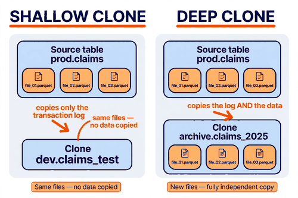
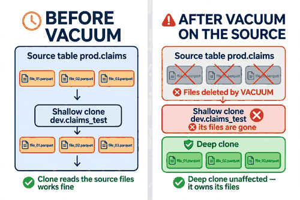
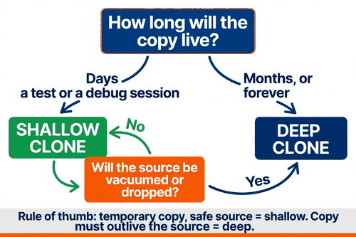

*Part of my daily Databricks series — the hardest topics, explained simply. Also published on [Substack](https://masterdataengineering.substack.com/) and in my LinkedIn newsletter, Master Data Engineering.*

Part of my daily Databricks series — the hardest topics, explained simply.

Clones: shallow vs. deep — the copy that costs almost nothing

Picture this. It is Friday afternoon, and a data scientist on your team needs a copy of the production claims table to test a new model.

Nothing exotic. She does not need new data. She needs the same data, in a sandbox, where she can break things without touching production.

The team does the obvious thing. Someone writes a CREATE TABLE AS SELECT, points it at the production table, and waits.

And waits. The table holds years of claims history. The copy job reads every row and writes every row again, into a brand-new set of files. It runs for hours. The test does not start until Monday, and by Monday the copy is already stale, because production kept moving all weekend.

Meanwhile the storage bill now has two copies of the same table in it. Same rows, twice the bytes.

This is the moment to stop and ask a different question. Why are we copying the data at all, when all she needs is a table that behaves like the production table?

That is exactly what a Delta clone is for.

A clone is a new table that starts from an existing table's state. You get a table you can query, filter, and join against, without first copying all the data underneath it.

There are two kinds, and the difference between them is the whole topic.

A shallow clone copies only the transaction log. That is the metadata: which files belong to the table, at which version.

The new table points at the same Parquet files the source table already has. No data is copied. No files are duplicated. The clone is ready in seconds, and it costs almost nothing in storage.

A deep clone copies the log and the data files. It reads every file from the source and writes a full second copy. The result is a genuinely independent table, and it costs exactly what you would expect a full copy to cost: the time to copy it, and the storage to hold it.

Here is the shallow version in one line:

```sql
-- A test copy of the claims table, ready in seconds
CREATE TABLE dev.claims_test
SHALLOW CLONE prod.claims;
```

And the deep version looks almost the same:

```sql
-- A fully independent copy, with its own files
CREATE TABLE archive.claims_2025
DEEP CLONE prod.claims;
```

Same syntax, same result on the surface: a new table with the same rows. Underneath, they could not be more different.



The shallow clone is fast and cheap because it is a trick. The clone and the source share the same files. Query the clone, and you are reading the source's Parquet files through a second table name.

That trick has a catch, and it is the one thing you have to understand before you use shallow clones in anger.

A shallow clone depends on the source's files still existing. If those files go away, the clone breaks.

When does that happen? The usual way is VACUUM. Delta keeps old file versions around for time travel, and VACUUM deletes the ones older than the retention period. Run VACUUM on the source with a short retention, and it can delete files the shallow clone is still pointing at.

Dropping the source table is the other way. Drop a managed table and its files get deleted. Any shallow clone pointing at those files breaks with it.

So a shallow clone is a short-lived thing by nature. It is a scratch copy, a debugging copy, a "let me try this for a day" copy. It is not an archive, and it is not a backup. The moment you need the copy to outlive the source, or to survive a cleanup on the source, shallow is the wrong choice.

A deep clone has no such problem. It owns its files. VACUUM the source, drop the source, rewrite the source — the deep clone does not care, because it never shared files with the source in the first place.

That independence is what you are paying for with the copy time and the storage. And sometimes it is exactly what you need.



There is one more shallow-clone trick worth knowing. You can clone a specific version of the source, not just its current state.

```sql
-- Freeze the table exactly as it was at version 42
CREATE TABLE dev.claims_debug
SHALLOW CLONE prod.claims VERSION AS OF 42;
```

This is the fastest way I know to debug a data problem. Something looked wrong in yesterday's run? Clone the table as it was yesterday, query it in isolation, and compare it against today. No restoring backups, no re-running pipelines, no waiting for a copy job. The frozen moment is a table in seconds.

So when do you pick which?

Use a shallow clone when the copy is temporary and the source is safe. A data scientist testing a model, an analyst reproducing a bug, a developer trying a new transformation on real data. The copy lives for a day or a week, the source is not going anywhere, and nobody is about to VACUUM it. Shallow is the right answer, and the full-copy approach is pure waste.

Use a deep clone when the copy has to stand on its own. Archiving a table before a major migration. Moving data to another storage location or region. Handing a snapshot to another team. Making a copy you intend to keep after the source is deleted. In all of those cases the independence is the point, and the copy cost is the price of it.

There is a simple way to decide, and it is three questions.

First, how long will this copy live? Hours or days points to shallow. Months or forever points to deep.

Second, is anything going to clean up the source? If the source gets vacuumed regularly, or might be dropped, a shallow clone is living on borrowed files.

Third, does the copy need to survive the source? If the answer is yes, even in theory, that is a deep clone. If the answer is no, shallow will do.



Here is the pattern to unlearn. The instinct to copy data before working with it is a good instinct — you should never experiment on production. But a full copy is the most expensive way to honour that instinct.

The wrong pattern looks like this:

```sql
-- The expensive habit: a full copy for a one-day experiment
CREATE TABLE dev.claims_test AS
SELECT * FROM prod.claims;
```

Hours of compute, a second copy of every file, and a snapshot that starts going stale the moment it finishes.

The fix is one word:

```sql
-- The same sandbox, without copying the data
CREATE TABLE dev.claims_test
SHALLOW CLONE prod.claims;
```

Same sandbox. Same rows. Seconds instead of hours, and no second copy of the data on the bill.

The data scientist in my story got her sandbox on Friday afternoon, not Monday morning. The model test ran against the real data, in a table she could break freely, and the production table never noticed.

The lesson is not that copying is bad. Copies are how you test safely, archive honestly, and move data between places. The lesson is that a copy is a means, not a goal — and Delta lets you pick how much copying the goal actually requires.

Shallow when the copy is temporary and the source is safe. Deep when the copy has to stand alone. One line of SQL either way, and no more waiting all weekend for a copy job to finish.

What is the biggest table your team has ever copied just to test something on it?
