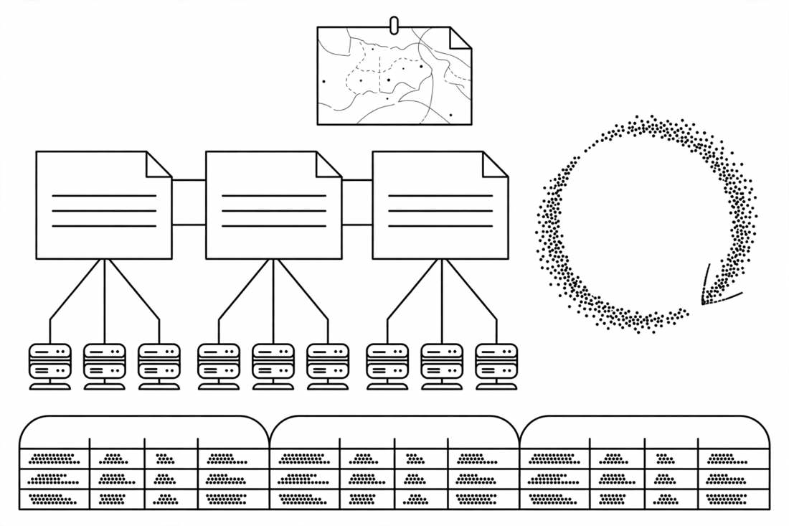

*Part of my daily series on Fundamentals of Data Engineering by Joe Reis and Matt Housley — [read the whole series](/book-series/).*

"Hadoop is dead" is the laziest sentence in data engineering.

HDFS still runs under half the pipelines people call modern. It breaks a file into blocks, copies each one three times, and keeps a map of where everything lives. A disk dies, the copies rebuild themselves. Durability by triplication.

Streaming storage flips the deal. A queue keeps data for a set time, then it is gone. Keep retention long and you get replay — re-read history, rebuild a pipeline from scratch. That is the feature I care about.

Then the finding problem: an index is a map that finds one row fast. Analytics does not look up one row, it scans millions. So columnar stores dropped indexes and split tables into partitions, usually by date, sorting similar values together so the engine skips chunks it never needs. Snowflake's micro-partitions do it automatically, its metadata catalog playing the index's role.

From my own work:

My pipelines live on Delta Lake, and date partitioning is the first thing I get right. A backfill that rewrites one day's partition instead of the whole table is the difference between a five-minute fix and an all-night rerun. I cluster on the columns my queries filter on, so the engine reads less, finishes sooner.

The takeaway: storage is not about where data sits. It is about how fast you find the piece you need and how cheaply you rebuild the rest.

Day 33 of my read-through of Fundamentals of Data Engineering.
