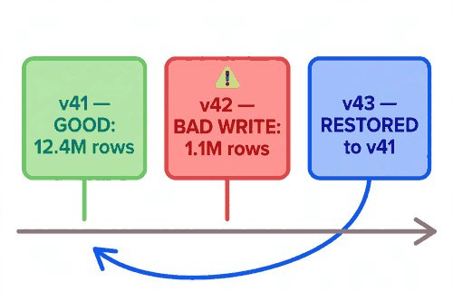
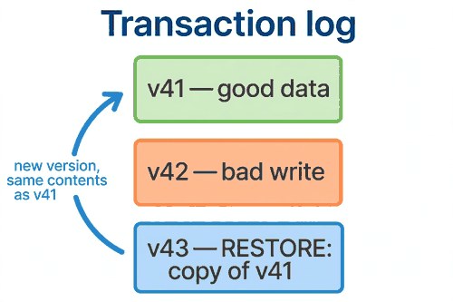

*Part of my daily Databricks series — the hardest topics, explained simply. Also published on [Substack](https://masterdataengineering.substack.com/) and in my LinkedIn newsletter, Master Data Engineering.*

Part of my daily Databricks series — the hardest topics, explained simply.

RESTORE: the undo button for a bad write

Part of my daily Databricks series — the hardest topics, explained simply.

Picture this. It is 4 PM on a Tuesday, and a pipeline run has just finished writing to your production claims table.

Except something is wrong.

The row count is half of what it should be. The dashboards that read from this table are already showing the damage. Someone on the team is already in the group chat asking why the numbers dropped off a cliff.

You check the job. The write step ran fine. No errors, no failures, green ticks all the way down.

Then you find it. The job overwrote the table, and the filter that was supposed to limit it to this month's claims was missing. Instead of replacing one month, it replaced the whole table with one month of data.

Years of claims history, gone from the table in a single write.

This is the moment that separates teams who have a recovery plan from teams who have a very long evening.

The instinct is to fix it by re-running the pipeline. Rebuild the table from scratch, reload everything from the source, hope the source still has it all, hope nothing else changed in the meantime.

That instinct is understandable, and it is usually the slowest possible answer.

Re-running a full pipeline can take hours. The source system may not keep the same history. And while you are rebuilding, the dashboards are still wrong, the downstream jobs are still failing, and the team is still waiting.

There is a better answer, and it has been sitting in Delta Lake the whole time.

Delta tables keep a history of every version. Every write creates a new version in the transaction log, and the old versions are still there, with their files, until VACUUM cleans them up.

RESTORE rewinds the table to one of those earlier versions. One command, and the table is back to exactly how it was before the bad write.

Here is what it looks like:

```sql
-- The table is currently at version 42, which is wrong.
-- Version 41 was the last good one. Go back to it.
RESTORE TABLE prod.claims TO VERSION AS OF 41;
```

That is the whole fix. No reload, no rebuild, no re-running the pipeline. The table's contents are back to version 41, and the dashboards recover with it.



It is worth understanding what RESTORE actually does, because the mental model matters the next time you are the one staring at a broken table.

RESTORE does not delete the bad version. It does not rewrite history or pretend the bad write never happened.

It creates a new version — version 43, in this example — whose contents are a copy of version 41. The log now reads: version 41 good, version 42 bad, version 43 restored to version 41.

That matters for two reasons.

First, the audit trail stays honest. Anyone looking at the history can see exactly what happened: the bad write, and the restore that fixed it. Nothing is hidden.

Second, you can undo the undo. If you restore to the wrong version, you can restore again. The bad version is still in the history, and so is every version before it. You are never one mistake away from losing the table for good.

You can also restore by timestamp instead of version number, which is handy when you know when things broke but not which version that was:

```sql
-- Go back to how the table looked yesterday at 9 AM
RESTORE TABLE prod.claims
TO TIMESTAMP AS OF '2026-11-18 09:00:00';
```

The hard part is almost never the restore itself. The hard part is knowing which version to go back to.

That is where DESCRIBE HISTORY earns its keep. It lists every version of the table, with the timestamp, the operation, and how many rows were written:

```sql
-- Read the history, find the last good version
DESCRIBE HISTORY prod.claims;
```

Look for the version just before the bad write. Check the operation column. A suspicious overwrite with a row count that does not match the pattern of the runs before it is usually your culprit.

The version right before that one is where you restore to.



There are a few things RESTORE will not do for you, and you should know them before the day you need them.

RESTORE cannot bring back files that VACUUM has already deleted. If the good version's files are gone, the restore fails. This is the real cost of an aggressive retention window — it does not just limit time travel, it limits your ability to recover.

So if your tables have a seven-day retention and a bad write sits undiscovered for eight days, RESTORE cannot save you. The files are gone. The recovery plan is the backup, if there is one.

That is why the retention setting and the restore plan are the same conversation. A short retention saves storage. It also shortens the window in which a bad write is fixable with one command.

RESTORE also restores the table's data, not its schema history or its permissions. If the bad write changed the schema in a way that breaks downstream readers, restoring the data gets the rows back, but you may still need to deal with the schema change separately.

And RESTORE works on the table as a whole. You cannot restore half a table, or one partition, or one column. If the bad write touched only one partition, you still rewind the entire table to the earlier version. Any good writes that happened after the bad one get rewound too.

That last point is the one that catches people. Say the bad write happened at 4 PM, and a good write landed at 5 PM before anyone noticed. Restoring to the pre-4 PM version also removes the good 5 PM write.

So the real recovery sequence is: restore to the last good version, then re-apply the good writes that came after the bad one. In practice that usually means re-running the one good job, which is a much smaller job than rebuilding the whole table.


Here is the pattern to unlearn.

The wrong pattern is treating a bad write as a data loss event that needs a rebuild. Re-running the full pipeline, reloading from the source, rebuilding years of history from scratch — hours of work, during which everything downstream is broken.

The fix is to treat it as a version problem, because that is what it is:

```sql
-- Wrong: rebuild the whole table from the source
-- (hours of compute, dashboards broken meanwhile)

-- Right: rewind to the last good version
RESTORE TABLE prod.claims TO VERSION AS OF 41;
```

Then re-run only the good writes that came after.

The team in my story had the table back in minutes. The dashboards recovered. The bad write stayed in the history where everyone could see it, and the postmortem was about the missing filter, not about the recovery.

But none of that works if the team has never practised it.

RESTORE is a one-line command, and it is exactly the kind of thing that looks simple until you are doing it for the first time at 4 PM with a broken table and an audience.

So rehearse it once, on a table that does not matter. Write a bad version on purpose. Find it in DESCRIBE HISTORY. Restore to the version before it. Check the row counts. Do it when nothing is on fire, so that when something is, the command is already in your hands.

A recovery plan you have never run is not a recovery plan. It is a hope.

And hope is a poor substitute for one line of SQL.

What is the worst bad write your team has had to recover from — and how long did it take?

