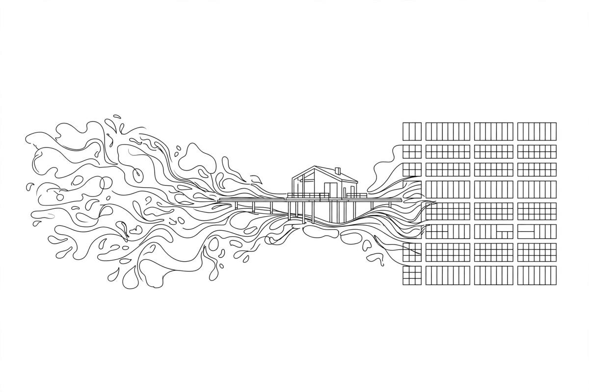

*Part of my daily series on Fundamentals of Data Engineering by Joe Reis and Matt Housley — [read the whole series](/book-series/).*

I have watched teams argue for months about warehouse versus lake. The argument was never really about the technology.

A warehouse is brilliant at one thing: structured data, governed and ready to query. But it cannot hold the messy stuff. Images, audio, raw feeds. A lake can hold all of that, cheaply, in raw form. The problem is what happens next. Without schema, without updates and deletes, a lake quietly turns into a swamp. I have seen teams store everything and find nothing.

That is why the lakehouse stuck. It keeps the lake's cheap object storage and adds back the warehouse discipline the early lakes threw away: schema, updates, deletes, table history. And because the data sits in open formats, any tool can read it. No reserializing, no lock-in tax.

From my own work:

At EXL I built on a Databricks lakehouse. Raw claims data landed in the lake, Delta tables gave it schema and versioning, and when a late file arrived I could fix just that slice instead of rebuilding everything. That one ability, updating in place, changed how fast we could move.

The takeaway: data platforms sell the same idea as a walled garden. Convenient, tightly integrated, and hard to leave. Pick your abstraction by your update pattern and your use case, not by a vendor's slide.

Day 34 of my read-through of Fundamentals of Data Engineering.
