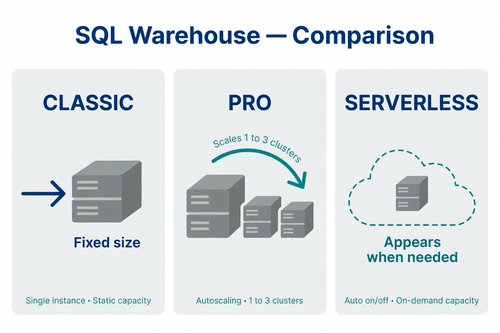
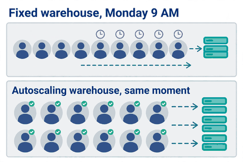
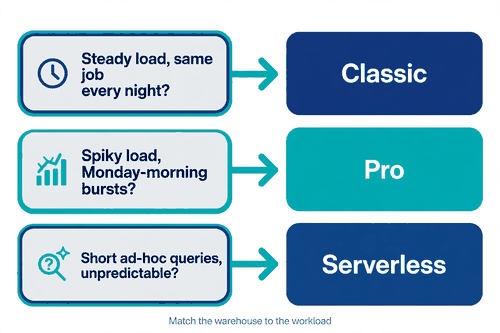

*Part of my daily Databricks series — the hardest topics, explained simply. Also published on [Substack](https://masterdataengineering.substack.com/) and in my LinkedIn newsletter, Master Data Engineering.*

Part of my daily Databricks series — the hardest topics, explained simply.

Serverless vs. pro vs. classic warehouses: pick the wrong one and you pay for it

Picture this. It is 9 AM on a Monday, and ten people open the same dashboard at the same time.

The first query finishes in seconds. The second takes a little longer. By the fifth, the little spinner is just sitting there, and someone in the team chat is asking whether the dashboard is broken.

It is not broken. The queries are queueing.

The warehouse underneath the dashboard can only run so many queries at once. When the tenth person opens the dashboard, their query waits in line behind the other nine. Nobody changed anything. The dashboard did not get slower. Monday morning just arrived, and the warehouse was sized for a quiet afternoon.

This is the part of Databricks SQL that trips up almost every team, and it has nothing to do with the query itself. The query is fine. The warehouse underneath it is the wrong shape for the job.

There are three kinds of SQL warehouse in Databricks, and they are not three sizes of the same thing. They are three different answers to the question of who manages the compute.

A classic warehouse is the simplest one. You pick a size — small, medium, large — and that is what you get. One fixed cluster, running at that size, until you change it or turn it off. It does the job, and it is the cheapest of the three, but it cannot grow. If ten people show up at once, the tenth query waits.

A pro warehouse adds autoscaling. You set a minimum and a maximum number of clusters, and Databricks adds clusters when the queue builds up and removes them when it clears. It also turns on Photon by default, which speeds up the scans, filters, and aggregations that most dashboard queries are made of. It costs more than classic, and it earns that money exactly on Monday mornings.

A serverless warehouse removes the cluster from your life entirely. There is nothing to size, nothing to start, nothing to stop. You run a query and compute appears, scales up and down on its own, and disappears when the query finishes. It starts fast and it is the easiest of the three to live with. It is also the most expensive per unit of compute, because you are paying for that convenience.



Here is the mistake I see most often. A team picks one warehouse type and uses it for everything.

Usually it goes like this. Someone creates a classic warehouse because it is the cheapest option on the screen, and it becomes the default for the whole workspace. Dashboards run on it. Ad-hoc exploration runs on it. The nightly batch job that rebuilds the reporting tables runs on it. It works fine for weeks, right up until the morning when everyone uses it at once and the queue forms.

Or the opposite. A team hears serverless is the modern choice, puts everything on it, and then wonders why a long, steady job that runs for hours every night costs more than it used to. Serverless is brilliant for spiky, unpredictable work. For a job that runs flat-out for hours at a steady pace, you are paying a premium for instant scaling you never use.

Neither warehouse is bad. The mistake is choosing on a single dimension — usually sticker price, or whatever someone recommended in a blog post — instead of matching the warehouse to the shape of the work.

The shape of the work is the whole decision, and it comes down to three questions.

First, how spiky is the load? If usage is steady and predictable — the same nightly job, the same reports at the same hour — a fixed-size classic warehouse fits, because you are paying for capacity you actually use. If usage comes in bursts — Monday mornings, month-end, a dashboard launch — you want something that can grow, which means pro or serverless.

Second, how long do queries run? Short, interactive queries love serverless, because the warehouse is there the moment you ask and gone the moment you are done. Long, heavy jobs that run for hours are usually cheaper on a warehouse you sized yourself, because you are not paying the serverless premium for the whole run.

Third, who is paying attention? A classic warehouse needs someone to watch it. Someone has to notice it is too small and resize it, or notice it has been running idle all weekend and stop it. Pro and serverless take that job off your plate. If nobody on your team owns warehouse sizing, that alone is a reason to pay for the automation.



Here is how the fix looks in practice. You do not need one warehouse. You need one per workload shape.

The dashboards that the whole company opens at 9 AM get a pro warehouse with autoscaling — a minimum of one cluster, a maximum of three, and an auto-stop after ten idle minutes:

```json
{
  "name": "dashboards-pro",
  "warehouse_type": "PRO",
  "cluster_size": "Small",
  "min_num_clusters": 1,
  "max_num_clusters": 3,
  "auto_stop_mins": 10,
  "enable_photon": true
}
```

The nightly batch job that rebuilds the reporting tables at a steady pace gets a classic warehouse, sized to the job, because the load never spikes and nobody needs it to scale. The ad-hoc exploration — the analysts poking at data, running a query, thinking, running another — gets a serverless warehouse, because those sessions are short, unpredictable, and nobody wants to wait for a cluster to start just to check a hunch.

That is the pattern. Small, separate warehouses, each matched to the shape of its workload, instead of one big warehouse carrying everything.

It also makes the bill readable. When the dashboard warehouse costs too much, you can see it is the dashboard warehouse, not a mystery line item shared by five teams. When the batch job gets slower, you know exactly which warehouse to resize.

There are two traps left, and both are easy to fall into even after you get the types right.

The first is auto-stop. A warehouse that never stops is a warehouse that bills all weekend. Ten minutes of idle time is a sensible default for dashboards. For a warehouse that analysts use all day, a longer window avoids the annoyance of waiting for a restart every time someone goes to lunch. The wrong answer is no auto-stop at all, which is how a cluster runs from Friday to Monday with nobody using it.

The second is the maximum on a pro warehouse. Autoscaling is only as good as the ceiling you give it. A maximum of one cluster is not autoscaling — it is a classic warehouse wearing a pro label. Set the maximum from the busiest hour you actually see, not from the quietest one. If the queue forms every Monday at 9 AM, the maximum is too low, whatever it says on the screen.



None of this is complicated. That is what makes it so easy to get wrong. Picking a warehouse feels like a five-minute admin decision, so nobody treats it like a design decision. Then the dashboards queue on Monday morning, the bill surprises someone in finance, and a team spends a week tuning queries that were never the problem.

So here is the simple version. Classic is a fixed room: cheap, and exactly the size you built. Pro is a room that grows when more people arrive. Serverless is a room that appears when you need it and vanishes when you do not.

Pick the room that matches the crowd.

If you run dashboards on Databricks, go and look at which warehouse they are actually running on right now. Not the one you think they are on. The one in the settings.

Did anyone choose it on purpose — or did it just end up that way?
