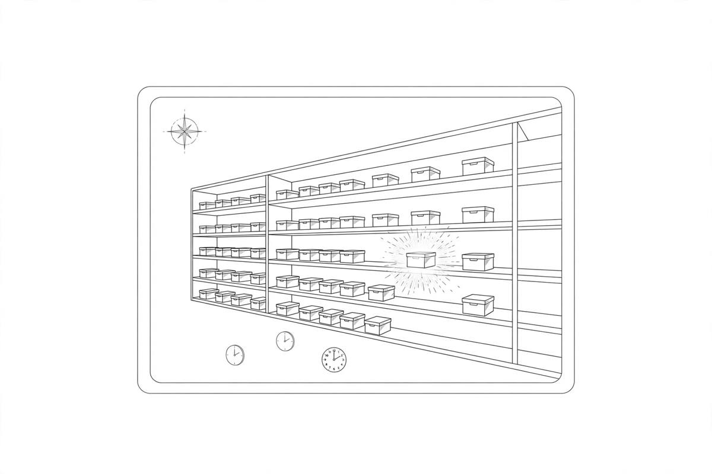

*Part of my daily series on Fundamentals of Data Engineering by Joe Reis and Matt Housley — [read the whole series](/book-series/).*

Storage is the cheapest part of data engineering. Knowing what you stored is the expensive part.

Teams celebrate how cheap object storage is, then dump everything in and call it a lake. Six months later, nobody can find the table they need, nobody knows what a column means, and the "just in case" data is still sitting there, costing money every month.

That is what a catalog is for. Not a fancy tool. A map. And schema is the key to the map — it tells the next person how to read what you wrote. Without it, your lake is a swamp with cheap rent.

Then there is the other half nobody likes to talk about: letting go. Data has a temperature. The stuff people query every day stays hot. The rest cools down, and some of it should be deleted on a schedule, not kept forever because deleting feels risky.

From my own work:

At EXL I built on a Databricks lakehouse. Raw claims landed in the lake, Delta tables gave them schema and versioning, and that discipline is what kept the data usable months later. In healthcare, some data has to be kept for years because the rules say so. The rest is a bill and a risk if you hoard it.

The takeaway: store less, label everything, delete on schedule.

Day 35 of my read-through of Fundamentals of Data Engineering.
