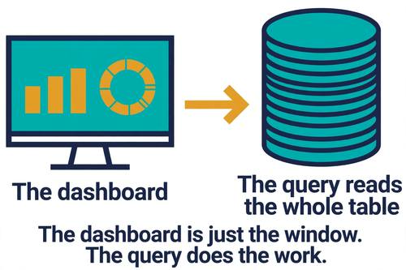
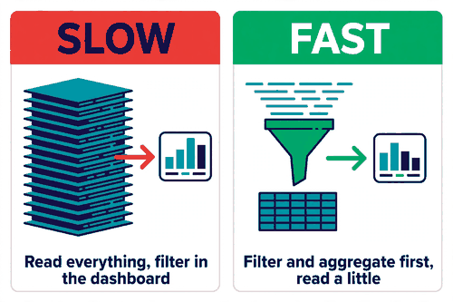
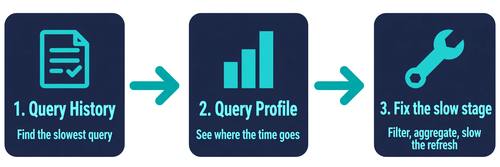

*Part of my daily Databricks series — the hardest topics, explained simply. Also published on [Substack](https://masterdataengineering.substack.com/) and in my LinkedIn newsletter, Master Data Engineering.*

Part of my daily Databricks series — the hardest topics, explained simply.

Why your dashboard is slow: it's the query, not the visualization

Picture this. It is 9 AM, and an executive opens the revenue dashboard before the weekly meeting.

The spinner turns. And turns. Thirty seconds in, someone in the room says the dashboard is broken.

Nobody blames the data. Nobody blames the query. They blame the dashboard, because the dashboard is the thing they can see.

I have watched this exact scene play out more times than I can count. A team spends a week rebuilding the dashboard — new charts, new layout, fewer widgets — and the spinner is still there on Monday morning. The dashboard was never the problem. The dashboard is a window. The query behind it is doing the work, and the query is slow.

Here is the mental model that fixes this. A dashboard does almost no work of its own. It sends a SQL query to the warehouse, waits for the answer, and draws the result. If the query takes forty seconds, the dashboard takes forty seconds. No amount of chart redesign changes that number.

So the first move is not to touch the dashboard at all. It is to find the query.

Databricks keeps a record of every query that runs. In the SQL editor, open Query History, sort by duration, and look at the slowest runs from the morning. The dashboard's queries will be right there at the top, usually with names you recognise from the widgets. Click the slowest one and open its query profile.

The profile tells you the story in three numbers.

First, how much data did the query read? If a dashboard that shows one month of revenue read the entire history of the table, that is the first red flag. The query asked for a glass of water and drank the whole tank.

Second, how long did each stage take? The profile breaks the query into stages. Usually one stage eats almost all the time. That stage is where the fix lives. Everything else is noise.

Third, did the query shuffle? If it grouped or joined large tables, the profile shows the shuffle size. A big shuffle on a dashboard query is almost always a sign the data was not prepared before the dashboard asked for it.

Now look at what the query actually says. Here is the pattern I see most often, the slow version:

```sql
SELECT *
FROM sales_transactions
WHERE region = 'Northeast'
```

That looks harmless. It is not. It reads every column of every row in the table, then throws most of it away. If the table holds years of transactions, the dashboard is paying to read all of it just to show one region's last month.

And it usually gets worse. The date filter is missing, so the query reads all of history. The aggregation happens inside the dashboard tool, so the warehouse ships millions of rows across the network and the dashboard adds them up. The dashboard refreshes every few minutes, so the same heavy query runs over and over, all day, for every person who opens the page.



The fix is not a bigger warehouse. A bigger warehouse makes a bad query finish faster, and then you pay for the bigger warehouse on every single refresh. The fix is to make the query ask for less.

Start with the filter. Push it into the query, on a column the table is organised by — usually the date. A dashboard showing the last thirty days should never touch older data:

```sql
SELECT
  date,
  region,
  SUM(revenue) AS revenue
FROM sales_transactions
WHERE date >= current_date() - 30
  AND region = 'Northeast'
GROUP BY date, region
```

That one change does three things at once. The date filter lets the engine skip the files it does not need. The aggregation happens in the warehouse, so only a few dozen rows travel back instead of millions. And the dashboard stops doing arithmetic it was never good at.

Then ask the next question: does this dashboard really need to run the query live every time someone opens it? Most dashboards show numbers that change once a day, when the overnight pipeline runs. If that is true, precompute the answer. Build a small aggregated table once — daily revenue by region, say — and point the dashboard at that. The dashboard query becomes a tiny read of a tiny table, and it finishes before anyone notices the spinner.

That is the real split. Dashboards should read answers. Pipelines should compute them. The moment a dashboard starts computing — aggregating millions of rows, joining fact tables, filtering in the visualisation layer — you have put the heavy work in the worst possible place.



There are two more things worth checking before you declare victory.

The first is the refresh schedule. A dashboard set to refresh every five minutes runs its queries twelve times an hour, whether anyone is looking or not. If the numbers only change daily, set the refresh to daily. You will cut the warehouse load by an order of magnitude without changing a single query.

The second is result caching. When the same dashboard is opened by ten people in the same meeting, the warehouse does not need to run the same query ten times. Databricks caches query results, so the second person to open the dashboard gets the answer instantly. But the cache only helps if the query is identical — same filters, same parameters. If every user tweaks a filter slightly, every open is a fresh run. Keep the default view fixed and let the cache do its job.



So here is the checklist I run through whenever someone tells me a dashboard is slow.

First, find the query in Query History and read its profile. How much data did it read, and where did the time go?

Second, check the filter. Is there a date filter, on a column the table is organised by? If not, add one.

Third, check the aggregation. Is the warehouse summing millions of rows so the dashboard can show twelve numbers? Move the aggregation into a precomputed table.

Fourth, check the refresh. Is the dashboard re-running a heavy query every few minutes for data that changes once a day? Slow the refresh down.

Fifth, check the cache. Are ten people running the same query ten times? Keep the default view identical so the cache kicks in.

None of this requires rebuilding the dashboard. The charts were fine. The layout was fine. The problem was always underneath, in a query that read too much, aggregated too late, and ran too often.

Next time the spinner shows up in a meeting, skip the dashboard redesign. Open Query History first. The query will tell you exactly what is wrong, and it is usually a smaller fix than anyone expects.

What is the slowest dashboard in your workspace — and have you ever looked at what its query actually reads?
