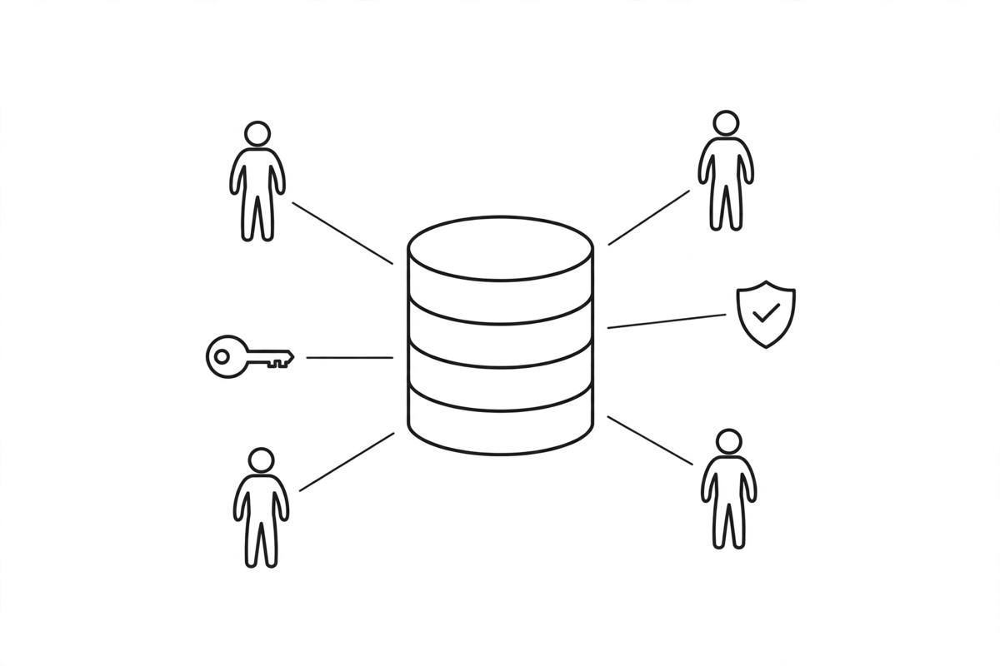

*Part of my daily series on Fundamentals of Data Engineering by Joe Reis and Matt Housley — [read the whole series](/book-series/).*

Storage is never just a technical choice. It is a negotiation with half the company.

The book makes a point I wish someone had told me earlier. Storage sits at the heart of everything, so the data engineer ends up working with DevOps, security, and cloud architects. And the first job is agreeing who owns what. Can you deploy in the cloud account yourself, or does another team have to do it? If that line is fuzzy, every change turns into a ticket queue.

The undercurrents matter most when data is at rest, not in motion. Security is not a blocker. It is what lets you share data more widely. Least privilege, column and row level access, give people only what they need and no more. A catalog and lineage, so the next person can find the table and trace a bad number back to its source. Versioning, so a bad write can be rolled back. And monitoring the data itself, not just the disks.

From my own work:

At EXL I built on a Databricks lakehouse where claims data sat in Delta tables. I was the one answering when an analyst could not find a table, or when access had to be tightened because the data was PHI. In healthcare you cannot hand someone full access and hope for the best.

The takeaway: storage is a team sport. Define who owns what, lock it down properly, and document it. Or the lake becomes a swamp nobody can use.

Day 36 of my read-through of Fundamentals of Data Engineering.
