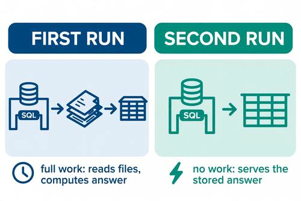
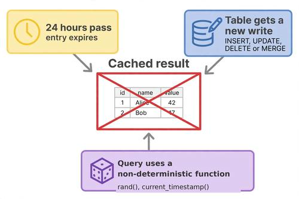

*Part of my daily Databricks series — the hardest topics, explained simply. Also published on [Substack](https://masterdataengineering.substack.com/) and in my LinkedIn newsletter, Master Data Engineering.*

Part of my daily Databricks series — the hardest topics, explained simply.

Query result caching: why the second run is instant

Picture this. It is Monday morning, and the weekly operations meeting starts in five minutes.

Someone opens the claims dashboard. The first load takes forty seconds. The room waits, the spinner turns, and the meeting starts late.

Then the next person opens the same dashboard on their own laptop. It loads instantly. Same dashboard, same numbers, no spinner.

Someone says, "Did you fix it?" Nobody fixed anything. The second load was fast because the warehouse never ran the query. It remembered the answer.

That is query result caching. It is the simplest performance feature in Databricks, and also the one that confuses people the most — because people treat the cache like a faster warehouse, when it is really a memory of answers.

When you run a query on a SQL warehouse, Databricks does the full work: it reads the files, filters, joins, aggregates, and produces a result. Then it quietly stores a copy of that final result before handing it to you.

Run the exact same query again, and the warehouse checks the stored copy first. If it is there, it hands it back without touching the data at all — no scan, no shuffle, no compute. That is why the second load feels instant: the warehouse did not get faster, it did no work.

This is different from the other caches in Databricks, and mixing them up is where most confusion starts.

The disk cache stores data files on the warehouse's local SSDs, so the next query reads from fast local disk instead of cloud storage. The Spark cache stores DataFrames in memory when you ask for it. Both speed up the work.

The result cache is different. It does not speed up the work. It skips it entirely, by storing the finished answer. That is why it is so fast — and why it only helps when the same question gets asked more than once.



Now, the part everyone gets wrong: the cache does not last forever. A cached result lives up to 24 hours. After that it expires, and the next run does the full work again.

But expiry is not the only way a cached result disappears. The cache is tied to the data it came from. If any table in the query gets a new write — an insert, an update, a delete, a merge — the cached result is invalidated immediately, and the next run recomputes from scratch.

That invalidation is automatic, and it is why the cache is safe to leave on. You do not get yesterday's numbers after the overnight pipeline loads fresh data: its write kills the old cache entry, and the morning's first dashboard load builds a new one.

So when does the cache bite people? In three specific ways, all with the same root cause: the query you ran is not the query you think you ran.

The first way is the dashboard filter. Ten people open the same dashboard, and the cache only helps if the query is identical — same text, same parameters. If every person tweaks a filter slightly, every open is a brand-new query doing the full work.

This is also why a published dashboard with embedded credentials behaves differently from a draft. With embedded credentials, everyone shares one cache, because everyone runs the same query as the same user. Without them, each viewer has their own cache, because each viewer runs it as themselves. Same dashboard, very different caching.

The second way is the warehouse restart. On a classic or pro warehouse, the local result cache lives in memory on the warehouse itself. Stop the warehouse, and the cache goes with it. The first query after a restart is always a full run.

Serverless warehouses have an extra layer for this: a remote result cache that lives outside any single warehouse and survives restarts. It is shared across all the warehouses in the workspace. So a query cached by one serverless warehouse can be served instantly by another. That is a real difference between warehouse types, and one of the quiet reasons serverless dashboards feel snappier after a cold start.

The third way is the function that cannot be cached at all. If your query calls a function whose answer changes every time it runs — `rand()`, `current_timestamp()`, anything non-deterministic — the result cache steps aside, because there is no point storing an answer that would be wrong a second later. The query runs fresh every time.

Here is the wrong pattern I see most often. Someone is benchmarking a query — trying to prove an optimisation made it faster — and runs it three times, taking the best time. The first run takes forty seconds. The second takes one second. They declare a huge speedup and move on.

They measured the cache, not the optimisation — the second run never touched the data. If you are benchmarking, turn the cache off first:

```sql
SET use_cached_result = false;
```

Run your test, then turn it back on. That setting exists for testing and benchmarking, and that is the only time you should touch it. In production, leave the cache alone — it is on by default for a reason.



So how do you use the cache well, instead of fighting it? The rules are simple, and they are all about keeping the question identical.

First, keep the default view of a dashboard fixed. If the dashboard opens with the same filters every time, the first person to open it pays the cost, and everyone after that gets the answer for free. The moment every user lands on a different default, the cache stops helping.

Second, do not fight the 24-hour clock. If your data changes once a day, the cache is perfect: the first load after the pipeline runs rebuilds it, and every load after that is instant. If your data changes every few minutes, the cache keeps invalidating itself. That is not a cache failure. It is a workload the cache was never built for.

Third, remember the restart. If your warehouse stops overnight and the first person in at 9 AM complains the dashboard is slow, that is not a regression. The cache was empty, and the first run rebuilt it. A scheduled query that runs the dashboard's queries before people arrive — a warm-up — fixes this, and costs almost nothing.


One more thing, said plainly: the result cache does not make a bad query good. It makes a repeated query cheap. If your dashboard query scans years of data to show one month, the cache hides that cost on the second load — and the first person to open it every morning still waits forty seconds.

Fix the query first, the way the earlier articles in this series describe. Then let the cache do what it is good at: making the second, third, and tenth run of a good query feel instant.

So here is the checklist I run through whenever someone tells me a dashboard is fast for one person and slow for another.

First, is the query identical? Same text, same filters, same parameters. If not, that is your answer.

Second, did the data change? A fresh write invalidates the cache, and the next run pays the full cost. That is correct behaviour, not a bug.

Third, did the warehouse restart? A cold warehouse has an empty cache. The first run rebuilds it.

Fourth, does the query use a non-deterministic function? If it does, it never caches, and re-running it will never get faster.

Fifth, are you benchmarking? Turn the cache off with `SET use_cached_result = false`, or you are measuring the cache, not the query.

The cache is not magic. It is a memory of answers, kept for a day, thrown away the moment the data changes, and only useful when the same question gets asked twice. Once you see it that way, the mystery disappears: the second run is instant because the warehouse already knows the answer, and the first run is slow because somebody has to compute it.

When was the last time a dashboard felt fast for you and slow for the person next to you — and did you check whether you were both asking the same question?
