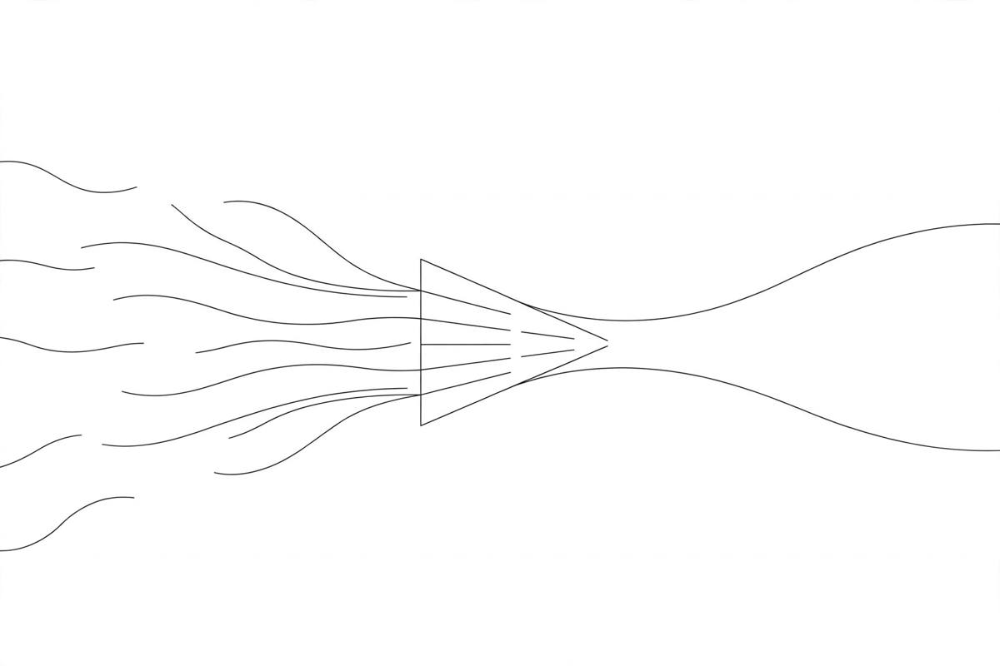

*Part of my daily series on Fundamentals of Data Engineering by Joe Reis and Matt Housley — [read the whole series](/book-series/).*

Ingestion is where a pipeline stops being a diagram and starts being real work.

Everything before it is just a source system doing its own thing. Ingestion is the first step I actually design. And the book makes a point I keep coming back to: before you move a single byte, ask the boring questions. What is this data actually for? Where is it going? How often does it need to refresh? How much of it is there, and is it even in good shape?

Skip those questions and you end up moving the same dataset three times, in three formats, for three teams, and nobody trusts any of it.

One idea that stuck with me: all data is unbounded until you bound it. A claims feed never stops. It only looks like a batch because someone drew a line around a day of it. The moment you forget that, you build a pipeline that breaks the first time a file arrives late or twice.

From my own work:

At EXL I ran batch ingestion with Airflow into Delta tables, claims and EHR feeds that never arrived clean. Schema drift, late files, duplicates. The pipelines that survived were the ones built idempotent from the start. Rerun a backfill and it lands exactly once. No double-counted members.

The takeaway: ingestion is not a connector choice. It is a set of questions you answer before you pick the connector. Get those right and the rest of the pipeline has a chance.

Day 37 of my read-through of Fundamentals of Data Engineering.
