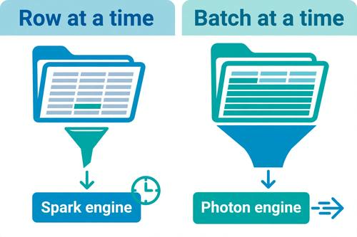
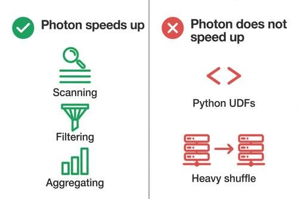
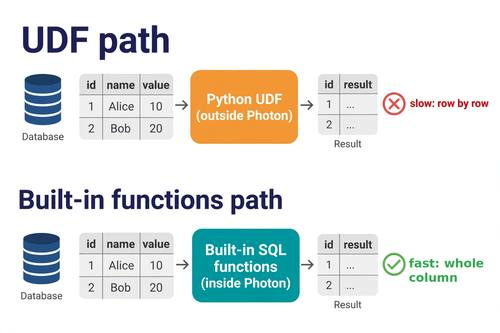

*Part of my daily Databricks series — the hardest topics, explained simply. Also published on [Substack](https://masterdataengineering.substack.com/) and in my LinkedIn newsletter, Master Data Engineering.*

Part of my daily Databricks series — the hardest topics, explained simply.

Photon on SQL warehouses: why some queries fly and others don't

Picture this. A team moves its dashboards onto a SQL warehouse, and the first morning is a surprise in both directions.

One dashboard — a monthly claims summary over a big table — goes from slow to instant. People notice. Someone says the new warehouse is magic.

Another dashboard — a member lookup that runs a custom function on every row — barely moves at all. Same warehouse, same data, same morning. People notice that too. Someone says the new warehouse is a waste of money.

Both reactions are wrong. The warehouse did not get magic, and it did not get worse. Something inside it sped up one query and left the other one alone. That something is Photon, and understanding what it touches — and what it does not — explains the whole morning.

Here is the simple version. A SQL warehouse runs your queries with an engine. On Databricks, that engine has two gears. The regular gear is Spark, the engine you already know. The second gear is Photon, a newer engine that does the same work in a fundamentally faster way.

Photon is on by default on SQL warehouses. You do not turn it on, you do not pay extra for it, and you do not write different SQL to use it. If your query can run on Photon, it does. If it cannot, it falls back to regular Spark, quietly, and you get the same answer at the old speed.

So the question is never "is Photon on?" It is always "did Photon actually run my query?"

To answer that, you need the mental model of what Photon does differently. Regular Spark processes data roughly one row at a time. It reads a row, applies the filter, does the maths, and moves on to the next row. That is fine for small data. On a table with millions of rows, it is a lot of tiny steps.

Photon processes data in batches. It reads a whole block of values from a column at once, applies the filter to the entire block in one go, and aggregates the block together. The work is the same, but the engine does it in chunks instead of drips. On the kind of work a dashboard does — scan a big table, filter it down, add things up — that change is dramatic.

That is the first thing to know: Photon is a speed-up for the bread and butter of SQL. Scanning, filtering, aggregating, joining. The queries that spend their time reading columns and crunching numbers are exactly the queries Photon was built for. The claims summary dashboard is that kind of query.

The member lookup dashboard is not that kind of query. And that is the second thing to know: Photon has a list of things it does not do, and when your query hits one of them, Photon steps aside.

The biggest item on that list is the user-defined function. A Python UDF, or any custom function you wrote, runs outside Photon. Photon cannot look inside your function and batch it up, so it hands that part of the query back to regular Spark. If your query spends most of its time inside a UDF, Photon barely gets a look in, and the query runs at the old speed.

This is the pattern I see most often. Someone needs to clean up a messy text field — say, a diagnosis code with inconsistent formatting — and writes a Python function to do it, then calls it on every row:

```sql
SELECT
  clean_code(diagnosis_code) AS code,
  COUNT(*) AS members
FROM claims
WHERE service_date >= current_date() - 90
GROUP BY clean_code(diagnosis_code)
```

That query looks like one query, but it is really two engines doing two jobs. Photon scans and filters the table fast. Then every single row passes through the Python function, one at a time, outside Photon. The function is the bottleneck, and Photon cannot help it.



The fix is almost always the same: do the work with the built-in functions the engine already understands. Databricks SQL has a large library of them — string functions, date functions, conditional logic — and Photon knows how to batch all of them. The same cleanup, written with built-ins, stays inside Photon from start to finish:

```sql
SELECT
  UPPER(TRIM(diagnosis_code)) AS code,
  COUNT(*) AS members
FROM claims
WHERE service_date >= current_date() - 90
GROUP BY UPPER(TRIM(diagnosis_code))
```

Same result, same logic, completely different engine path. The first version pays the one-row-at-a-time tax on every row. The second version lets Photon process the whole column in batches. I am not going to quote a speedup number, because it depends on the data — but the shape of the difference is real, and it is the difference between a dashboard that flies and one that does not.

That is the rule of thumb, and it is worth memorising: if your query is built from the functions SQL already has, Photon can probably accelerate it. If your query leans on a custom function, Photon probably cannot.

There are two more cases worth knowing about, because they confuse people in the same way.

The first is the tiny query. Photon is a batch engine, and batches have a small amount of setup cost. On a query that reads a handful of rows, that setup costs more than it saves. Photon earns its keep on big scans, not small ones. If someone shows you a benchmark where Photon made no difference, check the size of the data first. A small table is not a fair test.

The second is the shuffle-heavy query. Photon speeds up the work inside each machine — the scanning, the filtering, the aggregating. It does not make data move between machines any faster. A query that joins two enormous tables and shuffles most of the data across the cluster is still paying the shuffle cost, Photon or not. If your query is slow because of a giant shuffle, the fix is the same as it always was: filter earlier, or aggregate before you join.



So how do you check whether Photon actually ran your query? You do not guess. You look at the query profile.

Open the query in Query History, and look at its profile. The plan shows which parts ran on Photon and which fell back to regular Spark. If you see your UDF sitting outside the Photon section, that is your answer: the function is the bottleneck, and no warehouse setting will fix it. Rewrite the function with built-ins, and run the query again.

Here is the checklist I run through whenever a query is slower than I expected on a SQL warehouse.

First, look at the profile. Did Photon run the query, or did part of it fall back to Spark? If it fell back, find out why before you change anything else.

Second, look for a UDF. Is there a custom function in the query? If there is, that is the most likely reason Photon stepped aside. Rewrite it with built-in functions and measure again.

Third, look at the size of the data. Is this a small lookup that was already fast? Photon is not a small-query accelerator. Judge it on the big scans, where it earns its keep.

Fourth, look at the shuffle. Is the query moving huge amounts of data between machines? Photon does not fix shuffle. Filter earlier, aggregate before the join, and keep the data movement small.

Fifth, remember what Photon does not change. It does not change your results, your SQL, or your data. Same query, same answer, different speed — and only for the parts of the query it can run.

Photon is not magic, and it is not a waste of money. It is a faster gear already switched on in your warehouse, waiting for queries it can actually run. The queries that fly are written in the language Photon understands: plain SQL, built-in functions, big scans, honest aggregations. The queries that do not fly route around it — a custom function here, a giant shuffle there — and then blame the warehouse for speed they never gave it a chance to deliver.

Which query in your workspace is still slow on a SQL warehouse — and have you checked whether Photon ever got to run it?


