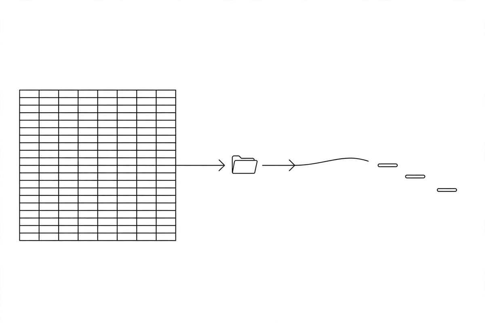

*Part of my daily series on Fundamentals of Data Engineering by Joe Reis and Matt Housley — [read the whole series](/book-series/).*

Most batch pipelines break on a decision nobody remembers making: full snapshot, or just the changes since last time?

A snapshot grabs the whole table every run. Dead simple, which is why it is everywhere. But it gets expensive fast once the table grows, and you move the same rows night after night for nothing.

Differential pulls only what changed. Cheaper, but it only works if you can trust your watermark. One bad timestamp and you silently lose rows.

Same story with files. A lot of ingestion is still files dropped in a bucket or over SFTP. The source team controls what leaves their system. You never touch their database directly. Boring, and it works.

Then ETL versus ELT. Transform before you load, or load the raw data and transform it later. On a lakehouse I load raw first. Storage is cheap, and keeping the raw file means I can re-derive anything later.

From my own work:

At EXL I ran Airflow batch jobs into Delta tables on claims and EHR feeds. Reference tables came in as full snapshots every night. The big claims tables came in differential, keyed on an updated timestamp. Every job was built idempotent, so a file arriving twice still landed once.

The takeaway: batch ingestion is not one pattern. Four small choices — snapshot or differential, files or a connection, transform now or later, big batches or small ones — and each has a cost you pay later.

Day 38 of my read-through of Fundamentals of Data Engineering.
