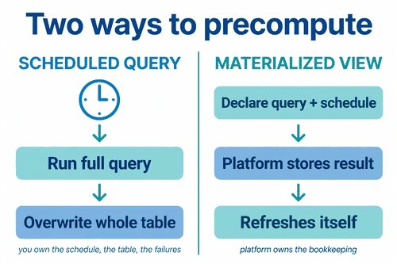
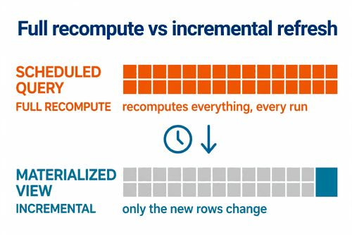
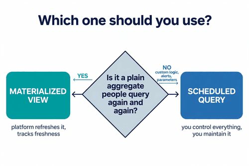

*Part of my daily Databricks series — the hardest topics, explained simply. Also published on [Substack](https://masterdataengineering.substack.com/) and in my LinkedIn newsletter, Master Data Engineering.*

Part of my daily Databricks series — the hardest topics, explained simply.

Materialized views vs. scheduled queries: stop recomputing the same dashboard

Picture this. A team has a dashboard that shows monthly claims by category. It reads a big table, groups millions of rows, and takes a few minutes to load. Every time someone opens it, the whole aggregation runs again from scratch.

Two engineers decide to fix it, and they fix it two different ways.

The first one sets up a scheduled query. It runs the same aggregation every hour and writes the result into a small reporting table. The dashboard points at the small table instead of the big one, and it loads instantly.

The second one creates a materialized view. It holds the same precomputed result, refreshed on a schedule, and the dashboard points at it instead. It also loads instantly.

On day one, both fixes look identical. Fast dashboard, happy team, problem solved.

Six months later, they do not look identical at all. One of them has quietly become a maintenance headache, and the other one just keeps working. The difference between them is worth understanding before you pick one, because you will pick one of them for almost every dashboard you ever build.

Here is the simple version. A scheduled query is your SQL on a clock. You write the query, you pick the schedule, and you tell it where to put the result — usually a reporting table that the dashboard reads. The platform runs it when the clock says so. Everything else is yours: the destination table, the overwrite logic, what happens when it fails, and how anyone knows whether the data is fresh.

A materialized view is a table the platform manages for you. You declare the query and the refresh schedule, and Databricks stores the precomputed result and keeps it up to date. You do not write the overwrite logic. You do not build the failure handling. The refresh is part of the object itself.

That difference sounds small. In practice, it decides how much of your time the thing eats over its lifetime.

Let me show you the scheduled query version first, because it is the one most people reach for. It looks like this:

```sql
CREATE OR REPLACE TABLE monthly_claims_summary AS
SELECT
  category,
  date_trunc('month', service_date) AS month,
  COUNT(*) AS claims,
  SUM(paid_amount) AS total_paid
FROM claims
GROUP BY category, date_trunc('month', service_date)
```

Run that on a schedule — every hour, say — and your dashboard reads `monthly_claims_summary` instead of the raw table. Fast, simple, and fully under your control.

But notice what this does on every single run. It reads the entire claims table, re-aggregates every month of history, and rewrites the whole summary table. The new claims that arrived in the last hour might be a tiny fraction of the data, but the query recomputes all of it anyway. That is the first cost of the scheduled query approach: full recompute, every time, whether anything changed or not.

And it is not the only cost. The schedule lives in one place, the destination table in another, and the freshness of the data in nobody's head. When the dashboard shows a number that looks stale, someone has to go and check whether the job ran, whether it failed, and when it last succeeded. The platform will not tell you, because as far as it is concerned, the query and the table are two unrelated things that you wired together by hand.



A materialized view handles the same problem differently. You declare it once, with the schedule built in:

```sql
CREATE OR REPLACE MATERIALIZED VIEW monthly_claims_summary
SCHEDULE REFRESH EVERY 1 HOUR
AS
SELECT
  category,
  date_trunc('month', service_date) AS month,
  COUNT(*) AS claims,
  SUM(paid_amount) AS total_paid
FROM claims
GROUP BY category, date_trunc('month', service_date)
```

It looks like almost the same statement, and the dashboard reads it the same way. But two things happen under the hood that the scheduled query cannot do.

First, the refresh is incremental where the query allows it. Instead of recomputing the whole history, the platform works out which rows changed upstream and recomputes only what those changes affect. The new claims from the last hour get folded in; the old months stay untouched. That is not a small optimisation when the table is large and the new data is small. It is the difference between redoing all the work and doing only the new work.

Second, freshness is part of the object. The materialized view knows when it last refreshed, whether the refresh succeeded, and whether the data behind it has changed since. When someone asks "is this number current?", that is a question you can answer from the view itself, instead of digging through job history.



So if the materialized view is better at all of this, why does anyone still use a scheduled query? Because the materialized view comes with rules, and the scheduled query does not.

A materialized view lives in Unity Catalog, and its source tables have to be Delta tables in Unity Catalog. It is created and refreshed on a serverless or pro SQL warehouse. And not every query can refresh incrementally — the shape of the query matters, and some shapes fall back to a full recompute anyway. If your query cannot be expressed the way a materialized view needs, the platform will tell you, and you are back to doing it yourself.

A scheduled query has none of those restrictions. It can run any SQL you can write, write to any destination, feed an alert, or run a piece of logic that a materialized view would never accept. It is the escape hatch, and it is a good one — it just charges you in maintenance for the freedom it gives you.

So here is how I decide between them.

Use a materialized view when the job is a straightforward aggregate that people query over and over — a dashboard summary, a monthly rollup, a reporting table that barely changes shape. That is the case it was built for, and it will quietly do the incremental refreshes and the freshness tracking for you for years.

Use a scheduled query when the logic is custom, or when you need something the materialized view cannot do. A report that needs parameters, a query that writes to several destinations, a result that should trigger an alert when a number crosses a threshold, a query shape the materialized view refuses — those are scheduled query jobs, and a materialized view would be the wrong tool for them.

And if you already have a scheduled query doing a plain aggregate on a clock, it is worth asking whether it should have been a materialized view all along. The symptom is easy to spot: a job that rewrites a whole table every hour, a dashboard nobody can tell the freshness of, and a failure that nobody notices until someone asks why the numbers look old.

Here is the checklist I run through before I precompute anything.

First, who reads this, and how often? If the answer is a dashboard that a dozen people open every day, precompute it. If the answer is one person running it once a month, do not.

Second, how much of the data actually changes between refreshes? If the answer is a small slice of a big table, an incremental refresh earns its keep. If the whole table changes every time, it does not.

Third, who owns the freshness? If the answer has to be "the platform tracks it", that points to a materialized view. If the answer is "I will check the job history", be honest about whether anyone ever will.

Fourth, does the query fit the materialized view rules — Unity Catalog Delta sources, a refreshable shape, a serverless or pro warehouse? If it does not fit, do not force it. Use the scheduled query and accept the maintenance.

Fifth, remember what neither option fixes. Precomputing makes a slow query fast by paying the cost ahead of time. It does not fix a bad query, a missing filter, or a table that should have been organised differently in the first place. If the underlying query is slow for a fixable reason, fix that first.

A scheduled query and a materialized view solve the same problem — a query that is too slow to run on demand — and they solve it by doing the work ahead of time. The difference is who carries the bookkeeping. With a scheduled query, you do. With a materialized view, the platform does.

Pick the one that matches the job, and the dashboard stays fast without becoming someone's part-time job.

Which dashboard in your workspace is still recomputing the same aggregation on every load — and is it a scheduled query that should have been a materialized view?


