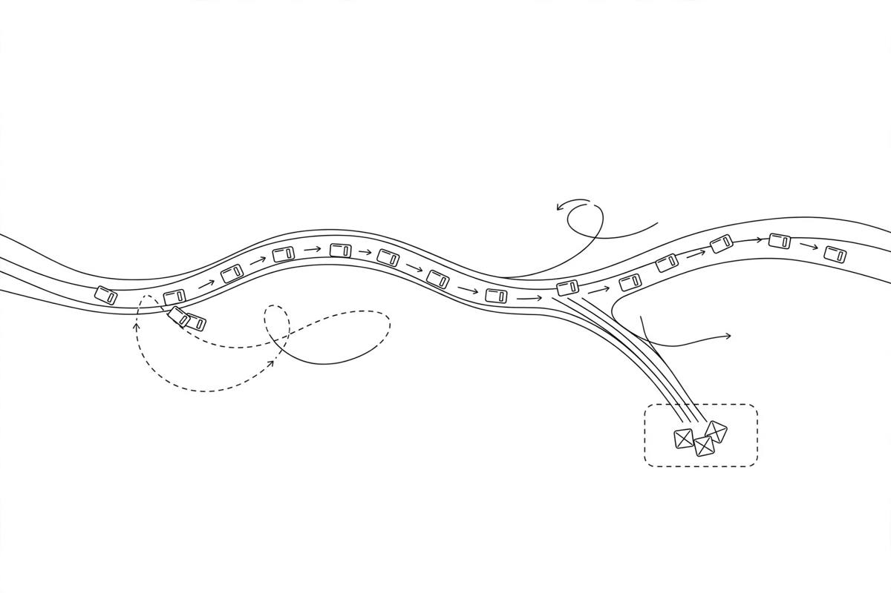

*Part of my daily series on Fundamentals of Data Engineering by Joe Reis and Matt Housley — [read the whole series](/book-series/).*

Streaming data never arrives the way the diagram promised. If your pipeline assumes it will, the pipeline is the bug.

The chapter on stream ingestion is really about everything that goes wrong after the data starts flowing. A field gets renamed upstream and your schema breaks. An event shows up hours late, after the report already went out. Messages arrive out of order, or twice. The fixes are boring on purpose: version your schemas in a registry, set a cutoff for how late is too late, keep replay so you can rewind and reprocess, and give bad events a dead-letter queue instead of letting them block everything behind them. None of it is glamorous. All of it is the difference between a stream you trust and one you quietly stop believing.

From my own work:

I have lived all of this on healthcare feeds. Claims and EHR files change shape without warning, and the thing that saved us was landing the raw file untouched first and transforming after. A renamed column or a late file became a fix, not a fire, because the raw data was still there to replay from.

The takeaway: streaming is not about speed. It is about surviving the mess and still landing clean data.

Day 39 of my read-through of Fundamentals of Data Engineering.
