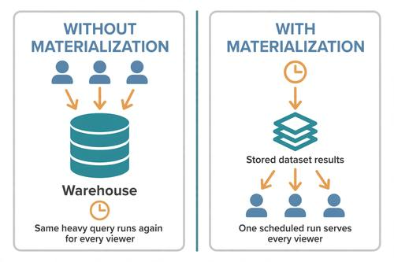
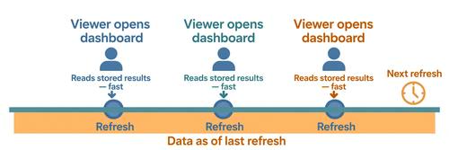
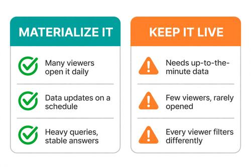

*Part of my daily Databricks series — the hardest topics, explained simply. Also published on [Substack](https://masterdataengineering.substack.com/) and in my LinkedIn newsletter, Master Data Engineering.*

Part of my daily Databricks series — the hardest topics, explained simply.

Dataset materialization in AI/BI dashboards: stop making every viewer wait for the same query

Picture this. A team builds a dashboard that shows admissions by department, length of stay, and readmission rates. It is the dashboard everyone actually uses — the one that gets opened in every Monday meeting.

The first person opens it at 9 AM and waits. The queries behind it scan months of records, join a few tables, and aggregate everything from scratch. It takes a few minutes to load.

The second person opens it at 9:05 and waits the same few minutes. The third person at 9:10 waits again. By the end of the morning, twenty people have sat through the same slow load, and the platform has run the same heavy queries twenty times.

Nothing is broken. The queries are fine. The dashboard is fine. But the design is doing the same expensive work over and over, once per viewer, when the answer barely changes between loads.

That is the problem dataset materialization solves. And it is worth understanding, because it is one of the simplest ways to make a dashboard feel fast without rewriting a single query.

Here is what happens today, without it. When someone opens a published dashboard, the queries behind each chart run live against the warehouse. Every viewer triggers a fresh run. If the data has not changed since the last person opened it, the platform does the work anyway, because nobody told it not to.

That is the honest default. If the data changes constantly and people need the latest numbers, running live is the price of freshness.

But most dashboards do not work like that. The underlying data updates on a schedule — once an hour, once a morning, once a night. Between those updates, the answer to the dashboard's queries does not change at all. And yet every viewer pays the full cost of recomputing it.

Dataset materialization flips that around. Instead of running the dashboard's queries every time someone opens it, you precompute the datasets on a schedule and store the results. When someone opens the dashboard, it reads the stored results instead of running the queries.

One scheduled run serves every viewer until the next refresh. The dashboard loads fast because the hard work already happened.

Let me make the difference concrete, because it is easy to confuse this with a couple of things it is not.

It is not a materialized view. A materialized view lives in the warehouse: it is a table the platform manages, and any query can read it. Dataset materialization lives in the dashboard: it precomputes the specific datasets that dashboard's charts need, and the benefit stays inside that dashboard.

It is not the query result cache, either. The result cache helps when the exact same query runs twice in a row — the second run reuses the first run's answer. But the cache is short-lived and it only helps identical queries. Dataset materialization is deliberate: you choose the schedule, the platform runs the datasets on that schedule, and the stored results are there waiting whenever anyone opens the dashboard.

Here is the mental model I use. A live dashboard is a kitchen that cooks every meal to order. A materialized dashboard is a kitchen that cooks the lunch menu once, at a set time, and serves it all afternoon. If everyone is ordering the same lunch, the second kitchen is faster and cheaper. If everyone wants something different, made fresh, it is the wrong setup.

So when does this actually help? Three signs tell you.

First, the dashboard is slow to load and lots of people open it. A dashboard that takes a few minutes to load and gets opened fifty times a day is paying the same heavy cost fifty times. Materialize the datasets once, and all fifty loads become fast.

Second, the data behind it updates on a schedule anyway. If the source tables refresh once an hour, a dashboard dataset refreshed on the same schedule is never meaningfully staler than the live version. You are not giving up freshness — you are matching the freshness the data already has.

Third, the queries are heavy and the answers are stable. Big aggregations over months of data, joins across several tables, numbers that barely move between refreshes. That is the shape that benefits most, because the work being skipped is the expensive part.

Now the part people get wrong: materialization trades freshness for speed, and you have to be honest about that trade.

A materialized dataset is only as fresh as its last refresh. If the schedule runs every hour, a viewer at 9:50 sees data as of 9:00. For a Monday morning review, that is fine. For a dashboard someone watches during an incident, or one that tracks something changing minute by minute, it is not fine at all.

So the first question is never "should I materialize this?" It is "how fresh does this dashboard actually need to be?" If the honest answer is "as fresh as the last scheduled load", materialize it. If the honest answer is "right now, always", leave it live.

The second thing people get wrong is materializing everything. Not every dataset in a dashboard needs it. A chart that reads a small lookup table loads instantly already — materializing it buys nothing. The datasets worth materializing are the slow ones: the big aggregations, the wide joins, the queries that make people wait. Start with those, and leave the fast ones alone.

The third thing is forgetting that materialization has a cost of its own. The scheduled runs still consume compute. You are not eliminating the work — you are moving it from "every viewer, every load" to "once per schedule". That is a huge saving when a dashboard has many viewers, and a waste when it has one viewer a week. Count the viewers before you turn it on.

And one more: filters change the picture. A dashboard where every viewer picks different filters and dates is harder to precompute, because the stored results have to cover what people actually ask for. Materialization shines brightest where most viewers look at roughly the same thing. If every viewer slices the data a completely different way, the live query may still be the right call.

Here is the checklist I run through before turning it on.

First, how many people open this dashboard, and how often? If the answer is a handful of people a few times a day, the win is small. If the answer is a whole team opening it every morning, the win is large.

Second, how slow is it today, and why? If the load is slow because the queries are heavy, materialization helps. If the load is slow because the dashboard has dozens of charts all firing at once, you may have a different problem.

Third, how fresh does it need to be? Match the materialization schedule to the real freshness requirement, not to the fastest schedule available. Hourly data does not need a five-minute refresh.

Fourth, which datasets are actually slow? Materialize the heavy ones. Leave the fast ones live.

Fifth, who notices when a refresh fails? A materialized dataset that stops refreshing quietly serves stale numbers, and stale numbers that look fresh are worse than a slow dashboard. Make sure someone sees the refresh status — and that a failed refresh is visible, not silent.

A dashboard that takes minutes to load is not always a query problem. Sometimes the queries are fine, and the problem is that the platform is being asked to run them again and again for every viewer, when the answer has not changed since the last run.

Dataset materialization is the simple fix for that shape of problem: do the work once, on a schedule, and let every viewer read the result. It will not fix a bad query, and it will not help a dashboard that needs live data. But for the dashboard everyone opens every morning, it is the difference between a meeting that starts with a spinner and a meeting that starts with the numbers.

Which dashboard in your workspace is still making every viewer wait for the same query — and how fresh does it actually need to be?
