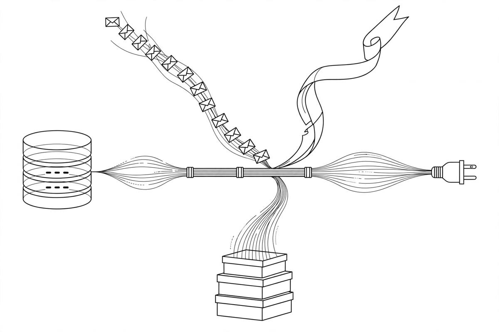

*Part of my daily series on Fundamentals of Data Engineering by Joe Reis and Matt Housley — [read the whole series](/book-series/).*

Every ingestion method works in the demo. The real question is who maintains it at 2 AM when it breaks.

The chapter walks through five ways data actually gets in: CDC, APIs, message queues, managed connectors, and object storage. The point that stuck with me: the best method is rarely the cleverest one. It is the one that fails loudly instead of silently, and the one someone is already maintaining.

CDC reads the database log instead of hammering the production database with queries. APIs mean hundreds of sources with no standard, so build a custom connector only when nobody sells one. A message disappears once you consume it; a stream persists, so you can rewind and replay. Managed connectors are the book's blunt advice: connecting sources is heavy lifting, outsource it. And object storage is the most practical way to move files — land the raw file first, transform after.

From my own work:

I have lived this on healthcare feeds. Claims and EHR files change shape without warning, and landing the raw file untouched in Delta Lake first meant a renamed column was a fix, not a fire. Our Airflow batch jobs could re-run safely because they were idempotent, and the raw data was always there to backfill from.

The takeaway: pick your ingestion method by who maintains it and how it fails, not by how it looks on a diagram.

Day 40 of my read-through of Fundamentals of Data Engineering.
