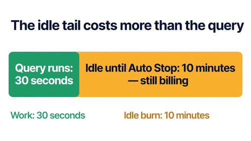
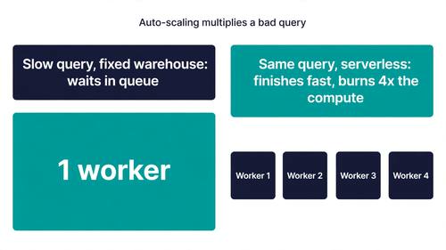
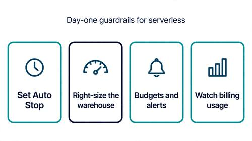

*Part of my daily Databricks series — the hardest topics, explained simply. Also published on [Substack](https://masterdataengineering.substack.com/) and in my LinkedIn newsletter, Master Data Engineering.*

Part of my daily Databricks series — the hardest topics, explained simply.

Serverless cost surprises: convenient until the bill arrives

Picture this. A team moves its reporting dashboards from a Pro warehouse to a serverless warehouse. The migration takes an afternoon. The dashboards load instantly, nobody has to start a cluster or wait for one to warm up, and for three weeks nobody touches a single setting.

Then the first bill arrives. It is noticeably bigger than the old warehouse's bill. Same dashboards, same queries, same data. Nothing broke. Nothing got slower. The bill just went up.

The team did not do anything wrong. They just moved to a billing model they had not actually looked at. Serverless is convenient, and the convenience is real — but it changes what you pay for, and when, in ways that catch people off guard.

Here is the first thing to understand. With a Pro or Classic warehouse, you pay for the warehouse while it runs: the cloud VMs in your own account plus the DBU rate. With a serverless warehouse, there are no VMs for you to manage — Databricks runs the compute — and you pay per second of DBU use, with the cloud instances bundled into that DBU rate.

That bundled rate is higher per DBU than Pro or Classic. That is the convenience premium, and it is not hidden — it is just easy to miss when the setup screen only asks you to pick a size and go. Per-second billing sounds cheap because a second sounds small. But a warehouse burns DBUs for every second it is awake, not just every second it is running your query.

That gap — awake versus working — is where the first surprise lives.



A warehouse keeps billing until it auto-stops. The serverless default is 10 minutes of idle time before it stops. Pro and Classic default to 45 minutes.

So imagine a dashboard that gets opened once an hour. Someone opens it, a query runs for thirty seconds, and then the warehouse sits idle for ten minutes, burning DBUs the whole time. By the end of the day, the idle minutes can easily outnumber the query minutes. Nobody ran anything expensive. The warehouse was simply awake, waiting, and the meter was running.

The fix is to set Auto Stop deliberately instead of leaving the default. In the UI you can take it down to 5 minutes; through the API you can go as low as 1 minute. The right number depends on how bursty your usage is. A warehouse that serves a dashboard people open every few minutes should stay awake a little longer, because waking up again and again has its own cost. A warehouse that gets touched once an hour should stop quickly, because every idle minute is pure waste.

The second surprise is auto-scaling, and it is the one that turns a slow query into an expensive one.

A serverless warehouse scales out automatically when a query needs more power. On a fixed-size warehouse, a heavy query queues and waits. On serverless, it grabs more workers and finishes faster. Faster feels like a win, and it is — until you remember that every worker it grabbed is burning DBUs for every second it runs.

Per-second billing does not make a bad query cheap. It makes the cost of a bad query exact. A dashboard query that scans a whole year of data with no date filter costs you for every second of that scan, on every worker the platform gave it.

Here is the pattern I see most often, and the fix.

The wrong version runs the same heavy aggregation every time someone opens the dashboard:

```sql
SELECT department, COUNT(*) AS admissions
FROM admissions
GROUP BY department
```

No date filter, no pruning, full scan, every load. On a fixed warehouse it was slow and annoying. On serverless it is fast and expensive — the worst combination, because nothing complains.

The fix is not a bigger warehouse. It is a smaller query:

```sql
SELECT department, COUNT(*) AS admissions
FROM admissions
WHERE admission_date >= current_date() - INTERVAL 90 DAYS
GROUP BY department
```

Filter early so the engine reads less. And if the dashboard only needs the numbers refreshed on a schedule, stop recomputing them on every load at all — a materialized view or a scheduled refresh does the work once and serves the stored result. The cheapest DBU is the one you never burn.



The third surprise is the quietest one: nobody owns the cost anymore, because there is nothing visible to turn off.

On a Classic warehouse, someone had to provision it, someone picked its size, and someone noticed when it was still running on Monday morning after a weekend nobody used it. The cluster was a visible thing, and visible things get managed.

Serverless removes the visible thing. There is no cluster to start, no cluster to stop, no cluster sitting in your cloud account with your name on it. That is the whole point — and it is also why cost ownership has to move somewhere else. If nobody is watching usage, the first person to notice the spend is whoever opens the bill.

So here is the checklist I run through on day one of any serverless warehouse.

First, set Auto Stop on purpose. Five minutes in the UI is the floor. Match it to your real usage pattern, not to the default.

Second, size the warehouse to the workload. Start at the smallest size that answers queries acceptably and grow only when the queries prove they need it. A warehouse that is one size too big costs more on every single query, forever.

Third, set a budget with an alert before the bill surprises you. Databricks budgets let you cap spend and get warned as you approach it. And check the billing usage tables regularly — system.billing.usage shows exactly which warehouse burned what, so you can attribute the spend instead of guessing. Tag your warehouses by team or use case while you are at it, because an unattributed bill is an unfixable bill.

Fourth, fix the query before you scale the warehouse. An unfiltered scan, a dashboard refreshing every few minutes, a scheduled job waking the warehouse all night — these are query and scheduling problems, and a bigger warehouse only makes them cost more per second.

Fifth, watch for the patterns that quietly burn money. Dashboards refreshing on a short interval when the data only changes hourly. Ad-hoc users running unfiltered scans against the biggest tables. A warehouse that stays awake all night because one job runs at 2 AM and the Auto Stop is set to the default. Each one is small on its own. Together they are the bill.



Serverless is genuinely good. Instant startup, no cluster babysitting, no capacity planning meeting. The bill is not a trap. It is the price of that convenience, charged by the second, for every second the warehouse is awake.

The teams that get surprised are the ones who moved to serverless and kept their old habits: unfiltered queries, default settings, nobody watching usage. The fix is not to go back to managing clusters. It is to take the five minutes to set Auto Stop, size, budgets, and alerts — and to fix the slow queries instead of paying to run them faster.

Which warehouse in your workspace has been awake the longest without anyone noticing — and what is it still billing for?

