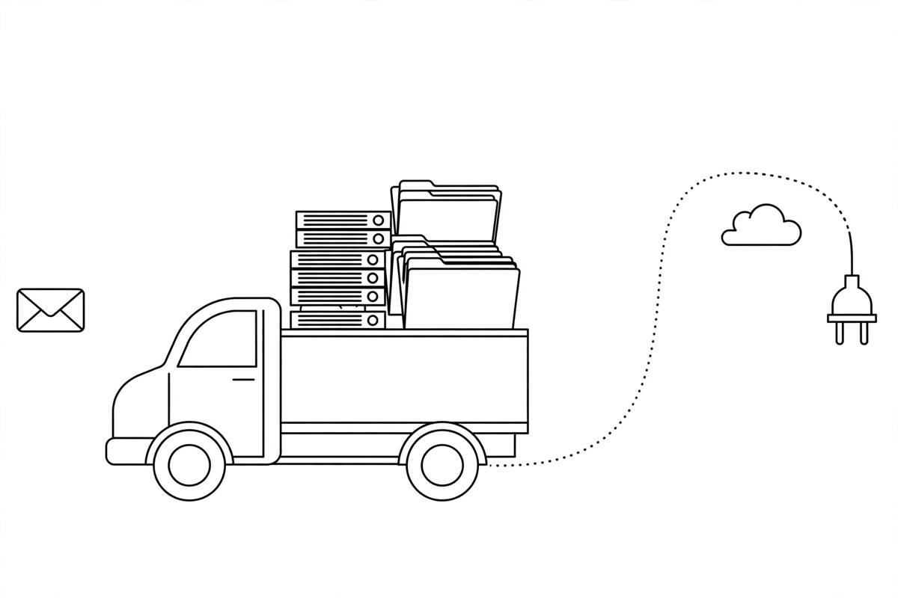

*Part of my daily series on Fundamentals of Data Engineering by Joe Reis and Matt Housley — [read the whole series](/book-series/).*

Some of the ugliest ways data gets into a system are the ones that never go away.

The chapter covers the second batch of ingestion methods: EDI, SFTP, webhooks, web scraping, transfer appliances, and data sharing. The point that stuck with me: the best method is not the newest one. It is the one your data partner can actually use — the one that still works when their systems do not change.

EDI is decades old and still moves huge amounts of data — some partners will never modernize. SFTP makes engineers cringe, but it is reality when a partner only speaks file drops. Webhooks flip the API around — the provider calls you — and they get brittle fast without a buffer. Scraping works until the website changes — then you maintain a scraper instead of building pipelines. At 100 terabytes, the fastest way to move data is a truck. Data sharing is the odd one out: you never own the data, you only borrow access.

From my own work:

I have lived this on healthcare feeds. Partners still send files over SFTP and by email, and the shape changes without warning. Landing the raw file untouched in Delta Lake first meant a renamed column was a fix, not a fire. Our Airflow jobs picked the files up on a schedule and re-ran safely because they were idempotent.

The takeaway: pick the ingestion method that survives the real world, not the one that looks best on a diagram.

Day 41 of my read-through of Fundamentals of Data Engineering.
